# Chickxel

**홈페이지·사용 설명서: <https://1000pro-1997.github.io/Chickxel/>** · **제보·아이디어: [Discord](https://discord.gg/Avw7aUVxqr)**

게임(특히 Unity 2D)용 픽셀 아트 편집기입니다(Windows·macOS). 저장하면 PNG 스프라이트 시트와 Unity `.meta`가 함께 나옵니다. 앱 안에서는 **F1**로 같은 사용 가이드를 엽니다.

## 대표 기능

움짤을 누르면 홈페이지 사용 가이드의 그 쪽이 열립니다.

### 숫자 칸 바꾸는 법

<a href="https://1000pro-1997.github.io/Chickxel/guide.html#featured-number-field">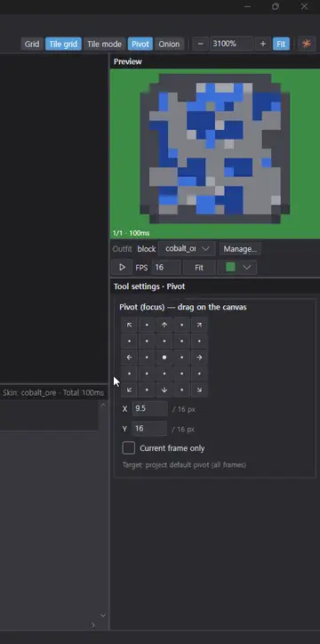</a>

### AI로 그리기

<a href="https://1000pro-1997.github.io/Chickxel/guide.html#featured-ai-draw">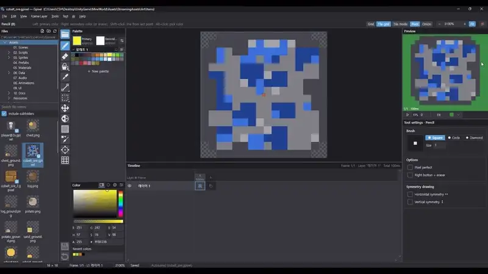</a>

### 크게 보기로 칸 단위 비교

<a href="https://1000pro-1997.github.io/Chickxel/guide.html#featured-pixelate-zoom">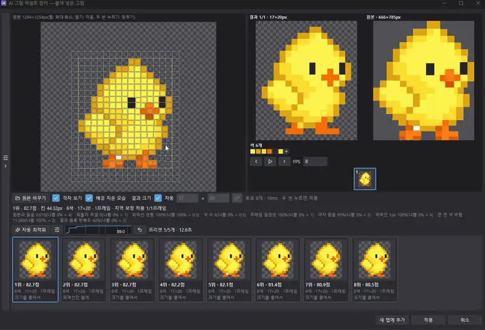</a>

### 이미지를 픽셀 아트로

<a href="https://1000pro-1997.github.io/Chickxel/guide.html#featured-pixelate-convert">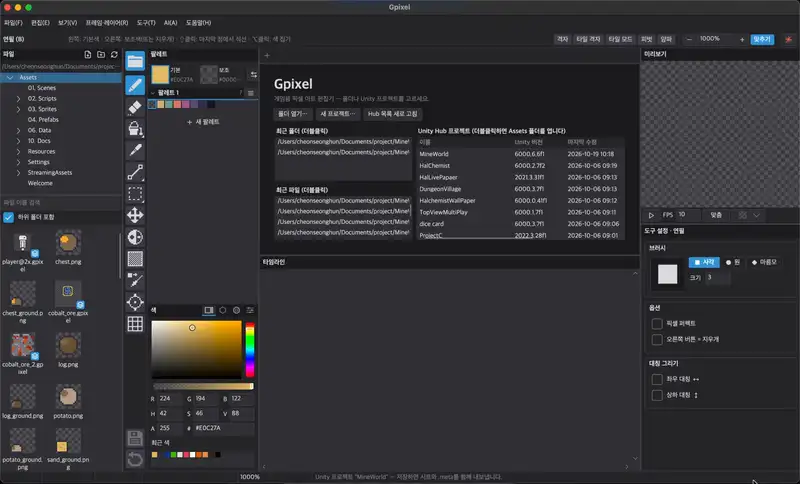</a>

### 색 빼기·더하기

<a href="https://1000pro-1997.github.io/Chickxel/guide.html#featured-pixelate-colors">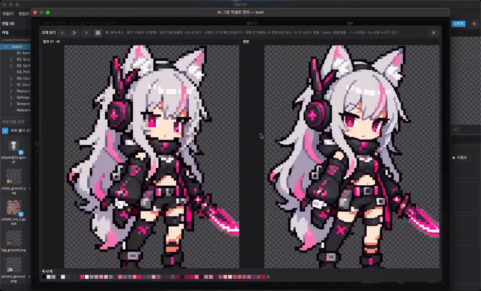</a>

### 효과 겹치기

<a href="https://1000pro-1997.github.io/Chickxel/guide.html#featured-effects">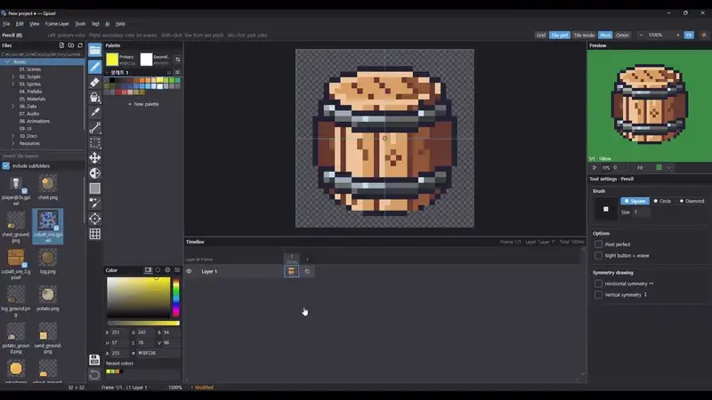</a>

### 효과 클리핑

<a href="https://1000pro-1997.github.io/Chickxel/guide.html#featured-clip">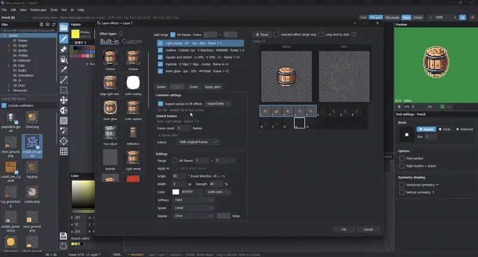</a>

### Lospec 팔레트 가져오기

<a href="https://1000pro-1997.github.io/Chickxel/guide.html#featured-palette-web">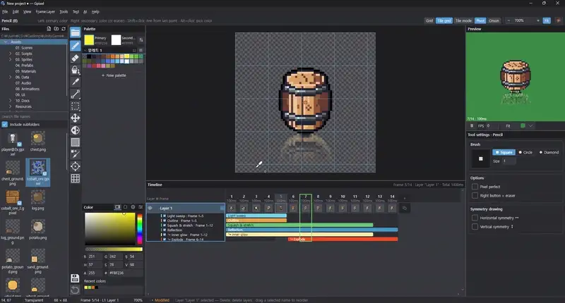</a>

### 팔레트로 색 바꾸기

<a href="https://1000pro-1997.github.io/Chickxel/guide.html#featured-palette-convert">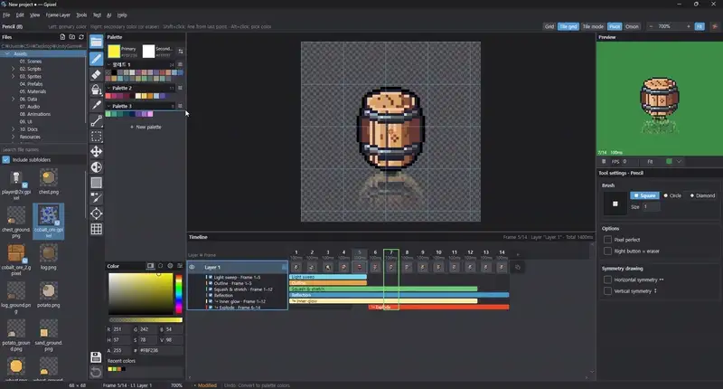</a>

### 스킨 관리

<a href="https://1000pro-1997.github.io/Chickxel/guide.html#featured-skins">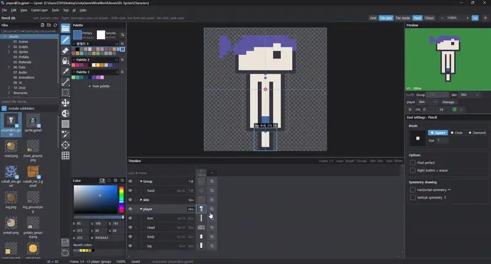</a>

### 타일·아이템 스킨

<a href="https://1000pro-1997.github.io/Chickxel/guide.html#featured-skins-tiles">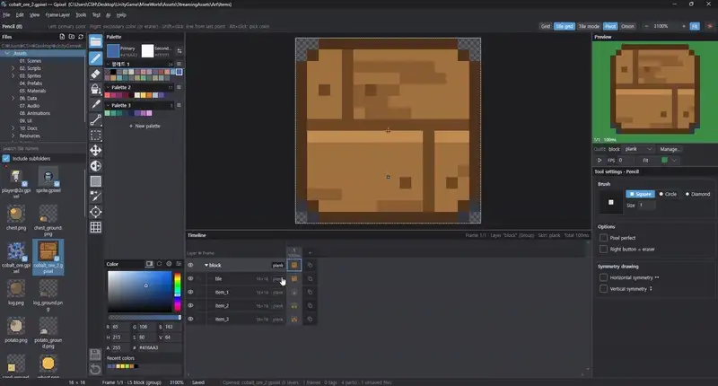</a>

### 피벗 연동

<a href="https://1000pro-1997.github.io/Chickxel/guide.html#featured-pivot">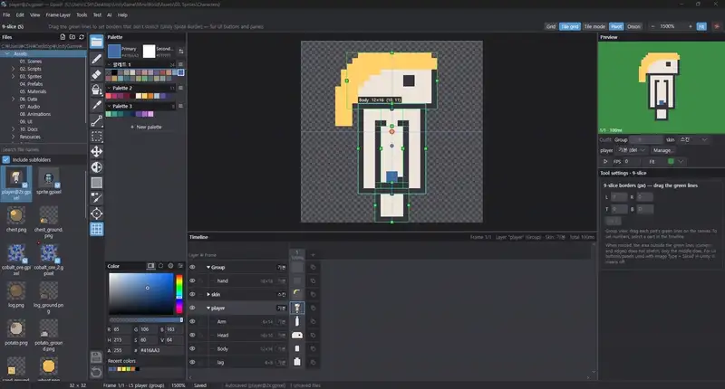</a>

### 내보내기

<a href="https://1000pro-1997.github.io/Chickxel/guide.html#featured-export">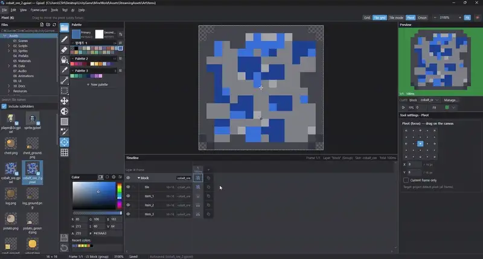</a>

## 내려받기

| OS | 내려받기 (최신 버전) | 실행 |
|---|---|---|
| Windows 10/11 (x64·ARM64) | [Chickxel-windows-x64.zip](https://github.com/1000Pro-1997/Chickxel/releases/latest/download/Chickxel-windows-x64.zip) | 압축을 풀고 `Chickxel.exe` 더블클릭 |
| macOS 12+ Apple Silicon (M1 이후) | [Chickxel-macos-arm64.zip](https://github.com/1000Pro-1997/Chickxel/releases/latest/download/Chickxel-macos-arm64.zip) | 압축을 풀고 `Chickxel.app`을 응용 프로그램 폴더로 옮긴 뒤 더블클릭 |
| macOS 12+ Intel | [Chickxel-macos-x64.zip](https://github.com/1000Pro-1997/Chickxel/releases/latest/download/Chickxel-macos-x64.zip) | 위와 같음 |

개발자 서명이 없는 앱이라 처음 한 번은 경고가 뜹니다(Windows **추가 정보 → 실행**, macOS **우클릭 → 열기**). 터미널 설치·업데이트·네트워크 사용은 [FEATURES.md](FEATURES.md#설치실행-그냥-쓰기--net-설치-필요-없음)에 있습니다.

## 더 보기

- [FEATURES.md](FEATURES.md): 화면·도구·파일·스킨·AI 채팅·단축키 등 모든 기능 설명
- [DEVELOPMENT.md](DEVELOPMENT.md): 빌드·배포·홈페이지·번역·기여 방법
- [CHANGELOG.md](CHANGELOG.md): 버전별 바뀐 점(영어) · 한국어: [CHANGELOG.ko.md](CHANGELOG.ko.md)
- 버그 제보·불편한 점·기능 제안: [Discord](https://discord.gg/Avw7aUVxqr) (또는 GitHub [Issues](https://github.com/1000Pro-1997/Chickxel/issues))

## 라이선스

Chickxel 자체 라이선스([LICENSE](LICENSE)): 소스는 공개하지만 오픈 소스는 아닙니다. 공식 릴리스는 상업적 작업을 포함해 누구나 무료로 쓸 수 있고, Chickxel로 만든 그림·에셋은 만든 사람의 것입니다. 소스는 읽고 빌드하고 개인용으로 고칠 수 있지만, 원본이나 고친 판을 다시 배포하거나 팔 수는 없습니다(허락받은 경우 제외). 기여한 코드·에셋은 저작권자가 Chickxel에 쓰고 라이선스를 정할 수 있습니다. v1.14.60까지와 이 라이선스로 바꾸기 전에 공개한 것은 MIT 그대로입니다. 영어 원문이 기준입니다.

함께 쓰는 오픈 소스 구성 요소와 그 라이선스는 [THIRD-PARTY-NOTICES.md](THIRD-PARTY-NOTICES.md)에 있습니다. AI 채팅 기능은 사용자의 Claude Code·Codex CLI 설치·로그인을 쓰며 Anthropic·OpenAI 이용 약관을 따릅니다.
