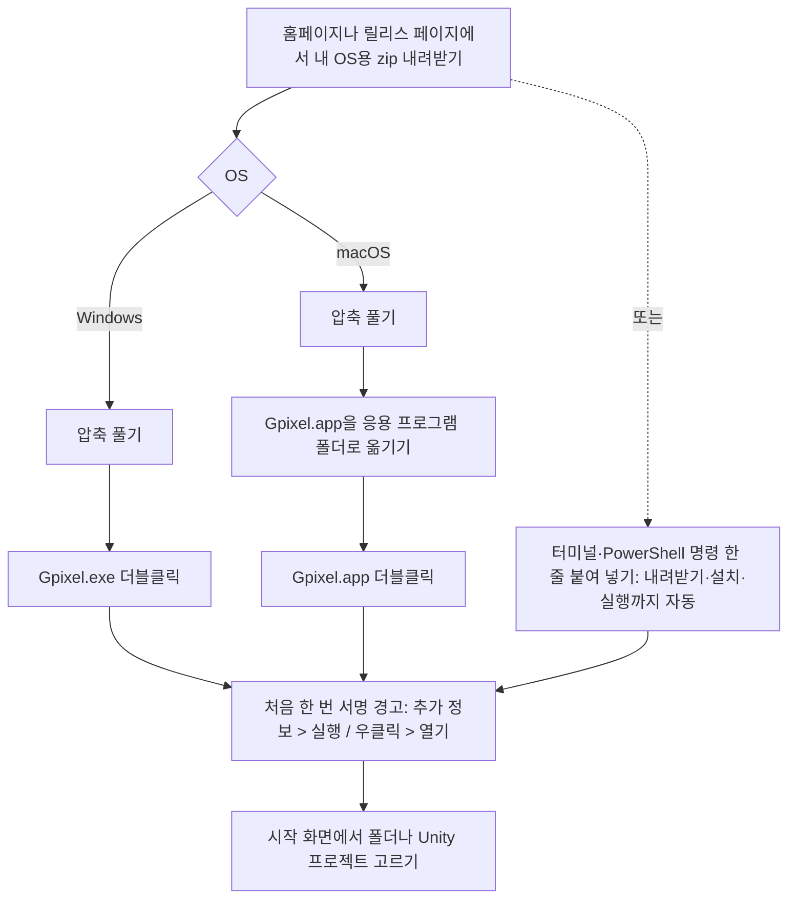
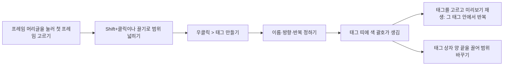
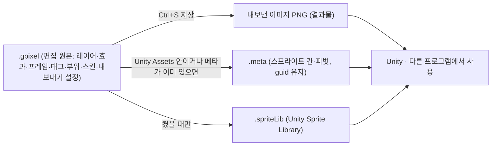
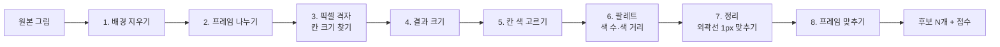
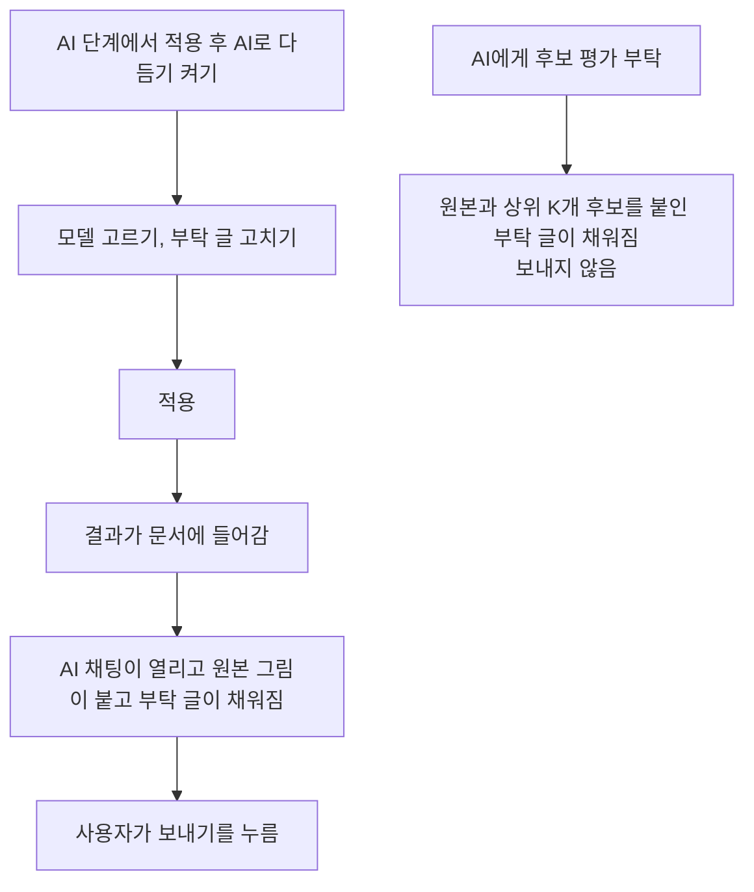
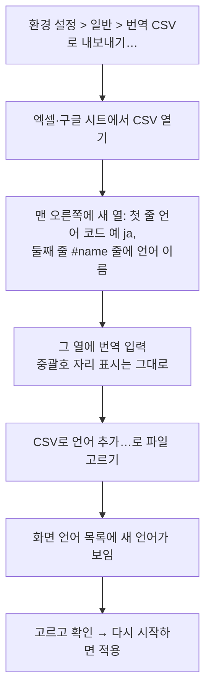
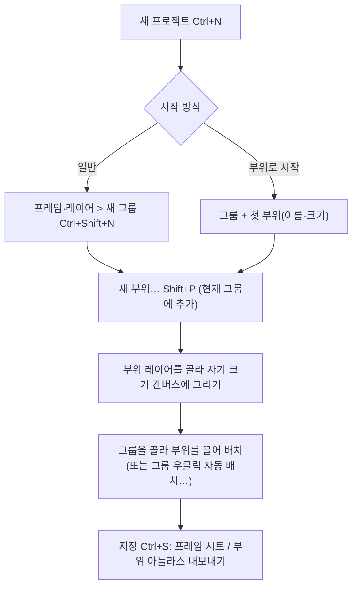
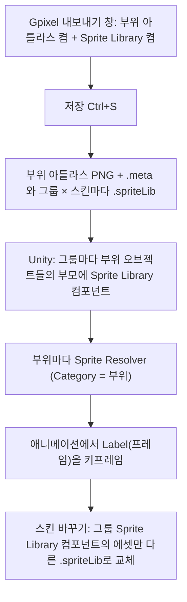
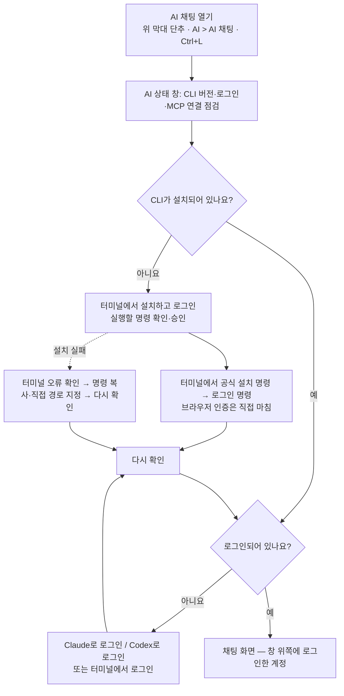

# 가이드 이미지 목록

사용 가이드(홈페이지 `docs/guide.html`·`docs/en/guide.html`, 앱 안 F1)의 쪽마다 넣을 그림 목록입니다. 아직 가이드 본문에는 넣지 않았습니다(넣으라고 하면 쪽마다 반영).

- 그림 위치: 한국어 `docs/assets/guide/<이름>.png`, 영어 `docs/assets/guide/en/<이름>.png`(같은 이름, 영어 화면). 이름은 가이드 쪽 id이고, 여러 장이면 `-2`, `-3`이 붙습니다.
- 다시 찍기: `dotnet run --project tools/GuideShots`(영어는 `-- --lang en`, 일부만이면 `-- screen- parts-`처럼 id 앞부분). 실제 Gpixel 화면을 화면 없이 띄워 찍으므로 UI를 바꾼 뒤 다시 돌리면 그대로 갱신됩니다. 사용법은 `tools/GuideShots/README.md`.
- 예시 그림은 늑대귀 모험가(`tools/GuideShots/Sample/wolf.png`)입니다. 화면에 보이는 경로는 사용자 이름이 나오지 않게 `C:\GpixelGuide\MyGame`, `D:\MyGame\…`, `%APPDATA%\…` 같은 예시 경로로 찍었습니다.
- 형태: 이미지 / 여러 장 / 워크플로우(그림 대신 흐름도·순서) / 움짤 요청(직접 녹화 필요) / 그림 불필요. 확인 `[x]`는 찍은 그림을 열어 보고 맞는지 확인한 것입니다.

## 직접 찍어 주실 것 (움짤·OS 화면)

장마다 아래 "움짤 요청"에 시작 상태·동작·길이를 자세히 적었습니다. 모아 보면 다음과 같습니다.

- [ ] `start-first-run` — 정지 화면 2장: Windows "PC 보호" 창(추가 정보 > 실행), macOS "확인되지 않은 개발자" 창
- [ ] `screen-common-controls` — 숫자 칸 끌기·Shift 끌기·입력·우클릭 목록
- [ ] `screen-file-browser` — 끌어 여러 파일 고르기 → 캔버스로 끌어 놓기
- [ ] `screen-tabs` — 탭 순서 바꾸기 → 끌어 두 칸 나누기 → 닫아서 풀기
- [ ] `screen-timeline-select` — 셀 끌어 고르기·Shift/Ctrl+클릭
- [ ] `screen-timeline-edit` — 프레임 끌어 옮기기·셀 묶음 옮기기·Alt 복사
- [ ] `screen-tags` — 태그 만들기 → 범위 끌기 → 재생
- [ ] `screen-layer-effects` — 타임라인 효과 상자 끝·몸통 끌기, 두 번 눌러 효과 창
- [ ] `tools-basics` — Shift+클릭 직선, 반대 버튼으로 획 취소
- [ ] `tools-gradient` — 캔버스에서 끌어 칠하기, 정지점 더하기
- [ ] `tools-transform` — Ctrl+T 회전·크기 조절·Enter
- [ ] `tools-canvas-size` — 손잡이 끌어 넓히기·자르기, 그림 옮기기
- [ ] `files-drop-layer` — 탐색기에서 그림을 캔버스로 끌어 놓기
- [ ] `pixelate-open` — 빈 창에 그림 끌어 놓아 후보가 채워지기까지
- [ ] `pixelate-optimize` — 자동 최적화 실행·끝·되돌리기
- [ ] `pixelate-view` — 칸 강조·색 견본 좌/우클릭·스포이드·크게 보기
- [ ] `pixelate-output` — 적용 → 새 레이어 변형 모드 → Enter
- [ ] `shortcuts-customize` — 단축키 검색·바꾸기·겹침 확인·기본값
- [ ] `parts-arrange` — 부위 위 마우스·끌어 옮기기·방향키·더블클릭
- [ ] `parts-auto-layout` — 부위 추가 시 다시 배치, 손으로 옮기면 묻는 창
- [ ] `parts-skin-manager` — 스킨 카드 바꾸기·순서 끌기·부위 전용 스킨
- [ ] `parts-outfits` — 착장 줄·Alt+[ / ]·착장 프리셋
- [ ] `ai-overview` — 실제 로그인 상태에서 외곽선 부탁 한 차례
- [ ] `ai-chat` — 그림 칩 붙여 넣기·끌어 놓기·미리보기·빼기
- [ ] `ai-help` — 도움말 칸 열기·예시 부탁 넣기·닫기
- [ ] `ai-generate` — Codex 그림 생성 → 변환 → 결과 카드

## 찍으면서 발견한 앱 문제

그림이 아니라 앱을 고쳐야 하는 것들입니다(아직 고치지 않음).

- 영어 화면: 앱 휴지통의 "Delete permanently" 단추 글자가 잘리고, "1 items now"처럼 복수형이 틀림.
- 영어 화면: 도구 설정의 "Diamond" 브러시 단추 글자가 잘림. 픽셀로 정리 넣기 단계의 "New layer in the current document (from the current frame)"이 설정 칸 너비(380px)에서 잘림.
- 기본 스킨 이름이 코드에 한국어로 고정(`Layer.DefaultSkinName = "기본"`)이라 영어 화면에서도 스킨 칩에 "기본"이 보임(영어 그림은 촬영 때만 Default로 바꿈).
- AI 상태 창의 확인 단추 글자가 두 언어 모두 잘림("확인하고 AI …" / "Continue to A…").
- 효과 창의 기본/커스텀 탭 머리글만 큰 기본 글꼴 크기로 보임.
- 픽셀로 정리: 일반 후보는 처음 체크한 프리셋(OKLCH1000, 점수용 색상 가중 1000)으로 점수를 매기는데, 이 기준에서는 "큰 면 색 바뀜"이 모든 후보에서 27 안팎(나쁨 100%)으로 커져 점수 차이에 기여하지 못함.

## 대표 기능 (featured-*)

대표 기능 장은 이미 홈페이지·F1에 영상(또는 움짤)이 들어 있어 새로 찍지 않았습니다.

| 쪽 id | 제목 | 형태 | 그림 | 확인 | 설명 |
|---|---|---|---|---|---|
| `featured-number-field` | 숫자 칸 바꾸는 법 | 기존 움짤 | `feature-number-field.gif` | [x] | 클릭 입력·끌기·우클릭 목록 |
| `featured-ai-draw` | AI로 그리기 | 기존 영상 | `feature-ai-draw.mp4` | [x] | Codex 채팅으로 나무 통 그리기 |
| `featured-pixelate-convert` | 이미지를 픽셀 아트로 | 기존 영상 | `feature-pixelate.mp4` | [x] | 붙여 넣기 → 후보 → 크게 보기 비교 |
| `featured-pixelate-colors` | 색 빼기·더하기 | 기존 영상 | `feature-pixelate-colors.mp4` | [x] | 쓰인 곳 보기·색 빼기·원본에서 집기 |
| `featured-effects` | 효과 겹치기 | 기존 영상 | `feature-effects.mp4` | [x] | 효과 여러 개 쌓고 범위 정하기 |
| `featured-clip` | 효과 클리핑 | 기존 영상 | `feature-clip.mp4` | [x] | 바로 위 효과에 클리핑 |
| `featured-palette-web` | Lospec 팔레트 가져오기 | 기존 영상 | `feature-palette.mp4` | [x] | 팔레트 웹 둘러보고 가져오기 |
| `featured-palette-convert` | 팔레트로 색 바꾸기 | 기존 영상 | `feature-convert.mp4` | [x] | 팔레트 색으로 변환 창 |
| `featured-skins` | 스킨 관리 | 기존 영상 | `feature-skins.mp4` | [x] | 스킨 칩·스킨 관리 창으로 갈아 끼우기 |
| `featured-skins-tiles` | 타일·아이템 스킨 | 기존 영상 | `feature-skins-tiles.mp4` | [x] | 블록·아이템 부위와 종류별 스킨 |
| `featured-pivot` | 피벗 연동 | 기존 영상 | `feature-pivot.mp4` | [x] | 피벗 옮기고 그 피벗으로 회전 |
| `featured-export` | 내보내기 | 기존 영상 | `feature-export.mp4` | [x] | 스킨 따로·한 장 모으기, 미리보기·파일 목록 |

## 시작하기 (start)

| 쪽 id | 제목 | 형태 | 그림 | 확인 | 설명 |
|---|---|---|---|---|---|
| `start-install` | 설치 | 워크플로우 | - | - | 내려받기·압축 풀기·실행은 앱 밖(브라우저·탐색기·Finder) 단계라 앱 화면 그림 대신 아래 워크플로우. 설치가 끝난 모습은 `start-first-run.png`를 같이 써도 됨 |
| `start-first-run` | 처음 실행할 때 | 이미지+움짤 요청 | `start-first-run.png` | [x] | 문서 없이 켠 첫 화면: 시작 화면(최근 폴더·최근 파일·Unity Hub 프로젝트 목록, 폴더 열기·새 프로젝트 단추). 목록 내용은 예시 값(D:\MyGame 등). Windows "PC 보호"·macOS "확인되지 않은 개발자" 경고 창은 OS 화면이라 사용자 촬영 필요(아래 요청) |
| `start-update` | 업데이트 | 여러 장 | `start-update.png`, `start-update-2.png` | [x] | 1: 업데이트 창(새 버전 1.14.38, 지금 1.14.36, CHANGELOG의 바뀐 점, 지금 업데이트·다음 업데이트까지 띄우지 않기·릴리스 페이지 열기·나중에). 오프라인이라 릴리스 정보는 CHANGELOG에서 만든 예시. 2: 위 막대에 나타나는 "업데이트 1.14.38" 단추 강조 |
| `start-privacy` | 네트워크와 개인정보 | 이미지 | `start-privacy.png` | [x] | 환경 설정 > 일반, "시작할 때 새 버전 확인" 체크 상자 강조(업데이트 확인을 끄는 곳). 개발 빌드 안내 문구는 릴리스 문구로 바꿔 찍음 |
| `start-feedback` | 제보·아이디어 | 여러 장 | `start-feedback.png`, `start-feedback-2.png` | [x] | 1: 도움말 메뉴를 펼친 모습(제보·아이디어(Discord)…, Gpixel 정보…). 2: Gpixel 정보 창(버전, Discord·문제 신고 단추). 설정 파일 경로는 %APPDATA%\Gpixel\settings.json으로 바꿔 찍음 |

### 움짤 요청
- `start-first-run` — 정지 화면 두 장(움짤 아님): Windows에서 처음 Gpixel.exe를 실행했을 때 뜨는 "Windows의 PC 보호" 창에서 "추가 정보"를 누른 뒤 "실행" 단추가 보이는 상태, macOS에서 Gpixel.app 우클릭 > 열기로 뜨는 "확인되지 않은 개발자" 확인 창. 앱 밖 OS 창이라 자동 촬영 불가.

### 워크플로우
`start-install`



## 화면 구성 (screen)

| 쪽 id | 제목 | 형태 | 그림 | 확인 | 설명 |
|---|---|---|---|---|---|
| `screen` | 화면 구성(장 첫 그림) | 이미지 | `screen-overview.png` | [x] | 전체 창(1600×900): 파일 브라우저(예시 폴더), 도구 막대, 팔레트·색, 캔버스, 타임라인(6프레임·태그 idle/hit·그룹과 부위·그림자 레이어), 미리보기, 도구 설정, 상태 표시줄. 시작하기 장 첫 그림으로도 쓸 수 있음 |
| `screen-top-bar` | 메뉴와 위 막대 | 여러 장 | `screen-top-bar.png`, `screen-top-bar-2.png`, `screen-top-bar-3.png` | [x] | 1: 메뉴와 위 막대 전체 폭, 도구 이름·사용법 / 보기 옵션 5개 / 확대율·맞추기 강조. 2: 격자 단추 우클릭 설정 팝업(색, 보이기 시작 배율). 3: 확대율 상자 우클릭 목록(화면에 맞추기, 100%~6400%) |
| `screen-common-controls` | 숫자 칸과 메뉴 다루기 | 이미지+움짤 요청 | `screen-common-controls.png` | [x] | 도구 설정의 브러시 크기 칸을 우클릭한 자주 쓰는 값 목록(지금 값에 점). 좌우로 끌어 값 바꾸기는 움짤로 |
| `screen-toolbar` | 도구 막대 | 이미지 | `screen-toolbar.png` | [x] | 왼쪽 세로 도구 막대: 맨 위 폴더 단추, 도형 묶음 칸을 우클릭해 펼친 목록(선·사각형·원), 맨 아래 저장·되돌리기 단추(수정된 상태라 켜짐) 강조 |
| `screen-file-browser` | 파일 브라우저 | 여러 장 | `screen-file-browser.png`, `screen-file-browser-2.png`, `screen-file-browser-3.png`, `screen-file-browser-4.png` | [x] | 1: 폴더 트리·검색·하위 폴더 포함·썸네일 목록, .gpixel 파란 레이어 배지와 저장 안 한 빨간 점, 제목 줄 아이콘 셋(새 픽셀 파일·새 폴더·새로 고침) 강조. 2: 두 개 고르고 우클릭한 메뉴(2개 합치기…, .gpixel 파일만 삭제, 앱 휴지통 보기…). 3: 합치기 창(순서·이름·방식·캔버스·기준점·미리보기·"타임라인에서는 이렇게 보입니다"). 4: 앱 휴지통 창(보관 정책, 지운 파일 미리보기). 폴더 경로는 D:\MyGame\Assets\스프라이트로 바꿔 찍음. 합치기는 워크플로우도 아래에 |
| `screen-palette` | 팔레트 | 여러 장 | `screen-palette.png`, `screen-palette-2.png` | [x] | 1: 기본색/보조색과 팔레트 두 개(DB32, 그림에서 만든 팔레트), 기본색 흰 테두리·보조색 파란 테두리, 활성 팔레트 파란 줄, 새 팔레트 단추. 2: 팔레트 메뉴 단추를 눌러 연 메뉴. 팔레트 웹(Lospec) 창은 인터넷이 필요해 찍지 않음 |
| `screen-color-picker` | 색 고르기 | 여러 장 | `screen-color-picker.png`, `screen-color-picker-2.png`, `screen-color-picker-3.png`, `screen-color-picker-4.png` | [x] | 같은 색(#5B6EE1)으로 네 방식: 사각형, 벌집, 색상환, 슬라이더. 알파 막대·RGBA/HSV/HEX·최근 색 포함. 표의 네 줄에 한 장씩 |
| `screen-canvas` | 캔버스 | 여러 장 | `screen-canvas.png`, `screen-canvas-2.png` | [x] | 1: 800%에서 픽셀 격자와 피벗 표시. 2: 부위(보석) 레이어를 고른 화면 — 부위만 자기 크기로 또렷하고 나머지는 반투명, 타임라인에서 고른 부위 행이 함께 보임 |
| `screen-tabs` | 문서 탭과 나누기 | 이미지+움짤 요청 | `screen-tabs.png`, `screen-tabs-2.png`, `screen-tabs-3.png` | [x] | 1: 탭 세 개(저장 안 한 탭의 빨간 점, 끝의 +, 오른쪽 옮기기 단추). 2: 다른 쪽으로 옮겨 좌우 두 칸으로 나눈 모습(포커스된 칸의 강조색 선). 3: 탭 우클릭 메뉴(닫기·다른 탭 닫기·다른 쪽으로 옮기기). 탭 끌어 옮기기·나누기는 움짤로 |
| `screen-timeline` | 타임라인 | 여러 장 | `screen-timeline.png`, `screen-timeline-2.png`, `screen-timeline-3.png` | [x] | 1: 태그 띠 / 프레임 머리글 / 레이어 행(그룹·부위 들여쓰기, 불투명도) / 프레임 추가·복사 칸 / 레이어 추가·복사 줄 강조. 2: 프레임 머리글 우클릭 메뉴. 3: 레이어 이름 우클릭 메뉴 |
| `screen-timeline-select` | 타임라인에서 고르기 | 여러 장 | `screen-timeline-select.png`, `screen-timeline-select-2.png` | [x] | 1: 프레임 2~4를 고른 모습과 상태 표시줄 안내("프레임 2~4 선택됨 — Delete: 프레임 삭제…"). 2: 셀 묶음(레이어 2개 × 프레임 2~3) 선택과 안내. 끌어서 사각형으로 고르기는 움짤로 |
| `screen-timeline-edit` | 타임라인 편집 | 이미지+움짤 요청 | `screen-timeline-edit.png` | [x] | 빈 셀 우클릭 메뉴(이전 프레임 그림 복사·셀 복사/잘라내기/붙여넣기·효과 추가…). 순서 바꾸기·셀 묶음 옮기기/복사는 끄는 동작이라 움짤로 |
| `screen-tags` | 태그 | 여러 장 | `screen-tags.png`, `screen-tags-2.png` | [x] | 1: 태그 띠(idle 1~4, hit 5~6) 강조. 2: 태그 우클릭 메뉴(태그 속성…·이 태그 재생·삭제). 범위 끌어 바꾸기는 움짤로, 태그 만들기 순서는 아래 워크플로우 |
| `screen-layer-effects` | 레이어 효과 | 여러 장 | `screen-layer-effects.png`, `screen-layer-effects-2.png` | [x] | 1: 타임라인의 효과 줄(몸 레이어 fx, 외곽선 = 모든 프레임, 피격 번쩍임 = 프레임 5~6 상자) 강조. 2: 효과 창 전체(효과 종류 미리보기 목록, 추가 범위·효과 목록, 공통 설정·설정, 전·후 미리보기와 프레임 줄). 효과 상자 끌기는 움짤로 |
| `screen-preview` | 미리보기 | 여러 장 | `screen-preview.png`, `screen-preview-2.png` | [x] | 1: 미리보기 패널(태그 idle 재생 정보, FPS·배율·배경 강조). 2: 그림 위 우클릭 메뉴(이미지 복사·크게 복사(×4)·프레임 저장…·GIF로 저장…) |
| `screen-export` | 내보내기 창 | 여러 장 | `screen-export.png`, `screen-export-2.png` | [x] | 1: 내보내기 탭(왼쪽 설정 묶음, 오른쪽 결과 시트 미리보기, 탭 줄 오른쪽 프리셋). 2: Import Settings 탭 |
| `screen-gif` | GIF 애니메이션으로 내보내기 | 이미지 | `screen-gif.png` | [x] | 범위(현재 태그 idle)·배율·반복·배경과 오른쪽 미리보기, 결과 크기·프레임 수·색 수 |
| `screen-tool-settings` | 도구 설정 | 여러 장 | `screen-tool-settings.png`, `screen-tool-settings-2.png` | [x] | 1: "도구 설정 · 연필"(브러시 모양·크기, 옵션, 대칭). 2: 피벗 도구(K) 설정(5×5 단추, X·Y, 현재 프레임만 따로) — 쪽 안 피벗 소제목용 |
| `screen-status-bar` | 상태 표시줄 | 이미지 | `screen-status-bar.png` | [x] | 캔버스 위에 마우스를 올린 상태: 좌표, 색, 크기, 프레임/레이어, 확대율, 저장 상태 강조, 오른쪽 안내 문구 |

영어 그림은 같은 이름으로 `docs/assets/guide/en/`에 있습니다(예시 이름도 영어: Wolf Adventurer, Sprites, Body, Props…).

### 움짤 요청
- `screen-common-controls` — 도구 설정의 브러시 크기(또는 위 막대 확대율) 칸을 좌우로 끌어 값이 바뀌는 모습, Shift를 누르고 천천히 끌기, 클릭해 글자로 입력, 우클릭 목록에서 값 고르기. 연필 도구가 고른 상태에서 시작, 8초쯤.
- `screen-file-browser` — 목록 빈 곳에서 끌어 사각형으로 여러 파일 고르기 → 고른 파일 하나를 캔버스로 끌어 놓아 새 레이어로 들어가는 모습. 예시 폴더를 연 상태에서 시작, 8초쯤.
- `screen-tabs` — 탭을 좌우로 끌어 순서 바꾸기 → 탭 하나를 캔버스 오른쪽 끝으로 끌어 놓아 두 칸으로 나뉘는 모습 → 한쪽 마지막 탭을 닫아 나눔이 풀리는 모습. 탭 세 개를 연 상태에서 시작, 10초쯤.
- `screen-timeline-select` — 셀 위를 누른 채 끌어 사각형으로 고르기, Shift+클릭으로 넓히기, Ctrl+클릭으로 빼기, 빈 곳 클릭으로 풀기. 6프레임 프로젝트에서 시작, 8초쯤.
- `screen-timeline-edit` — 이미 고른 프레임 머리글을 끌어 다른 자리로 옮기기(다른 열이 비켜 섬) → 셀 묶음을 끌어 옮기기 → Alt를 누른 채 놓아 복사하기. 6프레임 프로젝트에서 시작, 10초쯤.
- `screen-tags` — 프레임 머리글 2~4를 끌어 고르고 우클릭 "태그 만들기…"로 태그 만들기 → 태그 상자 안쪽 끝에 마우스를 대 좌우 화살표 커서가 되면 끌어 범위 늘리기 → 태그를 고르고 미리보기 재생. 8~10초.
- `screen-layer-effects` — 타임라인 효과 줄에서 효과 상자 오른쪽 끝을 끌어 범위 바꾸기 → 몸통을 끌어 통째로 옮기기 → 상자 두 번 눌러 효과 창 열기. 효과가 있는 레이어에서 시작, 8초쯤.

### 워크플로우
`screen-file-browser` — 여러 그림을 .gpixel 하나로 합치기

1. 파일 브라우저에서 Ctrl+클릭(또는 Shift+클릭, 끌어 사각형)으로 파일을 2개 이상 고릅니다.
2. 고른 파일 위에서 우클릭 > **N개 합치기…**를 고릅니다.
3. 합치기 창에서 순서(위 = 먼저)와 이름을 확인하고, 방식(레이어로 / 그룹으로 / 스킨으로 / 프레임으로)을 고릅니다.
4. 필요하면 캔버스 크기·기준점을 정하고, 원본을 치울 거면 **원본 삭제**를 켭니다(앱 휴지통으로 감).
5. 미리보기와 "타임라인에서는 이렇게 보입니다"를 확인하고 **합치기**를 누르면 첫 파일 폴더에 `<이름>.gpixel`이 만들어져 새 탭으로 열립니다.

`screen-tags` — 태그로 애니메이션 묶기



## 도구 (tools)

| 쪽 id | 제목 | 형태 | 그림 | 확인 | 설명 |
|---|---|---|---|---|---|
| `tools-list` | 도구 목록 | 이미지 | `tools-list.png` | [x] | 창 전체, 왼쪽 도구 막대와 오른쪽 도구 설정(연필) 강조 |
| `tools-basics` | 그리기 기본 | 이미지+움짤 요청 | `tools-basics.png` | [x] | 위 막대의 도구 안내 문구(왼쪽 = 기본색 · 오른쪽 = 보조색 · Shift+클릭 직선 · Alt+클릭 색 집기)와 팔레트의 기본/보조색 칸 강조 |
| `tools-groups` | 도구 묶음 | 이미지 | `tools-groups.png` | [x] | 선택 묶음 칸을 우클릭해 펼친 목록(사각·원·자유·스마트 선택과 단축키), 묶음 칸 강조 |
| `tools-brush` | 브러시 설정 | 여러 장 | `tools-brush.png`, `tools-brush-2.png`, `tools-brush-3.png` | [x] | 1) 연필: 브러시 모양(원)·크기 7과 픽셀 미리보기 강조 2) 디더링: 무늬 고르기 강조 3) 밝게/어둡게: 세기 % 강조 |
| `tools-select` | 선택 도구 | 여러 장 | `tools-select.png`, `tools-select-2.png`, `tools-select-3.png` | [x] | 1) 사각 선택으로 머리를 고른 점선 테두리 2) 자유 선택을 끄는 중(파란 점선으로 선택될 영역) 3) 스마트 선택으로 머리카락 색 영역 선택 |
| `tools-fill` | 채우기 | 이미지 | `tools-fill.png` | [x] | 채우기 도구 설정(허용 오차·이어진 영역만·대각선으로도 잇기·기준) 강조 |
| `tools-gradient` | 그라데이션 | 여러 장+움짤 요청 | `tools-gradient.png`, `tools-gradient-2.png` | [x] | 1) 그라데이션 바(위 = 불투명도 정지점, 아래 = 색 정지점, 3색 예시) 강조와 위치·색·보간·색 공간·디더링 2) 바 우클릭 프리셋 메뉴(이름 아래 색 띠) |
| `tools-transform` | 변형 모드 (회전·크기) | 이미지+움짤 요청 | `tools-transform.png` | [x] | 머리를 선택해 Ctrl+T 후 18도 돌린 상태: 주황 점선 테두리·손잡이·회전 중심과 도구 설정의 각도·가로/세로 %·중심·리샘플링·적용/취소 강조 |
| `tools-canvas-size` | 캔버스 크기 모드 | 이미지+움짤 요청 | `tools-canvas-size.png` | [x] | 캔버스를 69×88로 넓히고 아래를 잘라 낸 상태: 하늘색 점선 테두리·손잡이, 잘릴 발 부분이 흐리게, 도구 설정의 캔버스·그림 크기·위치·기준점 강조 |
| `tools-nine-slice` | 9-slice | 이미지 | `tools-nine-slice.png` | [x] | 예시 UI 단추(32×20)에 L5·T5·R5·B6 초록 선 4개와 도구 설정의 L·T·R·B·모두 0 강조 |

### 움짤 요청

- `tools-basics` — 늑대귀 모험가를 연 상태에서 연필로 한 점을 찍고 Shift를 누른 채 다른 곳을 클릭해 직선이 이어지는 모습, 이어서 왼쪽 버튼으로 긋는 중에 오른쪽 버튼을 눌러 획이 취소되는 모습(약 6~8초).
- `tools-gradient` — 사각 선택으로 빈 영역(또는 새 레이어)을 고른 뒤 그라데이션 도구로 시작점에서 끝점까지 끌어 칠하고, 바 아래 빈 곳을 눌러 색 정지점을 더해 결과가 바뀌는 모습(약 8초).
- `tools-transform` — 머리를 사각 선택한 뒤 Ctrl+T, 테두리 바깥을 끌어 회전, 모서리 손잡이를 Shift+끌기로 크기 조절, Enter로 적용(약 8~10초).
- `tools-canvas-size` — Ctrl+Alt+C로 들어가 오른쪽 손잡이를 끌어 여백을 늘리고, 아래 손잡이를 위로 끌어 발이 흐려지는 모습, 그림 안쪽을 끌어 옮긴 뒤 Enter(약 8~10초).

## 파일 · 저장 · 내보내기 (files)

| 쪽 id | 제목 | 형태 | 그림 | 확인 | 설명 |
|---|---|---|---|---|---|
| `files-roles` | 파일의 종류 | 워크플로우 | - | - | 그림 불필요(파일 역할 표가 본문에 있음) — 저장 한 번으로 어떤 파일이 생기는지 흐름도로 보완 |
| `files-save` | 저장하기 | 여러 장+워크플로우 | `files-save.png`, `files-save-2.png` | [x] | 1) 파일 메뉴의 저장(+ 시트 내보내기) Ctrl+S 강조 2) 저장 뒤 상태 표시줄 "저장: ….gpixel → 프레임 ….png 칸 1개" 강조, 도구 막대 아래 저장 단추가 흐려짐 |
| `files-autosave` | 자동 저장 | 여러 장 | `files-autosave.png`, `files-autosave-2.png` | [x] | 1) 환경 설정 > 일반 > 저장: 자동 저장 체크와 기다리는 시간(초) 강조 2) 자동 저장이 돈 뒤 상태 표시줄 "자동 저장됨 (….gpixel)" 강조 |
| `files-revert` | 저장한 내용으로 되돌리기 | 여러 장 | `files-revert.png`, `files-revert-2.png` | [x] | 1) 수정한 뒤 켜진 도구 막대 아래 되돌리기 단추 강조(상태 표시줄 "수정됨") 2) 되돌릴지 묻는 창 |
| `files-history` | 닫아도 남는 실행취소 기록 | 이미지 | `files-history.png` | [x] | 환경 설정 > 일반 > 실행취소 기록: 기록 남기기·보관 기간·최대 용량 강조, 기록 모두 지우기 단추 |
| `files-png-import` | PNG 열기(가져오기) | 여러 장 | `files-png-import.png`, `files-png-import-2.png` | [x] | 1) 칸이 모두 같은 크기인 시트를 열 때 묻는 창(부위로 / 애니메이션 프레임으로) 2) 격자로 나눠 프레임 만들기 창 |
| `files-open-media` | 그림·움직이는 그림·영상 열기 | 여러 장 | `files-open-media.png`, `files-open-media-2.png` | [x] | 1) 파일 메뉴의 열기(.gpixel · 이미지 · GIF · 영상) Ctrl+O 강조 2) 영상 가져오기 창(구간·초당 프레임·최대 프레임 수·크기·예상치, 예시 값) |
| `files-drop-layer` | 캔버스에 그림 끌어 놓기 | 여러 장+움짤 요청 | `files-drop-layer.png`, `files-drop-layer-2.png` | [x] | 1) 끄는 중: 캔버스 둘레 빛남과 들어갈 자리 점선 사각형(하트 그림) 2) 놓은 뒤 창 전체: 새 레이어 "heart", 바로 변형 모드 손잡이, 상태 표시줄 안내 강조 |
| `files-cleanup` | 옛 결과 정리와 파일 이름 바꾸기 | 이미지 | `files-cleanup.png` | [x] | 저장 때 옮겨진 옛 결과(시트 + .meta)가 든 앱 휴지통 창(되살리기·영구 삭제·비우기) |
| `files-cell-names` | 내보낼 칸 이름 | 여러 장 | `files-cell-names.png`, `files-cell-names-2.png` | [x] | 1) 타임라인 프레임 머리글 우클릭 메뉴에서 내보낼 칸 이름… 강조 2) 칸 이름 입력 창 |
| `files-quit` | 끝낼 때 저장 묻기 | 이미지 | `files-quit.png` | [x] | 저장하지 않은 파일 2개를 썸네일·이름과 함께 모은 창(선택한 파일 저장 / 저장 안 함 / 취소) |
| `files-settings` | 환경 설정 | 여러 장 | `files-settings.png`, `files-settings-2.png` | [x] | 1) 일반 탭 전체 2) 단축키 탭(검색, 바꾸기·추가·없음·기본값, JSON 내보내기·불러오기) |
| `files-crash-log` | 오류가 생겼을 때 | 이미지 | `files-crash-log.png` | [x] | "작업은 계속할 수 있습니다" 오류 창(로그 파일 이름, Discord에 제보, 로그 폴더 열기) — 예시 오류로 띄움 |

### 움짤 요청

- `files-drop-layer` — 늑대귀 모험가를 연 상태에서 탐색기의 작은 PNG를 캔버스 위로 끌어 오며 점선 사각형이 따라 움직이는 모습, 놓은 뒤 변형 모드로 크기를 조금 맞추고 Enter(약 6~8초).

### 워크플로우

`files-roles` — 저장 한 번으로 생기는 파일



`files-save` — Ctrl+S를 누르면

1. 저장한 적 없는 새 프로젝트면 저장 위치를 묻습니다(가져온 PNG는 같은 폴더의 같은 이름 `.gpixel`로 바로 저장).
2. `.gpixel`을 씁니다.
3. 설정에 따라 이미지를 내보내고, Unity `Assets` 안이거나 메타가 이미 있으면 `.meta`도 씁니다(guid·spriteID는 이름 기준으로 유지).
4. 더 이상 만들지 않게 된 옛 결과는 앱 휴지통으로 옮깁니다.
5. 결과를 상태 표시줄에 보여 줍니다. 이미지 내보내기만 실패하면 그 사실을 알립니다.

## AI 그림 픽셀로 정리 (pixelate)

예시 원본은 늑대귀 모험가를 7~8px 칸으로 고르지 않게 키우고 흐리게 해 밝은 배경에 JPEG로 저장한 "AI 그림 같은" 그림입니다(451×813 → 49×98, 17색으로 정리). 자동 최적화 그림은 촬영 시간을 줄이려고 프리셋 2개·시도 120번만 돌린 결과입니다.

| 쪽 id | 제목 | 형태 | 그림 | 확인 | 설명 |
|---|---|---|---|---|---|
| `pixelate-open` | 여는 방법 | 여러 장+움짤 요청 | `pixelate-open.png`, `pixelate-open-2.png`, `pixelate-open-3.png` | [x] | 1) AI 메뉴로 연 빈 창(가운데 안내, 파일 찾기 단추 강조, 적용·자동 최적화 꺼짐) 2) AI 메뉴의 AI 그림 픽셀로 정리 명령 강조 3) 파일 브라우저에서 그림 파일 우클릭 메뉴(파일과 메뉴 항목 강조) |
| `pixelate-settings` | 설정 단계 | 이미지+워크플로우 | `pixelate-settings.png` | [x] | 펼친 설정 칸(프리셋 줄, 1. 배경 지우기·3. 픽셀 격자 펼침, 나머지 단계 머리글) + 접기 막대 강조. 단계 순서는 아래 워크플로우 |
| `pixelate-candidates` | 후보와 점수 | 이미지 | `pixelate-candidates.png` | [x] | 고른 후보 한 줄, 점수 내역 줄(강조), 점수 순 후보 8칸(1위 강조, 칸마다 방식 이름) |
| `pixelate-optimize` | 자동 최적화 | 여러 장+움짤 요청 | `pixelate-optimize.png`, `pixelate-optimize-2.png` | [x] | 1) 끝난 뒤 막대: 자동 최적화·설정 단추 강조, 최고 점수 그래프, 되돌리기, "프리셋 2/2개" 한 줄, 최적화 표시 후보 2) 자동 최적화 설정 창(프리셋 목록 체크, 항목·예산, 고정 점수 기준, 시도 기록, 불러오면 자동 최적화). 촬영용으로 프리셋 2개·시도 120번만 켬 |
| `pixelate-view` | 원본과 미리보기 | 여러 장+움짤 요청 | `pixelate-view.png`, `pixelate-view-2.png`, `pixelate-view-3.png`, `pixelate-view-4.png` | [x] | 1) 전체 창: 왼쪽 원본(격자 보기), 오른쪽 결과·원본 미리보기, 색 견본, 프레임 줄, 후보 2) 크게 보기 판(결과·원본 칸, 격자 보기 단추 켬) 3) 원본 아래 막대: 격자 보기·배경 지운 모습·결과 크기 자동·사슬 단추 강조 4) 색 견본 줄: 색 하나를 뺀 상태("색 빼기 1개 적용 중 · 모두 되살리기"), 원본에서 색 추가(+) 강조 |
| `pixelate-output` | 넣기 | 여러 장+움짤 요청 | `pixelate-output.png`, `pixelate-output-2.png` | [x] | 1) 설정 칸의 넣기 단계(현재 문서에 새 레이어 / 새 문서, 프레임 길이, 새 팔레트로 저장) 2) 창 아래 새 탭에 추가·적용 단추 강조 |
| `pixelate-ai` | AI로 다듬기 (실험) | 이미지+워크플로우 | `pixelate-ai.png` | [x] | AI(실험) 단계 펼침: 적용 후 AI로 다듬기(켬, 강조)·모델, 부탁 글, AI 참고 자료에 더하기, AI에게 후보 평가 부탁(강조)·보낼 후보 수 |
| `pixelate-presets` | 프리셋 | 이미지 | `pixelate-presets.png` | [x] | 프리셋 목록을 펼친 모습(기본·작은 스프라이트(32px)·색 적게(16색)·원본 색 유지), 저장(+)·삭제 단추가 있는 줄 강조 |

## 단축키 (shortcuts)

| 쪽 id | 제목 | 형태 | 그림 | 확인 | 설명 |
|---|---|---|---|---|---|
| `shortcuts-customize` | 단축키 바꾸기 | 여러 장+움짤 요청 | `shortcuts-customize.png`, `shortcuts-customize-2.png` | [x] | 1) 환경 설정 > 단축키 탭: 검색 칸 강조, "저장" 줄이 키를 기다리는 상태(바꾸기를 누른 뒤, 강조), 줄마다 바꾸기·추가·없음·기본값, 아래 모두 기본값·내보내기(JSON)·불러오기(JSON) 2) 도움말 > 단축키 목록 창(기본값 목록) |
| `shortcuts-file` | 파일과 창 | 그림 불필요(표 자체가 내용, 기본 목록 창 그림은 `shortcuts-customize-2.png`) | - | - | - |
| `shortcuts-edit` | 편집과 선택 | 그림 불필요(표 자체가 내용) | - | - | - |
| `shortcuts-transform` | 변형과 이미지 | 그림 불필요(표 자체가 내용) | - | - | - |
| `shortcuts-tools` | 도구 | 그림 불필요(표 자체가 내용, 도구 막대 그림은 도구 장에서) | - | - | - |
| `shortcuts-view` | 보기와 캔버스 | 그림 불필요(표 자체가 내용) | - | - | - |
| `shortcuts-timeline` | 타임라인·레이어·그룹 | 그림 불필요(표 자체가 내용) | - | - | - |

## 언어 (language)

| 쪽 id | 제목 | 형태 | 그림 | 확인 | 설명 |
|---|---|---|---|---|---|
| `language-change` | 화면 언어 바꾸기 | 이미지+워크플로우 | `language-change.png` | [x] | 환경 설정 > 일반 탭 맨 위 언어 부분, 화면 언어 목록을 펼친 모습(한국어·English) 강조. 확인 뒤 "지금 다시 시작" 질문 창은 실제로 앱을 다시 켤 수 있어 찍지 않음 — 워크플로우로 설명 |
| `language-make` | 새 언어 만들기 | 이미지+워크플로우 | `language-make.png` | [x] | 같은 언어 부분에서 번역 CSV로 내보내기…·CSV로 언어 추가… 단추 강조 |
| `language-fix` | 내장 문구 고치기와 지우기 | 이미지 | `language-fix.png` | [x] | 같은 언어 부분에서 언어 폴더 열기 단추 강조 |

### 움짤 요청 (픽셀로 정리·단축키)

- `pixelate-open` — 시작: AI > AI 그림 픽셀로 정리…로 연 빈 창과 옆에 탐색기. 탐색기에서 AI 그림 파일 하나를 창에 끌어 놓으면 원본이 보이고 후보 칸이 하나씩 채워지는 데까지. 약 6초.
- `pixelate-optimize` — 시작: 원본을 넣고 후보가 다 나온 창(최적화 설정에서 "빠른 확인" 프리셋만 체크해 짧게). 자동 최적화를 누르면 단추가 취소로 바뀌고 그래프가 오르며 진행 글이 바뀌다가, 끝나고 "최적화" 표시 후보가 들어오고 왼쪽 설정이 바뀌는 데까지, 이어서 되돌리기를 한 번 누름. 약 10~15초.
- `pixelate-view` — 시작: 후보를 고른 창. 왼쪽 원본의 칸 위로 마우스를 움직여 결과 픽셀 강조 보이기, 색 견본 좌클릭(결과에서 그 색 강조), 견본 우클릭(색 빼기 → 다시 우클릭으로 되살리기), 끝의 + 눌러 스포이드로 원본 칸 하나 집기(고정 색), 마지막으로 결과 그림을 눌러 크게 보기에서 휠 확대·끌기. 약 15~20초.
- `pixelate-output` — 시작: 문서가 열린 메인 창 위의 정리 창(넣기 = 현재 문서에 새 레이어). 적용을 누르면 창이 닫히고 결과가 새 레이어로 들어와 변형 모드가 되며, 조금 옮긴 뒤 Enter로 확정하는 데까지. 약 8초.
- `shortcuts-customize` — 시작: 환경 설정 > 단축키 탭. 검색 칸에 명령 이름 입력 → 그 줄의 바꾸기 → 키 누르기(다른 명령이 쓰는 키면 빼도 되는지 묻는 창에서 예) → 바뀐 키가 굵게 보임 → 기본값으로 되돌리기. 약 8초.

### 워크플로우 (픽셀로 정리·언어)

`pixelate-settings` — 단계는 왼쪽 위에서 아래로 차례로 적용되고, 값을 바꾸면 약 0.3초 뒤 처음부터 다시 만듭니다.



`pixelate-ai` — AI로 다듬기는 넣은 뒤 채팅을 준비만 하고, 보내기는 사용자가 합니다.



`language-change`

1. 편집 > 환경 설정…(Ctrl+,)을 엽니다. 일반 탭 맨 위가 언어입니다.
2. 화면 언어 목록에서 언어를 고릅니다.
3. 확인을 누릅니다.
4. 묻는 창에서 지금 다시 시작을 누르면 앱이 닫혔다가 새 언어로 켜집니다(저장하지 않은 문서가 있으면 먼저 물음). 나중에를 고르면 다음에 켤 때 적용됩니다.

`language-make`



## 부위(그룹) 레이어 · 스킨 (parts)

예시 프로젝트: 늑대귀 모험가(49×98)를 Head/Body/Legs 부위로 잘라 "캐릭터" 그룹에 넣고(스킨: 기본·knight·zombie, Head 전용 "모자"), 그 위 "장비" 그룹(스킨: 없음·검, 부위 Weapon), 착장 프리셋 "기사 세트"·"좀비", 머리가 까딱이는 4프레임 idle 태그. 만드는 코드는 `tools/GuideShots/Shots/PartsSample.cs`. 영어 그림은 같은 이름으로 `docs/assets/guide/en/`에 있음(그룹·스킨 이름도 영어). 내보내기 창의 경로 글자는 임시 폴더 대신 `D:\MyGame\Assets\Characters`로 바꿔 찍음.

| 쪽 id | 제목 | 형태 | 그림 | 확인 | 설명 |
|---|---|---|---|---|---|
| `parts-concept` | 그룹과 부위 | 이미지 | `parts-concept.png` | [x] | 그룹 "캐릭터"를 고른 캔버스(부위마다 점선 테두리·피벗)와 타임라인(그룹 아래 들여 쓴 Head 47×40 · Body 38×32 · Legs 34×25 부위 행, 위에 "장비" 그룹) |
| `parts-create` | 만들기 | 여러 장+워크플로우 | `parts-create.png`, `parts-create-2.png`, `parts-create-3.png` | [x] | 1) 새 프로젝트 창의 "부위로 시작" 강조 2) 새 부위 창(이름·크기·빠른 크기) 3) 타임라인 그룹 우클릭 메뉴의 "부위 추가…" 강조 |
| `parts-timeline` | 타임라인에서 보기 | 이미지 | `parts-timeline.png` | [x] | 타임라인만 잘라 그룹 접기 삼각형과 그룹 스킨 칩(knight) 강조, 부위 행 크기 글자·흐린(물려받은) Head 칸이 함께 보임 |
| `parts-arrange` | 배치하기(그룹 선택) | 이미지+움짤 요청 | `parts-arrange.png` | [x] | 그룹 화면: Head를 클릭해 고른 부위(파란 실선), Body 위 마우스(테두리 + "Body 38×32" 이름표), 부위 피벗 파란 점·프레임 피벗 주황 점 |
| `parts-draw` | 그리기(부위 선택) | 여러 장 | `parts-draw.png`, `parts-draw-2.png` | [x] | 1) Head 부위를 고른 캔버스(부위만 자기 크기, 나머지는 흐리게) + 타임라인 Head 행 강조 2) 부위 우클릭 메뉴의 "부위 크기… (47×40)"·"위치… (7, 4)" 강조 |
| `parts-auto-layout` | 자동 배치 | 여러 장+움짤 요청 | `parts-auto-layout.png`, `parts-auto-layout-2.png` | [x] | 1) 자동 배치 창(방향·맞춤·배치·간격·순서·영역·미리 보기) 2) 적용 뒤 가로로 늘어선 부위 + 타임라인 그룹 행 마름모 표시 강조(캔버스를 136px로 넓히고 장비 그룹은 숨긴 상태) |
| `parts-export` | 내보내기: 프레임 시트와 부위 아틀라스 | 여러 장 | `parts-export.png`, `parts-export-2.png` | [x] | 1) 내보내기 창 "내보낼 결과(프레임 시트·부위 아틀라스·둘 다)" 강조, 오른쪽에 ② 부위 아틀라스 미리 보기·칸 이름 목록 2) 왼쪽을 내려 "부위 아틀라스" 묶음(이름·Sprite Library·결과 경로) 강조 |
| `parts-skins` | 스킨과 슬롯 | 이미지+워크플로우 | `parts-skins.png` | [x] | 지금 스킨 knight: 그룹 스킨 칩과 첫 스킨에서 물려받아 흐리게 보이는 Head 칸 강조(Body·Legs만 knight로 다시 그림), 장비 그룹이 위에 겹친 캔버스 |
| `parts-per-part` | 부위마다 따로 고르기와 부위 전용 스킨 | 여러 장 | `parts-per-part.png`, `parts-per-part-2.png` | [x] | 1) Head만 부위 전용 스킨 "모자"를 입힌 캔버스 + 파랗게 강조된 Head 스킨 칩 2) 부위 우클릭 "이 부위 스킨" 하위 메뉴(그룹 따름 · 전체 스킨 · 모자 (개별) · 이 부위 스킨… · 스킨 관리…) |
| `parts-skin-manager` | 스킨 관리 창 | 이미지+움짤 요청 | `parts-skin-manager.png` | [x] | 스킨 관리 창 전체: 보기 거르기(전체/그룹 스킨/개별 스킨), 전체 착장 미리 보기, 착장 프리셋, 그룹마다 스킨 카드·새 스킨·복제, "부위별"을 펼친 Head/Body/Legs 줄(없음 카드, 빌림·개별 표시, 이 부위 스킨) |
| `parts-outfits` | 착장 바꾸기와 착장 프리셋 | 여러 장+움짤 요청 | `parts-outfits.png`, `parts-outfits-2.png` | [x] | 1) 미리보기 아래 착장 줄(장비·캐릭터 스킨 상자, 관리…) 강조 2) 스킨 관리 창의 착장 프리셋 카드("기사 세트"·"좀비")와 "지금 착장 저장…" |
| `parts-skin-export` | 스킨 내보내기 | 여러 장 | `parts-skin-export.png`, `parts-skin-export-2.png` | [x] | 1) 내보내기 창 "스킨(지금 착장/고른 스킨, 스킨 고르기…)"·"스킨 담기(한 이미지/따로 파일)" 강조, 오른쪽에 스킨마다 한 줄씩 늘어난 프레임 시트 2) 스킨 고르기 창(그룹별 스킨, Head 전용, 착장 프리셋, 합성 레이어) + "물려받은 칸도 이 스킨 스프라이트로" 강조 |
| `parts-sprite-library` | Unity Sprite Library | 이미지+워크플로우 | `parts-sprite-library.png` | [x] | 부위 아틀라스 묶음의 Sprite Library 켬 강조, 아래에 `<부위 아틀라스>_<그룹>@<스킨>.spriteLib` 결과 경로 |
| `parts-import` | 예전 파일과 PNG 가져오기 | 이미지 | `parts-import.png` | [x] | 칸 크기가 서로 다른 부위 아틀라스 PNG(+ .meta)를 연 결과: 시트 이름 그룹 하나 + 칸마다 부위(Head·Body·Legs), 프레임 1개. 예전 버전 아틀라스 .gpixel 변환은 그 버전 파일을 만들 수 없어 그림 없음(글로 충분) |

### 움짤 요청

- `parts-arrange` — 예시 프로젝트를 열고 타임라인에서 "캐릭터" 그룹을 고른 상태에서 시작. Body 위에 마우스를 올려 점선·이름표를 보이고, Head를 끌어 2~3px 옮긴 뒤 놓기, 방향키로 1px·Shift+방향키로 8px 옮기기, Head를 더블클릭해 부위 그리기 화면으로 넘어가기까지. 약 10초.
- `parts-auto-layout` — 자동 배치를 켠 그룹(타임라인 마름모 표시)에서 시작. 그룹 우클릭 "부위 추가…"로 새 부위를 더하면 부위들이 다시 늘어서는 모습, 이어서 부위 하나를 손으로 끌려 할 때 "자동 배치를 끌까요" 물음이 뜨는 데까지. 약 8초.
- `parts-skin-manager` — 스킨 관리 창을 메인 창 옆에 띄운 상태에서 시작. 캐릭터 그룹 카드 knight → zombie를 차례로 눌러 캔버스·미리보기가 바로 바뀌는 모습, 카드 하나를 끌어 순서 바꾸기, "부위별"을 펼쳐 Head 줄에서 "모자" 카드 누르기. 약 12초.
- `parts-outfits` — 미리보기 아래 착장 줄이 보이는 상태에서 시작. 캐릭터 상자에서 스킨 바꾸기, Alt+[ / Alt+] 로 현재 그룹 스킨 돌리기, 스킨 관리 창의 착장 프리셋 "좀비" → "기사 세트" 카드 누르기. 약 10초.

### 워크플로우

`parts-create` — 부위 캐릭터를 처음 만드는 흐름:



`parts-skins` — 새 스킨(의상·체형) 한 벌 만들기:

1. 타임라인 그룹 스킨 칩을 누르거나 프레임·레이어 > 스킨 관리… 로 스킨 관리 창을 연다.
2. 그룹 줄에서 "새 스킨"(빈 스킨) 또는 "복제"를 누른다. 새 스킨이 지금 스킨이 된다.
3. 빈 칸은 첫 스킨 그림을 물려받아 흐리게 보이므로, 달라지는 부위(예: Body·Legs)만 골라 다시 그린다. 그리기 시작한 칸은 그 스킨 자신의 그림이 된다.
4. 착장 줄이나 Alt+[ / Alt+] 로 스킨을 바꿔 가며 확인하고, 마음에 드는 조합은 "지금 착장 저장…"으로 착장 프리셋을 만든다.
5. 내보내기 창 스킨 = "고른 스킨"으로 원하는 스킨만 체크해 내보낸다.

`parts-sprite-library` — Unity에서 스킨 바꿔 끼우기:



## AI 채팅 (Claude · Codex) (ai)

대화 장면은 진짜 채팅 창에 CLI 대신 대본 세션을 붙여 만든 예시입니다(모델 요청 없음). 도구 호출은 편집기의 진짜 AI 도구로 실행해 캔버스·실행취소·오류 문구가 실제와 같습니다. 머리줄 계정(you@example.com)과 AI 상태 창의 경로·버전은 예시 값입니다. 영어판은 `docs/assets/guide/en/`에 같은 이름으로 있습니다.

| 쪽 id | 제목 | 형태 | 그림 | 확인 | 설명 |
|---|---|---|---|---|---|
| `ai-overview` | 무엇을 할 수 있나요 | 이미지+움짤 요청 | `ai-overview.png` | [x] | 메인 창 위에 채팅 창. "1px 흰 외곽선" 부탁 → 도구 줄·답·결과 그림, 캔버스에도 외곽선이 들어간 모습 |
| `ai-open` | 채팅 창 열기 | 이미지 | `ai-open.png` | [x] | AI 메뉴를 연 위 막대: AI 메뉴, AI 채팅(Ctrl+L) 항목, 위 막대 오른쪽 AI 채팅 단추 강조 |
| `ai-setup` | 처음 한 번: 설치와 로그인 | 여러 장+워크플로우 | `ai-setup.png`, `ai-setup-2.png`, `ai-setup-3.png` | [x] | 1) CLI를 못 찾은 화면(터미널에서 설치하고 로그인·다시 확인 강조) 2) 로그인 화면(Codex로 로그인·터미널에서 로그인 강조) 3) 첫 사용 때 뜨는 AI 상태 창(Claude Code 준비됨, Codex CLI 설치 안 됨 예시). 3번의 확인 단추 글이 실제 창에서도 잘려 보임(앱 쪽 단추 너비) |
| `ai-tabs` | Claude 탭과 Codex 탭 | 이미지 | `ai-tabs.png` | [x] | Codex 탭이 작업 중(탭 이름 뒤 점)일 때 Claude 탭에서 보내면 "Codex가 작업 중입니다" 안내가 뜨고 글은 입력란에 남음 — 탭과 안내 줄 강조 |
| `ai-chat` | 대화하기 | 여러 장+움짤 요청 | `ai-chat.png`, `ai-chat-2.png` | [x] | 1) 모델·새 대화·물음표·이미지…·캔버스 첨부·보내기 강조, 입력란에 그림 칩(#1)과 글 2) 모델 목록을 펼친 모습(첫 칸 "기본 · 실제 모델") |
| `ai-history` | 지난 대화 이어 하기 | 이미지 | `ai-history.png` | [x] | 새 대화를 누른 목록: 즐겨찾기(별, 맨 위 고정)·날짜·모델, 새 대화·별·휴지통 강조 |
| `ai-help` | 도움말과 예시 부탁 | 여러 장+움짤 요청 | `ai-help.png`, `ai-help-2.png` | [x] | 1) 물음표 단추로 오른쪽에 도움말 칸이 열린 창(AI가 할 수 있는 일) 2) 칸을 내린 예시 부탁·잘 쓰는 요령 |
| `ai-generate` | 그림 생성 → 픽셀 변환 | 여러 장+움짤 요청 | `ai-generate.png`, `ai-generate-2.png` | [x] | 1) Codex 탭에서 그리기 설정 칸을 연 모습(단추가 빨간 X, 그리는 방식·생성 옵션·Codex CLI 로그인됨) 2) 생성 결과 카드(썸네일·넣은 결과 안내·변환 설정 보기 강조)와 차례 결과 그림 |
| `ai-file-only` | 지금 그림만 고치게 하기 | 이미지 | `ai-file-only.png` | [x] | 지금 그림만 켜짐, "편집 범위: 지금 그림 …만" 안내 줄, 새 그림 만들기(new_project)가 거절된 빨간 도구 줄 강조 |
| `ai-locked` | 잠긴 레이어 지키기 | 이미지 | `ai-locked.png` | [x] | 타임라인에서 레이어 1이 잠긴(주황 자물쇠) 메인 창 + 채팅: replace_color가 "잠겨 있어 바꿀 수 없습니다"로 거절된 줄 강조 |
| `ai-progress` | 진행 표시 | 여러 장 | `ai-progress.png`, `ai-progress-2.png` | [x] | 1) "도구 호출 작성 중: draw_pixels (3.4K자) · 12초 (전체 41초)" 진행 줄과 정지 단추 강조 2) 그림 생성 중 진행 줄 "그림 생성 중(Codex)… · 31초 (전체 38초)" |
| `ai-edits` | AI가 할 수 있는 편집 | 이미지 | `ai-edits.png` | [x] | "지팡이 그려 줘" 한 차례: get_image·add_layer·draw_shape·set_pixels 도구 줄, 새 "지팡이" 레이어가 타임라인과 캔버스에 생긴 모습 |
| `ai-effects` | 레이어 효과 부탁하기 | 이미지 | `ai-effects.png` | [x] | 외곽선 효과를 넣은 차례: add_effect 도구 줄 강조, 효과라 픽셀은 그대로라는 답, 결과 그림 |
| `ai-references` | 참고 자료로 그림 실력 높이기 | 여러 장 | `ai-references.png`, `ai-references-2.png` | [x] | 1) AI 참고 자료 창: 단추 줄, "설명이 없습니다" 알림, 썸네일 목록, 고른 자료의 미리보기·제목·설명·태그·종류 2) 환경 설정 > AI 참고 자료 탭(폴더 칸은 %AppData% 표기로 바꿔 찍음) |
| `ai-undo` | 되돌리기 | 여러 장 | `ai-undo.png`, `ai-undo-2.png` | [x] | 1) 답 아래 결과 그림과 "이 단계 되돌리기" 강조 2) 누른 뒤: 캔버스의 외곽선이 사라지고 단추가 "다시 적용"으로 바뀐 모습 |
| `ai-edit-last` | 마지막 메시지 수정·삭제 | 여러 장+워크플로우 | `ai-edit-last.png`, `ai-edit-last-2.png` | [x] | 1) 마지막 메시지 아래 연필·휴지통 강조 2) 그림을 바꾼 차례를 지울 때 묻는 창(되돌리기 / 그림은 두기 / 취소) |
| `ai-troubleshoot` | 문제가 생기면 | 이미지 | `ai-troubleshoot.png` | [x] | Codex 탭: MCP 연결 실패 빨간 줄(프록시·VPN·보안 프로그램·CLI 버전 안내) 강조, 비용 없이 시간만 보이는 끝 줄 |

### 움짤 요청

- `ai-overview` — 실제 Claude 또는 Codex 로그인 상태에서 늑대귀 모험가(tools/GuideShots/Sample/wolf.png)를 열고 채팅 창을 메인 창 오른쪽에 둔 상태로 시작. "캐릭터에 1px 흰 외곽선을 넣어 줘"를 입력해 보내고, 진행 줄이 바뀌다가 도구 줄·답·결과 그림이 붙고 캔버스에 외곽선이 생기는 데까지 녹화. 15~25초(기다리는 구간은 빠르게).
- `ai-chat` — 채팅 입력란이 빈 상태에서 시작. 그림을 복사해 Ctrl+V로 붙여 칩(#1)이 생기는 것, 탐색기에서 PNG 하나를 입력란에 끌어 놓아 칩(#2)이 생기는 것, 칩에 마우스를 올려 작은 미리보기, 칩을 눌러 큰 그림과 "첨부 빼기", 칩 바로 뒤에서 Backspace로 칩이 빠지고 번호가 다시 매겨지는 것까지. 15~20초.
- `ai-help` — 대화가 있는 채팅 창에서 시작. 물음표 단추를 눌러 도움말 칸이 오른쪽으로 부드럽게 열리는 것, 칸을 조금 내려 예시 부탁 하나를 눌러 입력란에 들어가는 것, X로 닫혀 창이 원래 너비로 돌아오는 것. 8~10초.
- `ai-generate` — Codex 로그인 상태, 빈 64×112 그림을 연 Codex 탭에서 시작. "늑대귀 모험가 캐릭터를 그려 줘"를 보내고 진행 줄(그림 생성 중 → 변환 최적화 중… 시도 n/N)이 바뀌다가 결과 카드가 붙고 새 레이어가 들어가는 것까지. 실제로 30~90초 걸리므로 기다리는 구간은 빠르게 해 15~20초로.

### 워크플로우

`ai-setup` — 처음 한 번: 설치와 로그인



`ai-edit-last` — 마지막 메시지 수정·삭제

```mermaid
flowchart TD
    A[마지막 메시지 아래 연필 또는 휴지통] --> B{답을 받는 중인가요?}
    B -- 예 --> X[누를 수 없음 — 정지로 멈춘 뒤에는 지울 수 있음]
    B -- 아니요 --> C{그 답이 그림을 바꿨고 아직 되돌릴 수 있나요?}
    C -- 예 --> D[이 대화에서 바뀐 그림도 되돌릴까요?]
    D -- 되돌리기 --> E[그림을 그 차례 전으로 되돌림]
    D -- 그림은 두기 --> F[그림은 그대로]
    D -- 취소 --> Y[아무것도 지우지 않음]
    C -- 아니요 --> F
    E --> G[메시지와 그 뒤 답·도구 줄·결과 그림을 대화에서 지움]
    F --> G
    G --> H{연필(수정)이었나요?}
    H -- 예 --> I[지운 글과 그림 칩을 입력란에 다시 넣음 → 고쳐서 보내기]
    H -- 아니요 --> J[앞 메시지에 연필·휴지통이 생김 — 계속 거슬러 올라갈 수 있음]
    I --> K[다음 메시지는 새 AI 세션 + 남은 대화 요약과 함께 보냄]
    J --> K
```
