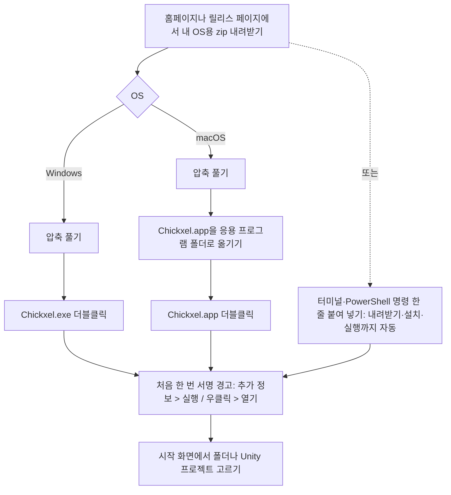
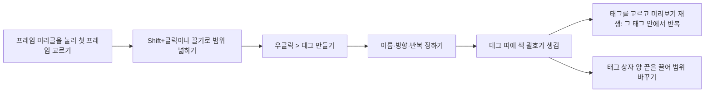
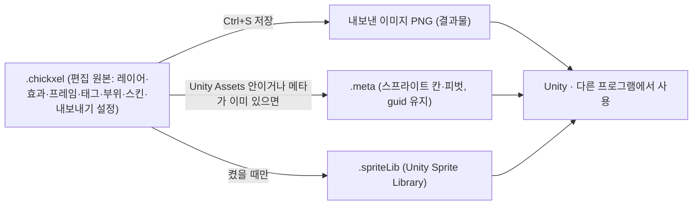
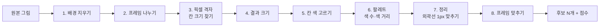
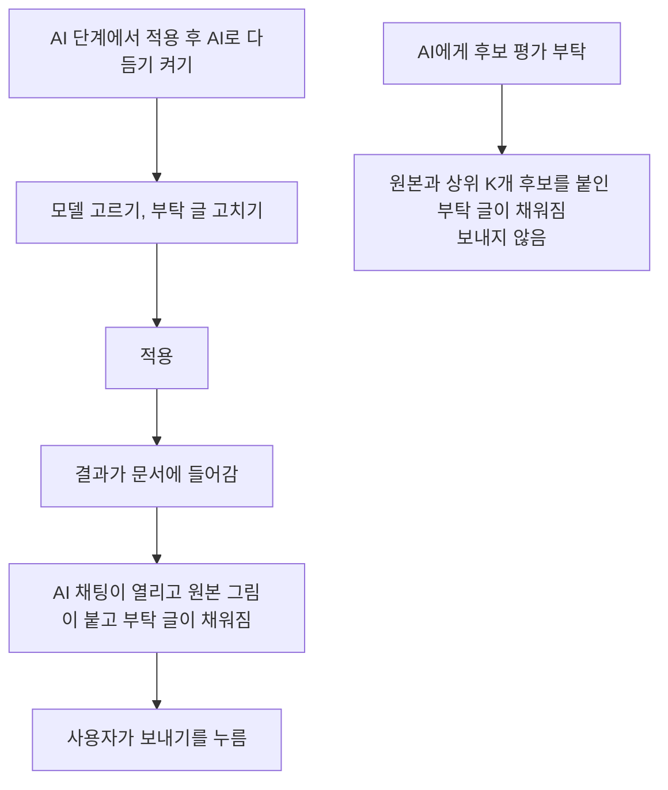
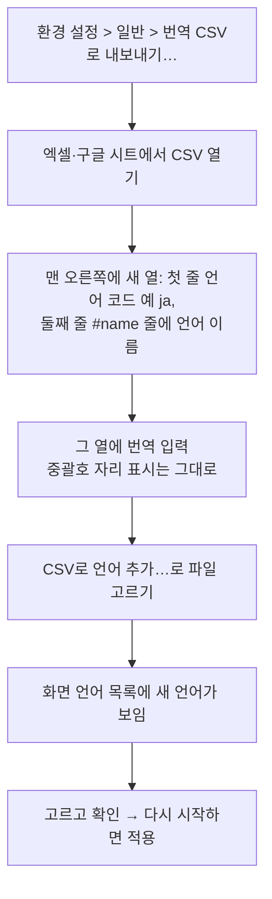
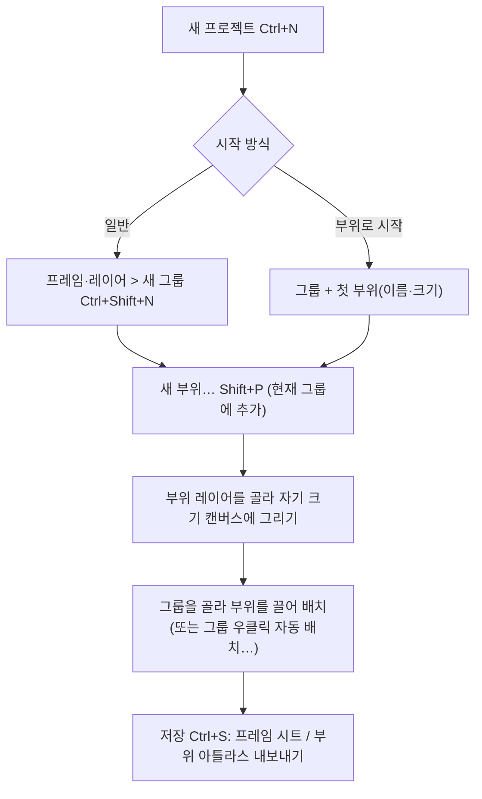
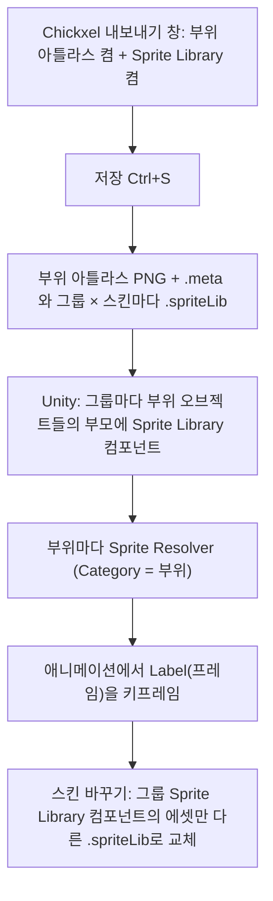
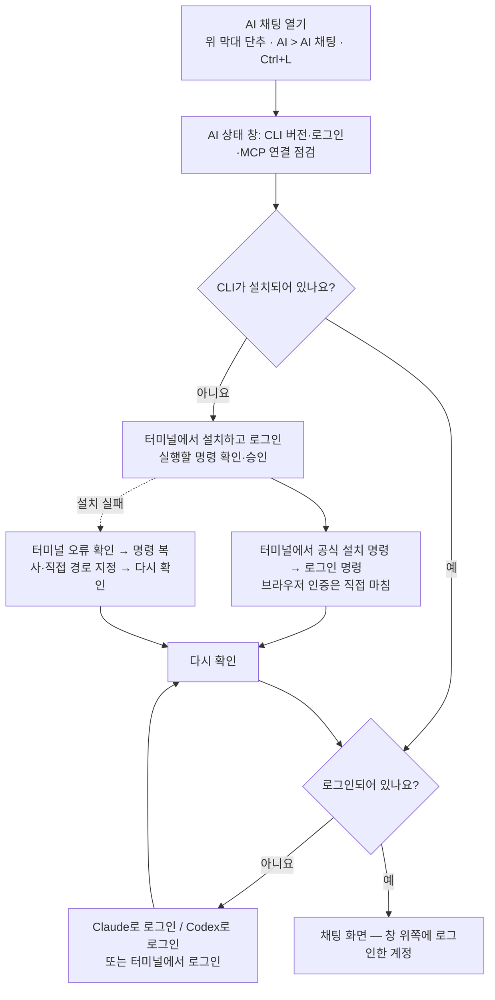

# 가이드 이미지 목록

사용 가이드(원본 `docs/i18n/guide.*` → 홈페이지 `docs/guide.html`·`docs/en/guide.html`, 앱 안 F1)의 쪽마다 넣은 그림 목록입니다. 모두 가이드 본문에 넣었습니다(`<figure class="shot">`, F1은 `python tools/build-docs.py`(→ build-help.py)가 만든 WebP).

- 그림 위치: `docs/assets/guide/<이름>.png`. 영어 화면 한 벌을 한국어·영어 가이드가 같이 씁니다. 이름은 가이드 쪽 id이고, 여러 장이면 `-2`, `-3`이 붙습니다.
- 움짤 위치: 받은 녹화를 30fps 움직이는 WebP로 바꿔 `docs/assets/guide/<이름>.webp`(홈페이지)와 `src/Chickxel.App/Assets/Help/media/<이름>.webp`(F1)에 두고, 가이드 그 쪽 끝에 `<figure class="clip">`으로 넣었습니다. 만드는 법은 `DEVELOPMENT.md`.
- 표시: 글이 설명하는 곳에 빨간 테두리와 빨간 동그라미 번호를 붙이고, 번호는 한 쪽의 그림 여러 장에 걸쳐 이어집니다. 그림 아래 설명(`figcaption`)과 본문이 같은 번호(①②…)로 가리킵니다.
- 다시 찍기: `dotnet run --project tools/GuideShots`(일부만이면 `-- screen- parts-`처럼 id 앞부분). 실제 Chickxel 화면을 화면 없이 띄워 찍으므로 UI를 바꾼 뒤 다시 돌리면 그대로 갱신됩니다(macOS에서도 Windows 모습). 그다음 `python tools/build-docs.py`. 사용법은 `tools/GuideShots/README.md`.
- 예시 그림은 늑대귀 모험가(`tools/GuideShots/Sample/wolf.png`)입니다. 화면에 보이는 경로는 사용자 이름이 나오지 않게 예시 파일 폴더(Windows `C:\ChickxelGuide\MyGame`, macOS `/tmp/ChickxelGuide/MyGame`)나 `D:\MyGame\…`, `%APPDATA%\…` 같은 예시 경로로 찍었습니다.
- 형태: 이미지 / 여러 장 / 워크플로우(그림 대신 흐름도·순서) / 움짤 요청(직접 녹화 필요) / 그림 불필요. 확인 `[x]`는 찍은 그림을 열어 보고 맞는지 확인한 것입니다.

## 직접 찍어 주실 것 (움짤·OS 화면)

장마다 아래 "움짤 요청"에 시작 상태·동작·길이를 자세히 적었습니다. 모아 보면 다음과 같습니다.

- [ ]  `start-first-run` — 정지 화면 2장: Windows "PC 보호" 창(추가 정보 > 실행), macOS "확인되지 않은 개발자" 창
- [X]  `screen-common-controls` — 숫자 칸 끌기·Shift 끌기·입력·우클릭 목록
- [ ]  `screen-file-browser` — 끌어 여러 파일 고르기 → 캔버스로 끌어 놓기
- [X]  `screen-tabs` — 탭 순서 바꾸기 → 끌어 두 칸 나누기 → 닫아서 풀기
- [X]  `screen-timeline-select` — 셀 끌어 고르기·Shift+클릭
- [X]  `screen-timeline-edit` — 프레임 끌어 옮기기·셀 묶음 옮기기·Ctrl 복사
- [X]  `screen-tags` — 태그 만들기 → 범위 끌기 → 재생
- [X]  `screen-layer-effects` — 타임라인 효과 상자 끝·몸통 끌기, 두 번 눌러 효과 창
- [ ]  `tools-basics` — Shift+클릭 직선, 반대 버튼으로 획 취소
- [X]  `tools-gradient` — 캔버스에서 끌어 칠하기(받은 녹화 `tools-gradient.webp`, 정지점 더하기는 없음)
- [X]  `tools-transform` — GuideShots `clip-tools-transform`으로 녹화(하트: 회전·늘리기·Ctrl 자유 변형·우클릭 끌기·우클릭 메뉴 뒤집기·Enter)
- [X]  `tools-canvas-size` — GuideShots `clip-tools-canvas-size`로 녹화(하트: 늘리기·우클릭 여백·우클릭 자르기·그림 옮기기·Ctrl 원근)
- [ ]  `files-drop-layer` — 탐색기에서 그림을 캔버스로 끌어 놓기
- [ ]  `pixelate-open` — 빈 창에 그림 끌어 놓아 후보가 채워지기까지
- [ ]  `pixelate-optimize` — 자동 최적화 실행·끝·되돌리기
- [ ]  `pixelate-view` — 칸 강조·색 견본 좌/우클릭·스포이드·크게 보기
- [ ]  `pixelate-output` — 적용 → 새 레이어 변형 모드 → Enter
- [ ]  `shortcuts-customize` — 단축키 검색·바꾸기·겹침 확인·기본값
- [ ]  `parts-arrange` — 부위 위 마우스·끌어 옮기기·방향키·더블클릭
- [ ]  `parts-auto-layout` — 부위 추가 시 다시 배치, 손으로 옮기면 묻는 창
- [ ]  `parts-skin-manager` — 스킨 카드 바꾸기·순서 끌기·부위 전용 스킨
- [ ]  `parts-outfits` — 착장 줄·Alt+[ / ]·착장 프리셋
- [ ]  `ai-overview` — 실제 로그인 상태에서 외곽선 부탁 한 차례
- [ ]  `ai-chat` — 그림 칩 붙여 넣기·끌어 놓기·미리보기·빼기
- [ ]  `ai-help` — 도움말 칸 열기·예시 부탁 넣기·닫기
- [ ]  `ai-generate` — Codex 그림 생성 → 변환 → 결과 카드

## 찍으면서 발견한 앱 문제

그림이 아니라 앱을 고쳐야 하는 것들입니다(아직 고치지 않음).

- 영어 화면: 앱 휴지통의 "Delete permanently" 단추 글자가 잘리고, "1 items now"처럼 복수형이 틀림.
- 영어 화면: 도구 설정의 "Diamond" 브러시 단추 글자가 잘림. 픽셀로 정리 넣기 단계의 "New layer in the current document (from the current frame)"이 설정 칸 너비(380px)에서 잘림.
- AI 상태 창의 확인 단추 글자가 두 언어 모두 잘림("확인하고 AI …" / "Continue to A…").
- 효과 창의 기본/커스텀 탭 머리글만 큰 기본 글꼴 크기로 보임.
- 픽셀로 정리: 일반 후보는 처음 체크한 프리셋(OKLCH1000, 점수용 색상 가중 1000)으로 점수를 매기는데, 이 기준에서는 "큰 면 색 바뀜"이 모든 후보에서 27 안팎(나쁨 100%)으로 커져 점수 차이에 기여하지 못함.
- 영어 복수형이 틀린 곳: "1 frames"(픽셀로 정리 후보), "1 colors excluded", "1 effects selected", "includes 1 effects above", "1 layers × Frames 5~6", "1 cells"(저장 상태), "cleaned up 1 old outputs".
- 영어 화면 글자 잘림: 픽셀로 정리 설정 칸(380px)의 "Use detected as manual"·두 번째 Offset 칸·"Min area"·"Max contrast"·"Auto (split by empty spac…"; 효과 창 기본 크기의 "Apply perma…"·"Expand keepi…"·"Outside (beyond the imag…"·"Edge light and s…"·피격 번쩍임 반복 단위 글자; 자동 배치 창의 "Vertical alignm…"·"Horizontal layo…"; GIF 내보내기 창 배경 묶음(300px 칸)의 투명 설명과 `#FFFFFF` 칸; AI 채팅 머리줄 계정 글자(470~520px 폭에서 "you@exa…").
- 영어 이름이 맞지 않음: 채우기·스포이드의 기준 목록 이름이 "Anchor"(가이드는 Source), 도구 이름 "Dodge/burn"과 묶음 이름 "Lighten/darken", 스마트 선택 묶음 제목 "Smart selection (same settings as fill)", 패널 머리 "Tool settings"(가이드는 Tool options). 부위 전용 스킨 표시가 "(Part only)"·"(individual)"·"Individual"로 제각각.
- 픽셀로 정리: CHANGELOG v1.14.38의 "원본·후보 칸 우클릭으로 PNG 저장·복사"가 코드에 없음(창에 우클릭 메뉴가 없음). 가이드 자동 최적화 설명의 기본값(Defaults) 단추도 실제로는 모두 선택/모두 해제 단추뿐. 프리셋 목록이 아무것도 고르지 않은 채 열림.
- 변형 중에는 미리보기와 타임라인 썸네일에 들어 올린 픽셀이 안 보임(의도일 수 있음).
- 내보내기 창 미리보기 머리글이 "① Frame sheet", "② Part atlas"처럼 동그라미 숫자를 써서 가이드 그림의 빨간 번호와 헷갈릴 수 있음.
- 파일 브라우저가 메인 창을 닫은 뒤에도 폴더 감시를 계속함(한 프로세스에서 다음 샷이 같은 폴더에 저장하다 멈춤 — 촬영 도구는 샷마다 프로세스를 나눠 피함). 설치 확인 창의 명령은 OS를 직접 확인해 `Platform.IsMac`을 따르지 않음.

## 대표 기능 (featured-*)

대표 기능 장은 이미 홈페이지·F1에 영상(또는 움짤)이 들어 있어 새로 찍지 않았습니다.


| 쪽 id                       | 제목                   | 형태      | 그림                          | 확인 | 설명                                         |
| --------------------------- | ---------------------- | --------- | ----------------------------- | ---- | -------------------------------------------- |
| `featured-number-field`     | 숫자 칸 바꾸는 법      | 기존 움짤 | `feature-number-field.gif`    | [x]  | 클릭 입력·끌기·우클릭 목록                 |
| `featured-ai-draw`          | AI로 그리기            | 기존 영상 | `feature-ai-draw.mp4`         | [x]  | Codex 채팅으로 나무 통 그리기                |
| `featured-pixelate-convert` | 이미지를 픽셀 아트로   | 기존 영상 | `feature-pixelate.mp4`        | [x]  | 붙여 넣기 → 후보 → 크게 보기 비교          |
| `featured-pixelate-colors`  | 색 빼기·더하기        | 기존 영상 | `feature-pixelate-colors.mp4` | [x]  | 쓰인 곳 보기·색 빼기·원본에서 집기         |
| `featured-effects`          | 효과 겹치기            | 기존 영상 | `feature-effects.mp4`         | [x]  | 효과 여러 개 쌓고 범위 정하기                |
| `featured-clip`             | 효과 클리핑            | 기존 영상 | `feature-clip.mp4`            | [x]  | 바로 위 효과에 클리핑                        |
| `featured-palette-web`      | Lospec 팔레트 가져오기 | 기존 영상 | `feature-palette.mp4`         | [x]  | 팔레트 웹 둘러보고 가져오기                  |
| `featured-palette-convert`  | 팔레트로 색 바꾸기     | 기존 영상 | `feature-convert.mp4`         | [x]  | 팔레트 색으로 변환 창                        |
| `featured-skins`            | 스킨 관리              | 기존 영상 | `feature-skins.mp4`           | [x]  | 스킨 칩·스킨 관리 창으로 갈아 끼우기        |
| `featured-skins-tiles`      | 타일·아이템 스킨      | 기존 영상 | `feature-skins-tiles.mp4`     | [x]  | 블록·아이템 부위와 종류별 스킨              |
| `featured-pivot`            | 피벗 연동              | 기존 영상 | `feature-pivot.mp4`           | [x]  | 피벗 옮기고 그 피벗으로 회전                 |
| `featured-export`           | 내보내기               | 기존 영상 | `feature-export.mp4`          | [x]  | 스킨 따로·한 장 모으기, 미리보기·파일 목록 |

## 시작하기 (start)


| 쪽 id             | 제목                | 형태             | 그림                                                                                                        | 확인 | 설명                                                                                                                                                                                                                                                                                                |
| ----------------- | ------------------- | ---------------- | ----------------------------------------------------------------------------------------------------------- | ---- | --------------------------------------------------------------------------------------------------------------------------------------------------------------------------------------------------------------------------------------------------------------------------------------------------- |
| `start-install`   | 설치                | 워크플로우       | -                                                                                                           | -    | 내려받기·압축 풀기·실행은 앱 밖(브라우저·탐색기·Finder) 단계라 앱 화면 그림 대신 아래 워크플로우. 설치가 끝난 첫 화면은`start-first-run.png`                                                                                                                                                    |
| `start-first-run` | 처음 실행할 때      | 이미지+움짤 요청 | `start-first-run.png` (①~④)                                                                               | [x]  | 문서 없이 켠 첫 화면: ① 폴더 열기 ② 최근 폴더 ③ 파일 브라우저(그림 목록이 나오는 곳) ④ Unity Hub 프로젝트 목록. 목록 내용은 예시 값(D:\MyGame 등). Windows "PC 보호"·macOS "확인되지 않은 개발자" 경고 창은 OS 화면이라 사용자 촬영 필요(아래 요청)                                            |
| `start-new-project` | 새 프로젝트 | 이미지 | `start-new-project.png` (①~④) | [x] | 클립보드에 그림(늑대 49×98)이 있을 때의 새 프로젝트 창: ① 클립보드 그림 붙여넣기(켬) ② 캔버스 크기(49×98로 바뀜) ③ 시작 방식(부위로 시작은 꺼짐) ④ 배경 투명 |
| `start-help` | 도움말 보기(F1) | 여러 장+움짤 요청 | `start-help.png` (①②), `start-help-2.png` (③), `start-help-3.png` (④~⑧) | [x] | 1: 도움말 메뉴 ① 화면에서 도움말 선택(F1) ② 사용 가이드… 2: 도움말을 고르는 동안 상태 줄 ③ 안내(도움말 커서는 headless 그림에 찍히지 않음) 3: 사용 가이드 창, 검색 칸에 "pivot"을 넣고 첫 결과를 연 상태 — ④ 검색 칸 ⑤ 목차·검색 결과 ⑥ 쪽 ⑦ 홈페이지에서 열기 ⑧ 개발 후원하기. 코드: `tools/GuideShots/Shots/GuideStartLangKeysShots.cs` |
| `start-update`    | 업데이트            | 여러 장          | `start-update.png` (①), `start-update-2.png` (②~⑥), `start-update-3.png` (⑦), `start-update-4.png` (⑧) | [x]  | 1: 위 막대의 "Update 1.x.y" 단추 2: 업데이트 창 — ② 지금 업데이트 ③ 나중에 ④ 다음 업데이트까지 띄우지 않기 ⑤ 새/지금 버전 줄 ⑥ 바뀐 점(오프라인이라 릴리스 정보는 CHANGELOG.md에서 만든 예시) 3: 도움말 메뉴 ⑦ 업데이트 확인… 4: 환경 설정 > 일반의 업데이트 부분 ⑧ 시작할 때 새 버전 확인 |
| `start-privacy`   | 네트워크와 개인정보 | 이미지           | `start-privacy.png` (①)                                                                                    | [x]  | 환경 설정 > 일반 전체, ① 시작할 때 새 버전 확인(업데이트 확인을 끄는 곳). 개발 빌드 안내 문구는 릴리스 문구로 바꿔 찍음. 팔레트 웹·AI 채팅 창은 각 장의 그림                                                                                                                                      |
| `start-feedback`  | 제보·아이디어      | 여러 장          | `start-feedback.png` (①~③), `start-feedback-2.png` (④~⑥)                                                | [x]  | 1: ① 도움말 메뉴 ② 제보·아이디어 (Discord)… ③ Chickxel 정보… 2: Chickxel 정보 창 ④ Discord ⑤ 문제 신고(GitHub Issues) ⑥ 버전. 설정 파일 경로는 %APPDATA%\Chickxel\settings.json으로 바꿔 찍음                                                                                                    |
| `start-account`   | Chickxel 계정      | 여러 장          | `start-account.png` (번호 없음), `start-account-2.png` (①~④) | [x]  | 가짜 서버로: 1: 로그인 전 창(Google·GitHub·Discord 로그인 단추) 2: Pixel Cat(@pixel-cat)으로 로그인, 다른 계정 Mole Studio — ① 계정 ② 프로필 ③ 갤러리 쪽·로그아웃·다른 계정 추가 ④ 이 컴퓨터에 로그인한 다른 계정 |

### 움짤 요청

- `start-first-run` — 정지 화면 두 장(움짤 아님): Windows에서 처음 Chickxel.exe를 실행했을 때 뜨는 "Windows의 PC 보호" 창에서 "추가 정보"를 누른 뒤 "실행" 단추가 보이는 상태, macOS에서 Chickxel.app 우클릭 > 열기로 뜨는 "확인되지 않은 개발자" 확인 창. 앱 밖 OS 창이라 자동 촬영 불가.
- `start-help` — 움짤 요청: 늑대귀 모험가를 연 메인 창에서 F1을 누르면 커서가 물음표 도움말 커서로 바뀌고 상태 줄에 안내가 뜨는 모습 → 왼쪽 도구 막대의 연필 칸을 클릭해 사용 가이드 창이 연필 쪽으로 열림 → 메인 창으로 돌아와 F1 → 위 막대의 격자 단추를 클릭해 가이드가 격자 그림 자리로 스크롤됨 → 다시 F1 → 우클릭으로 취소(아무 창도 안 열림). 커서가 보이게 녹화(headless 촬영으로는 커서가 안 찍힘), 약 12~15초.

### 워크플로우

`start-install`



## 화면 구성 (screen)


| 쪽 id                    | 제목                        | 형태              | 그림                                                                                                                                                                                                                                                                                                                            | 확인 | 설명                                                                                                                                                                                                                                                                                                                                                                                                                                                                                                                                                                                                                                          |
| ------------------------ | --------------------------- | ----------------- | ------------------------------------------------------------------------------------------------------------------------------------------------------------------------------------------------------------------------------------------------------------------------------------------------------------------------------- | ---- | --------------------------------------------------------------------------------------------------------------------------------------------------------------------------------------------------------------------------------------------------------------------------------------------------------------------------------------------------------------------------------------------------------------------------------------------------------------------------------------------------------------------------------------------------------------------------------------------------------------------------------------------- |
| `screen`                 | 화면 구성(장 첫 그림)       | 이미지            | `screen-overview.png`(①~⑪)                                                                                                                                                                                                                                                                                                    | [x]  | 전체 창(파일 브라우저 예시 폴더, 6프레임·태그·그룹 프로젝트): ① 메뉴와 위 막대 · ② 도구 막대 · ③ 파일 브라우저 · ④ 팔레트 · ⑤ 색 · ⑥ 문서 탭 · ⑦ 캔버스 · ⑧ 타임라인 · ⑨ 미리보기 · ⑩ 도구 설정 · ⑪ 상태 표시줄                                                                                                                                                                                                                                                                                                                                                                                                        |
| `screen-top-bar`         | 메뉴와 위 막대              | 여러 장           | `screen-top-bar.png`(①~⑥), `screen-top-bar-2.png`(⑦), `-3`(⑧), `-4`(⑨), `-5`(⑩), `-6`(⑪)                                                                                                                                                                                                                                 | [x]  | 1) 위 막대: ① 도구 이름 · ② 사용법 · ③ 보기 옵션 · ④ 확대율 상자 · ⑤ 맞추기 · ⑥ AI 채팅 2) ⑦ 확대율 상자 우클릭 목록 3~6) 보기 단추 우클릭 설정 팝업: ⑧ 격자 · ⑨ 타일 격자 · ⑩ 타일 모드 · ⑪ 양파(표의 줄마다 한 장). 피벗 단추는 설정 팝업이 없음                                                                                                                                                                                                                                                                                                                                                                         |
| `screen-outside-canvas` | 캔버스 밖 그림 보기 | 메뉴+비교 그림 | `screen-top-bar-outside.png`(①), `screen-top-bar-compare-outside.png`(번호 없음) | [x] | 위 막대 밖 보기 분할 단추의 라디오 목록과 현재 선택 ①; 같은 캔버스 밖 획을 진하게·40% 반투명·숨김으로 실제 렌더 비교 |
| `screen-common-controls` | 숫자 칸과 메뉴 다루기       | 이미지+움짤 요청  | `screen-common-controls.png`(①②)                                                                                                                                                                                                                                                                                              | [x]  | ① 도구 설정의 크기 숫자 칸 · ② 우클릭 자주 쓰는 값 목록(지금 값 4 px에 점). 좌우로 끌어 값 바꾸기는 움짤로                                                                                                                                                                                                                                                                                                                                                                                                                                                                                                                                 |
| `screen-toolbar`         | 도구 막대                   | 이미지            | `screen-toolbar.png`(①~⑤)                                                                                                                                                                                                                                                                                                     | [x]  | ① 폴더 단추 · ② 도형 묶음 칸 · ③ 우클릭으로 펼친 목록(선·사각형·원) · ④ 저장 · ⑤ 되돌리기(수정된 상태라 켜짐)                                                                                                                                                                                                                                                                                                                                                                                                                                                                                                                      |
| `screen-file-browser`    | 파일 브라우저               | 여러 장+움짤 요청 | `screen-file-browser.png`(①~⑦), `-2`(⑧⑨), `-3`(⑩~⑮), `-4`(⑯~⑱)                                                                                                                                                                                                                                                          | [x]  | 1) ① 폴더 트리 · ② 썸네일 목록 · ③ 검색 · ④ 하위 폴더 포함 · ⑤ 제목 줄 아이콘 셋 · ⑥ .chickxel 배지 · ⑦ 빨간 점 2) ⑧ 두 개 고름 · ⑨ 우클릭 메뉴 3) 합치기 창: ⑩ 순서 · ⑪ 이름 · ⑫ 방식 · ⑬ 캔버스·기준점·원본 삭제 · ⑭ 미리보기 · ⑮ 타임라인 모양 4) 앱 휴지통: ⑯ 목록·미리보기 · ⑰ 되살리기·영구 삭제·비우기 · ⑱ 보관 정책. 폴더 경로는 D:\MyGame\Assets\Sprites로 바꿔 찍음. Unity Hub 목록 창은 Unity Hub가 있어야 해서 찍지 않음                                                                                                                                                                       |
| `screen-palette`         | 팔레트                      | 여러 장           | `screen-palette.png`(①~⑦), `-2`(⑧), `-3`(⑨~⑫)                                                                                                                                                                                                                                                                              | [x]  | 1) ① 기본색/보조색 · ② 쌓인 팔레트(그림에서 만든 팔레트) · ③ 새 팔레트 · ④ 머리글 · ⑤ 활성 팔레트 파란 줄 · ⑥ 기본색 칸 · ⑦ 보조색 칸 2) ⑧ 머리글 메뉴 3) 팔레트 색으로 변환 창: ⑨ 대상 · ⑩ 디더링 · ⑪ 전·후 미리보기 · ⑫ 색 수. 팔레트 웹(Lospec) 창은 인터넷이 필요해 찍지 않음                                                                                                                                                                                                                                                                                                                                       |
| `screen-color-picker`    | 색 고르기                   | 여러 장           | `screen-color-picker.png`(①~⑦), `-2`(⑧), `-3`(⑨), `-4`(⑩)                                                                                                                                                                                                                                                                  | [x]  | 같은 색(#5B6EE1). 1) ① 알파 막대 · ② RGB · ③ HSV · ④ A·HEX · ⑤ 최근 색 · ⑥ 방식 탭 · ⑦ 사각형 2~4) ⑧ 벌집 · ⑨ 색상환 · ⑩ 슬라이더(표의 줄마다)                                                                                                                                                                                                                                                                                                                                                                                                                                                                             |
| `screen-canvas`          | 캔버스                      | 여러 장           | `screen-canvas.png`(①②), `-2`(③~⑨), `-3`(⑩)                                                                                                                                                                                                                                                                                | [x]  | 1) 보석 부위 레이어를 고른 화면: ① 부위 · ② 반투명한 나머지 2) 700%에서 ③ 체커 · ④ 픽셀 격자 · ⑤ 타일 격자 · ⑥ 대칭 안내선 · ⑦ 피벗 · ⑧ 선택 영역 · ⑨ 양파 껍질 3) ⑩ 타일 모드(가운데 칸). H로 이전 프레임 보기는 그림 불필요                                                                                                                                                                                                                                                                                                                                                                                                |
| `screen-tabs`            | 문서 탭과 나누기            | 여러 장+움짤 요청 | `screen-tabs.png`(①~⑤, 2배 확대), `-2`(⑥), `-3`(⑦~⑨)                                                                                                                                                                                                                                                                       | [x]  | 1) ① 탭 제목 · ② 빨간 점 · ③ 전체 경로 도움말 · ④ 닫기 X · ⑤ + 2) ⑥ 탭 우클릭 메뉴 3) 좌우로 나눔: ⑦ 옮기기 단추 · ⑧ 오른쪽 칸 · ⑨ 포커스된 칸의 강조색 선. 탭 끌어 옮기기·나누기는 움짤로                                                                                                                                                                                                                                                                                                                                                                                                                                    |
| `screen-timeline`        | 타임라인                    | 여러 장           | `screen-timeline.png`(①~⑬), `screen-timeline-2.png`(⑭⑮), `screen-timeline-3.png`(⑯), `screen-timeline-4.png`(⑰), `screen-timeline-5.png`(번호 없음), `screen-timeline-6.png`(⑱)                                                                                                                                          | [x]  | 1) 타임라인(그림자 레이어 잠금, 4번 프레임 재생 중): ① 눈 · ② 자물쇠 · ③ 불투명도 · ④ 그룹 접기 삼각형 · ⑤ 부위 들여쓰기 · ⑥ 프레임 번호·길이 · ⑦ 썸네일 · ⑧ 태그 띠 · ⑨ 빈 프레임 추가 · ⑩ 마지막 프레임 복사 · ⑪ 빈 레이어 추가 · ⑫ 맨 아래 레이어 복사 · ⑬ 재생 중인 프레임(초록) 2) 프레임 1~3을 고르고 머리글 우클릭: ⑭ 메뉴 맨 위 선택 표시 · ⑮ 우클릭한 머리글 3) ⑯ 그림이 있는 셀 우클릭 메뉴 4) ⑰ 레이어 이름 우클릭 메뉴 5) 레이어 메뉴의 불투명도… 창 6) ⑱ 왼쪽 위 빈 칸 우클릭(새로 만들기)                                                                                                      |
| `screen-timeline` (타일맵 아이콘) | 타일맵 레이어 알아보기 | 이미지 | `screen-timeline-tilemap.png`(번호 없음) | [x] | 타일맵 레이어 이름 앞 잔디 블록 벡터 아이콘 |
| `screen-timeline-select` | 타임라인에서 고르기         | 여러 장+움짤 요청 | `screen-timeline-select.png`(①), `screen-timeline-select-2.png`(②③)                                                                                                                                                                                                                                                          | [x]  | 1) ① 고른 프레임 2~4(상태 표시줄 안내도 보임) 2) ② 셀 묶음(레이어 2개 × 프레임 2~3) · ③ 상태 표시줄 안내. 끌어서 사각형으로 고르기는 움짤로                                                                                                                                                                                                                                                                                                                                                                                                                                                                                              |
| `screen-timeline-edit`   | 타임라인 편집               | 여러 장+움짤 요청 | `screen-timeline-edit.png`(①②), `screen-timeline-edit-2.png`(③④)                                                                                                                                                                                                                                                            | [x]  | 1) 셀 묶음 우클릭(복사해 둔 뒤라 붙여넣기 켜짐): ① 고른 셀 묶음 · ② 셀 복사·잘라내기·붙여넣기 2) 빈 셀 우클릭: ③ 빈 셀 · ④ 이전 프레임 그림 복사. 순서 바꾸기·셀 묶음 옮기기/복사는 끄는 동작이라 움짤로                                                                                                                                                                                                                                                                                                                                                                                                                             |
| `screen-tags`            | 태그                        | 여러 장+움짤 요청 | `screen-tags.png`(①②), `screen-tags-2.png`(③~⑥), `screen-tags-3.png`(⑦⑧)                                                                                                                                                                                                                                                  | [x]  | 1) hit 태그를 지운 뒤 프레임 5~6을 고르고 머리글 우클릭: ① 고른 프레임 · ② 태그 만들기… 2) 새 태그 창: ③ 이름 · ④ 프레임 범위 · ⑤ 방향·반복 · ⑥ 색 3) ⑦ idle 태그 상자 · ⑧ 태그 우클릭 메뉴(태그 속성…·이 태그 재생·삭제). 범위 끌어 바꾸기는 움짤로, 태그 만들기 순서는 아래 워크플로우                                                                                                                                                                                                                                                                                                                                    |
| `screen-layer-effects`   | 레이어 효과                 | 여러 장+움짤 요청 | `screen-layer-effects.png`(①②), `screen-layer-effects-2.png`(③~⑤), `screen-layer-effects-3.png`(번호 없음), `screen-layer-effects-4.png`(⑥~⑭), `screen-layer-effects-5.png`(⑮), `screen-layer-effects-6.png`(⑯⑰), `screen-layer-effects-7.png`(⑱), `screen-layer-effects-8.png`(⑲), `screen-layer-effects-9.png`(⑳), `screen-layer-effects-10.png`(㉑), `screen-layer-effects-11.png`(㉒) | [x]  | 1) 몸 레이어 이름 우클릭: ① 효과…(2) · ② fx 2) 피격 번쩍임(공식 스크립트 효과) 설정: ③ 색 칸 · ④ 일반색/그라데이션(목록 펼침) · ⑤ 바로 위 효과에 클리핑 3) 색 칸을 누른 색 팝업 4) 효과 창 전체: ⑥ 효과 탭(공식 효과 → 글씨 → 스크립트 효과, 맨 아래 상점 보기) · ⑦ 프리셋 탭 · ⑧ 추가 범위 · ⑨ 효과 목록과 단추 · ⑩ 설정 · ⑪ 전·후 미리보기와 재생 · ⑫ 프레임 줄 · ⑬ 캔버스 확대 · ⑭ 프레임 늘리기 5) 프리셋 탭(예시 프리셋 Gold outline·Hurt): ⑮ 현재 효과 프리셋 저장 6) 타임라인: ⑯ 효과 줄 · ⑰ 피격 번쩍임 상자(프레임 5~6) 7) 셀 5~6 우클릭: ⑱ 효과 추가… 8) ⑲ 효과 상자 우클릭 메뉴 9) 상자 밖 빈 칸 우클릭: ⑳ 여기까지 늘리기·여기부터 복사본 추가 10) 프레임 줄 지우기 칸을 끄는 중: ㉑ 11) 놓은 뒤: ㉒ 되돌릴 수 있는 프레임 수. 효과 상자 끌기는 움짤로 |
| `screen-effect-recipes` | 효과 프리셋 | 여러 장 | `screen-effect-recipes.png`(①~③), `screen-effect-recipes-4.png`(④⑤), `screen-effect-recipes-2.png`(⑥~⑨), `screen-effect-recipes-3.png`(⑩~⑫) | [x] | 1) 효과 창 프리셋 탭: ① 현재 효과 프리셋 저장 · ② 내 프리셋(Gold outline·Hurt) · ③ 받은 프리셋(Shiny Pickup, 풍선 열림) 2) 프리셋 저장 창: ④ 이름 · ⑤ 미리보기 병아리(20마리 목록) 3) 매개변수 창: ⑥ 목록 · ⑦ 이름 · ⑧ 연결할 설정 · ⑨ 범위·기본값 4) 효과 창의 프리셋 묶음: ⑩ 묶음 줄 · ⑪ 매개변수 · ⑫ 펼치기·묶음 풀기 |
| `screen-script-effects` | 스크립트 효과 | 여러 장 | `screen-script-effects.png`(①~⑤), `screen-script-effects-5.png`(⑥~⑪), `screen-script-effects-2.png`(⑫~⑮), `screen-script-effects-4.png`(⑯), `screen-script-effects-3.png`(⑰⑱) | [x] | 1) 효과 창(Color pulse): ① 효과 탭 끝의 내 스크립트 상자 · ② 이름·작성자·해시와 상태 · ③ 스크립트 편집…·JS 파일 열기… · ④ 에셋으로 저장 · ⑤ 설정 칸 2) 설정 칸(Sparks 예시): ⑥ 색과 단색/그라데이션 · ⑦ 색 목록 · ⑧ 각도 다이얼 · ⑨ 점 고르기 · ⑩ 레이어 고르기(목록 펼침, 맨 아래 줄) · ⑪ 시드 주사위 3) 편집 창(오류 원문): ⑫ 안내 · ⑬ 코드 편집기(물결 밑줄) · ⑭ 오류 목록 · ⑮ 적용·닫기 4) ⑯ ctx. 뒤 자동 완성 목록(고른 후보 설명) 5) 실행 확인 창: ⑰ 스크립트 목록 · ⑱ 실행·실행 안 함 |
| `screen-effect-maker` | 효과 만들기 | 여러 장 | `screen-effect-maker.png`(①~⑬), `-2`(⑭⑮), `-3`(⑯⑰), `-4`(⑱⑲), `-5`(⑳㉑), `-6`(㉒), `-7`(㉓㉔), `-8`(㉕), `-9`(㉖~㉘) | [x] | 1) 효과 만들기 전체(Glow pulse, 재생 중): ① 내 효과 목록 · ② 새 스크립트·JS 파일 열기 · ③ 정보 · ④ 규칙 · ⑤ 코드 편집기 · ⑥ 미리보기 설정 값 · ⑦ AI · ⑧ 미리보기와 칸 띠 · ⑨ 미리보기 병아리·끝 그림 병아리 · ⑩ 재생 줄 · ⑪ 저장·지금 레이어에 넣기 · ⑫ 상태 단추 · ⑬ 검증·올리기·닫기 2) 목록(핸들 pixel-cat 흉내): ⑭ 올린 효과·올린 효과 · 고침 · ⑮ 이 컴퓨터에 없는 올린 효과(회색 줄, 내려받기) 3) 미리보기 움직임 창: ⑯ 움직임(직접) · ⑰ 칸마다 X·Y 4) 변신(Morph, 끝 그림 병아리 wizard): ⑱ 끝 그림 병아리 · ⑲ 칸 띠 5) 레이어 고르기 효과(Ground shadow): ⑳ 레이어 고르기 칸 · ㉑ 미리보기 장면 줄 6) 장면 탭을 연 메인 창 + 작아진 효과 만들기(합성): ㉒ 작은 미리보기 창 7) 검증 뒤 상태(Blink flash, Jint 경고·그라데이션 안내): ㉓ 상태 단추 · ㉔ 자세한 상태 8) 규칙 창: ㉕ 지금 원문 포함·복사 9) AI 칸(가짜 대화): ㉖ 대화·입력란 · ㉗ 첨부 단추 · ㉘ 모델 목록·보내기 |
| `screen-preview`         | 미리보기                    | 여러 장           | `screen-preview.png`(①~④), `-2`(⑤), `-3`(⑥)                                                                                                                                                                                                                                                                                 | [x]  | 1) ① 재생 화면 · ② FPS · ③ 배율 단추 · ④ 배경(그룹 없는 프로젝트라 착장 줄 없음) 2) ⑤ 그림 위 우클릭 메뉴 3) ⑥ 배경 목록                                                                                                                                                                                                                                                                                                                                                                                                                                                                                                             |
| `screen-asset-manager`   | 에셋 관리자                 | 여러 장           | `screen-asset-manager.png`(①~⑤), `-2`(⑥~⑧), `-3`(⑨~⑭, 올리기 쪽), `-4`(⑨~⑭), `-5`(⑮⑯) | [x]  | 1) 설치됨 탭 한 목록(받은 Shiny Pickup 고름, 상세에 내보내기 단추 없음): ① 탭 · ② 효과·그라데이션·모양 펜 거르기와 검색 · ③ 가져오기·내보내기·올리기·기본 효과 되돌리기 · ④ 목록 · ⑤ 상세 2) 상점 탭(docs/catalog를 가짜 HTTP로): ⑥ 거르기·검색·태그·새로 고침·홈페이지에서 보기 · ⑦ 목록 · ⑧ 상세·설치 3) 가짜 계정의 온라인에 올리기 창(⑨~⑭, `screen-asset-publish` 쪽) 4) 모양 펜 칸(내 세트 My leaves 고름): ⑨ 캔버스에서 새 세트…·기본 세트 되돌리기 · ⑩ 내 세트 줄(첫 모양·모양 수) · ⑪ 기본 세트 여덟 줄(Chickxel · 모양 수 · 버전 · 기본(상점)) · ⑫ 모양 격자·정보 · ⑬ 캔버스에서 편집·이름 바꾸기·내보내기·온라인에 올리기·삭제 · ⑭ 내보내기 메뉴 펼침 5) 기본 세트 꽃 1 상세: ⑮ 출처 "앱이 기본으로 설치한 상점 에셋" · ⑯ 내 세트로 복사·캔버스에서 편집·웹 페이지·라이선스·삭제. 코드: `ScreenAssets.cs` |
| `screen-effects-dialog` | 효과 창 (레이어 효과 쪽에서 나눔) | 여러 장 | `screen-layer-effects-4.png`(⑥~⑭), `screen-layer-effects-5.png`(⑮), `screen-layer-effects-10.png`(㉑), `screen-layer-effects-11.png`(㉒) | [x] | 그림은 위 `screen-layer-effects` 줄과 같은 샷(ScreenTimeline.cs). 번호는 그대로 |
| `screen-effect-list` | 기본 효과 목록 | 비교 그림 2장 | `screen-effect-list-compare-outline.png`, `screen-effect-list-compare-shadow.png` | [x] | GuideScreenEffectsCompareShots.cs — 미리보기 병아리 1번에 공식 효과를 앱과 같은 길로 입혀 10배: 1) 효과 없음 · 외곽선 기본 · 8방향 · 인접 픽셀 기준 명암 2) 효과 없음 · 그림자 X·Y 2(반투명) · 같은 그림자 디더 50% |
| `screen-effect-colors` | 효과 색과 클리핑 | 여러 장+비교 그림 | `screen-layer-effects-2.png`(③~⑤), `screen-layer-effects-3.png`(번호 없음), `screen-effect-colors-compare-clip.png` | [x] | 비교: 외곽선(8방향 2px) 아래 무지개 직선 그라데이션 색 덮기 — 왼쪽 클리핑 끔 · 오른쪽 켬 |
| `screen-effect-settings` | 효과 범위와 공통 설정 | 여러 장+비교 그림 | `screen-effect-settings-compare-easing.png`, `screen-layer-effects-current.png`(①~④), `screen-layer-effects-pivot-tip.png`(⑤), `screen-layer-effects-hold-end.png`(⑥) | [x] | 비교: 충격파 고리 6칸 — 위 일정하게 · 아래 처음 빠르게. 끝 모습 꼬리 그림은 번호를 ⑥으로 다시 찍음(GuideFeatureShots.cs) |
| `screen-effect-timeline` | 타임라인의 효과 줄 | 여러 장 | `screen-layer-effects-6.png`(⑯⑰), `-7`(⑱), `-8`(⑲), `-9`(⑳) | [x] | 그림은 위 `screen-layer-effects` 줄과 같은 샷 |
| `screen-layer-effects` (순서 비교) | 효과가 쌓이는 순서 | 비교 그림 | `screen-layer-effects-compare-order.png` | [x] | 왼쪽 외곽선 → 그림자 · 오른쪽 그림자 → 외곽선(그림자 색 #5a6eb4, X·Y 2) |
| `screen-asset-publish` | 온라인에 올리기 (에셋 관리자 쪽에서 나눔) | 이미지 | `screen-asset-manager-3.png`(⑨~⑭) | [x] | 그림은 위 `screen-asset-manager` 줄과 같은 샷 |
| `screen-export`          | 내보내기 창                 | 여러 장           | `screen-export.png`(①~⑥), `-2`(⑦~⑪), `-3`(⑫~⑯), `-4`(⑰), `-5`(⑱)                                                                                                                                                                                                                                                        | [x]  | 내보낼 결과 = 둘 다. 1) ① 내보내기 단추 · ② 내보내기 탭 · ③ Import Settings 탭 · ④ 설정 · ⑤ 결과 미리보기 · ⑥ 나눔줄 2) 묶음을 모두 접은 모습: ⑦ 공통 · ⑧ 파일 · ⑨ 프레임 시트 · ⑩ 부위 아틀라스 · ⑪ 고급 3) 공통 묶음: ⑫ 칸 수 · ⑬ 정렬 · ⑭ 따로 파일 · ⑮ 칸 이름 · ⑯ 스킨(스킨 고르기) 4) ⑰ 프리셋 팝업 5) ⑱ Import Settings 탭                                                                                                                                                                                                                                                                              |
| `screen-gif`             | GIF 애니메이션으로 내보내기 | 여러 장           | `screen-gif.png`(①~⑥), `screen-gif-2.png`(⑦)                                                                                                                                                                                                                                                                                 | [x]  | 1) ① 범위 · ② 배율 · ③ 반복 · ④ 배경 · ⑤ 미리보기 · ⑥ 결과 정보 2) ⑦ 태그 고르기 목록                                                                                                                                                                                                                                                                                                                                                                                                                                                                                                                                             |
| `screen-gallery`         | 갤러리에 올리기             | 이미지            | `screen-gallery.png`(①~④) | [x]  | 로그인한 가짜 계정(Pixel Cat, @pixel-cat)으로 늑대귀 모험가: ① 올릴 그림·배율 · ② 설명(제목·설명·태그) · ③ Chickxel 계정 · ④ 미리보기와 공개 안내 |
| `screen-tool-settings`   | 도구 설정                   | 여러 장           | `screen-tool-settings.png`(①②), `-2`(③~⑥)                                                                                                                                                                                                                                                                                   | [x]  | 1) 연필: ① 제목 줄 · ② 그 도구의 설정 2) 피벗 도구: ③ 대상 · ④ 5×5 단추 · ⑤ X·Y · ⑥ 현재 프레임만 따로                                                                                                                                                                                                                                                                                                                                                                                                                                                                                                                            |
| `screen-status-bar`      | 상태 표시줄                 | 이미지            | `screen-status-bar.png`(①~⑦)                                                                                                                                                                                                                                                                                                  | [x]  | 캔버스 위에 마우스를 올린 상태: ① 좌표 · ② 색 · ③ 크기 · ④ 프레임/레이어 · ⑤ 확대율 · ⑥ 저장 상태 · ⑦ 안내                                                                                                                                                                                                                                                                                                                                                                                                                                                                                                                       |
| `screen-top-bar` (비교·효과 보기) | 격자·양파 껍질 비교, 효과 보기 | 비교 그림 2장+이미지 | `screen-top-bar-compare-grid.png`, `screen-top-bar-compare-onion.png`, `screen-canvas-effects-toggle.png`(⑫~⑭) | [x] | GuideScreenUiCompareShots.cs — 1) 같은 자리 32×32px를 8배: 왼쪽 격자 끔 · 오른쪽 픽셀 격자+타일 격자(16×16) 켬 2) 몸 레이어 5번 프레임 5배: 왼쪽 양파 껍질 끔 · 오른쪽 켬(앞 빨강·뒤 파랑). 효과 보기 그림(GuideFeatureShots.cs)은 위 막대 그림 번호에 이어 ⑫부터로 다시 찍음 |
| `screen-palette` (디더링 비교) | 팔레트 색으로 변환의 디더링 | 비교 그림 | `screen-palette-compare-dither.png` | [x] | GuideScreenUiCompareShots.cs — 부드럽게 칠한 공(40×40)을 DB32 파란 계열 6색으로 `PaletteRemap`(대화상자와 같은 변환) 6배: 원본 · 없음 · Bayer 4×4 |
| `screen-color-picker` (레이어 색) | 레이어 색 | 이미지 | `screen-color-picker-5.png`(⑪) | [x] | GuideScreenUiCompareShots.cs — 색 고르기 아래 펼친 레이어 색(몸 레이어 33색): ⑪ 레이어 색 |
| `screen-*` (번호 이어 붙임) | 타임라인·탭·미리보기·도구 설정의 추가 그림 | 여러 장 | `screen-preview-tab.png`(⑩), `screen-timeline-add-drag.png`(⑲), `screen-timeline-compact.png`(⑳㉑), `screen-timeline-multiselect.png`(④~⑥), `screen-timeline-links.png`(①), `-links-2`(②③), `screen-timeline-group-links.png`(④⑤), `screen-timeline-copy-image.png`(⑤⑥), `screen-preview-large.png`(⑦), `screen-effect-dock.png`(③④) | [x] | GuideFeatureShots.cs — 같은 쪽의 다른 그림 번호와 겹치지 않게 `firstNumber`로 이어서 다시 찍음. `screen-timeline-group-drag.png`(①②)·`parts-layer-skin-menu.png`(①②)는 부위 장(`parts-nest`)이 씀. `screen-tool-settings-2.png`(피벗 도구)는 화면 구성 장에서 더는 쓰지 않음(피벗 설명은 `tools-pivot`) |

### 움짤 요청

- `screen-common-controls` — 도구 설정의 브러시 크기(또는 위 막대 확대율) 칸을 좌우로 끌어 값이 바뀌는 모습, Shift를 누르고 천천히 끌기, 클릭해 글자로 입력, 우클릭 목록에서 값 고르기. 연필 도구가 고른 상태에서 시작, 8초쯤.
- `screen-file-browser` — 목록 빈 곳에서 끌어 사각형으로 여러 파일 고르기 → 고른 파일 하나를 캔버스로 끌어 놓아 새 레이어로 들어가는 모습. 예시 폴더를 연 상태에서 시작, 8초쯤.
- `screen-tabs` — 탭을 좌우로 끌어 순서 바꾸기 → 탭 하나를 캔버스 오른쪽 끝으로 끌어 놓아 두 칸으로 나뉘는 모습 → 한쪽 마지막 탭을 닫아 나눔이 풀리는 모습. 탭 세 개를 연 상태에서 시작, 10초쯤.
- `screen-timeline-select` — 셀 위를 누른 채 끌어 사각형으로 고르기, Shift+클릭으로 넓히기, 빈 곳 클릭으로 풀기. 6프레임 프로젝트에서 시작, 8초쯤.
- `screen-timeline-edit` — 이미 고른 프레임 머리글을 끌어 다른 자리로 옮기기(다른 열이 비켜 섬) → 셀 묶음을 끌어 옮기기 → Ctrl을 누른 채 놓아 복사하기. 6프레임 프로젝트에서 시작, 10초쯤.
- `screen-tags` — 프레임 머리글 2~4를 끌어 고르고 우클릭 "태그 만들기…"로 태그 만들기 → 태그 상자 안쪽 끝에 마우스를 대 좌우 화살표 커서가 되면 끌어 범위 늘리기 → 태그를 고르고 미리보기 재생. 8~10초.
- `screen-layer-effects` — 타임라인 효과 줄에서 효과 상자 오른쪽 끝을 끌어 범위 바꾸기 → 몸통을 끌어 통째로 옮기기 → 상자 두 번 눌러 효과 창 열기. 효과가 있는 레이어에서 시작, 8초쯤.
- `screen-effects-dialog` — 효과 없는 레이어에서 효과…로 연 효과 창: 효과 탭의 외곽선을 효과 목록으로 끌어 넣기 → 두께를 2로 바꾸기 → 피격 번쩍임을 두 번 눌러 넣고 프레임 줄에서 5~6칸을 끌어 범위 정하기 → 재생. 10초쯤.
- `screen-effect-colors` — 외곽선이 든 효과 창에서 외곽선 색 칸을 일반색 → 그라데이션(직선 (동적))으로 바꿔 미리보기가 흐르는 모습 → 색 덮기를 넣고 바로 위 효과에 클리핑을 껐다 켜기. 10초쯤.
- `screen-effect-settings` — 흔들기 → 회전 순서의 효과 창에서 흔들기의 '중심(피벗) 같이 옮기기'를 껐다 켜며 재생해 회전 중심이 따라가는 차이 보이기. 8초쯤.
- `screen-effect-maker` — 받은 스크립트 효과(상점에서 설치)를 효과 만들기에서 연 모습(편집기·정보 칸이 잠김, 정보 제목 옆 작성자 사진·이름) → 아래 줄 '내 에셋으로 복사' → 열린 사본에서 원문 한 줄 고쳐 저장. 10초쯤.
- `screen-top-bar` — 양파 껍질 단추를 우클릭해 앞·뒤 프레임 수를 1 → 2로, 진하기를 30% → 60%로 바꾸며 캔버스의 비침이 바로 바뀌는 모습 → 바깥을 눌러 팝업 닫기. 6프레임 프로젝트 3번 프레임에서 시작, 8초쯤.
- `screen-canvas` — 휠로 커서 아래를 중심으로 확대 → Space를 누른 채 끌어 화면 옮기기 → H를 누르고 있어 이전 프레임 보기(왼쪽 위 안내) → 떼기. 6프레임 프로젝트에서 시작, 8초쯤.
- `screen-palette` — 팔레트 칸 클릭(기본색)·우클릭(보조색) → X로 두 색 바꾸기 → 머리글 메뉴의 '현재 색 추가'. DB32 팔레트에서 시작, 8초쯤.
- `screen-color-picker` — 레이어 색 목록에서 칸을 눌러 기본색으로 고르고 연필로 칠하기 → 다른 레이어를 고르면 목록이 바뀌는 모습 → 머리글을 눌러 접기. 6프레임 프로젝트에서 시작, 8초쯤.
- `screen-timeline` — 다음 프레임 칸의 더하기를 오른쪽으로 끌어 프레임 세 개 더하기 → 프레임 번호를 더블클릭해 길이 150ms로 바꾸기. 6프레임 프로젝트에서 시작, 8초쯤.
- `screen-cel-links` — 몸 레이어 2~4번 셀을 고르고 우클릭 '셀 링크' → 3번 칸에 연필로 그리면 2·4번 썸네일도 바뀌는 모습 → '셀 링크 풀기'. 6프레임 프로젝트에서 시작, 10초쯤.
- `screen-preview` — 타임라인에서 idle 태그를 눌러 미리보기가 그 태그만 재생 → 미리보기 그림을 눌러 크게 보기 창 열기 → 휠로 확대·끌어 옮기기·더블클릭으로 맞추기. 8초쯤.

### 워크플로우

`screen-file-browser` — 여러 그림을 .chickxel 하나로 합치기

1. 파일 브라우저에서 Ctrl+클릭(또는 Shift+클릭, 끌어 사각형)으로 파일을 2개 이상 고릅니다.
2. 고른 파일 위에서 우클릭 > **N개 합치기…**를 고릅니다.
3. 합치기 창에서 순서(위 = 먼저)와 이름을 확인하고, 방식(레이어로 / 그룹으로 / 스킨으로 / 프레임으로)을 고릅니다.
4. 필요하면 캔버스 크기·기준점을 정하고, 원본을 치울 거면 **원본 삭제**를 켭니다(앱 휴지통으로 감).
5. 미리보기와 "타임라인에서는 이렇게 보입니다"를 확인하고 **합치기**를 누르면 첫 파일 폴더에 `<이름>.chickxel`이 만들어져 새 탭으로 열립니다.

`screen-tags` — 태그로 애니메이션 묶기



## 도구 (tools)


| 쪽 id               | 제목                   | 형태              | 그림                                                                                                | 확인 | 설명                                                                                                                                                                                                                                                                                                                                  |
| ------------------- | ---------------------- | ----------------- | --------------------------------------------------------------------------------------------------- | ---- | ------------------------------------------------------------------------------------------------------------------------------------------------------------------------------------------------------------------------------------------------------------------------------------------------------------------------------------- |
| `tools-list`        | 도구 목록              | 여러 장           | `tools-list.png`(①②), `tools-list-2.png`(③~⑮)                                                   | [x]  | 1) 창 전체: ① 도구 막대 · ② 도구 설정(연필) 2) 도구 막대 칸마다 번호(표의 도구 이름 앞 번호와 같음): ③ 연필 묶음(연필·그라데이션 연필) ~ ⑮ 9-slice, 묶음 칸은 한 번호(③ 연필, ⑤ 채우기·그라데이션, ⑦ 도형, ⑨ 선택), ⑧ 글씨 |
| `tools-basics`      | 그리기 기본            | 여러 장+움짤 요청 | `tools-basics.png`(①~④), `tools-basics-2.png`(⑤~⑧)                                              | [x]  | 1) 좁힌 창(1180×720): ① 기본색 · ② 보조색 · ③ 도구 설정의 오른쪽 버튼 = 지우개 · ④ 위 막대의 도구 안내 2) 펼친 편집 메뉴: ⑤ 외곽선 추가 · ⑥ 색 바꾸기 · ⑦ 뒤집기·회전 4개 · ⑧ 캔버스 크기                                                                                                                             |
| `tools-groups`      | 도구 묶음              | 이미지            | `tools-groups.png`(①~③)                                                                           | [x]  | ① 채우기 묶음 칸 · ② 선택 묶음 칸 · ③ 선택 묶음을 펼친 목록(사각·원·자유·스마트 선택과 단축키)                                                                                                                                                                                                          |
| `tools-pencil`      | 연필                   | 받은 움짤+이미지+비교 이미지 | 움짤 `tools-pencil.webp`, `tools-pencil-line.webp`, `tools-pencil-perfect.webp`, 그림 `tools-pencil-colors.png`, `tools-pencil-brush.png`(번호 없음), `tools-pencil-compare.png`(번호 없음), `tools-pencil-options.png`(①②), `tools-pencil-compare-steps.png`(번호 없음) | [x]  | 받은 녹화(oCam GIF, 1배 그대로 WebP): 좌클릭 기본색·우클릭 보조색 획, Shift+클릭 직선 잇기, 픽셀 퍼펙트 끔(위)·켬(아래) 곡선 비교. 받은 화면 조각: 팔레트 기본색/보조색, 도구 설정 · 연필의 브러시 묶음. 비교(`GuidePaintToolsCompareShots`): 천천히 그린 S자 크기 1 획(`Raster.Line`), 왼쪽 끔(빨강 = `PixelPerfect`가 빼는 ㄱ자 칸)·오른쪽 켬, 8배. 옵션(`ToolsShots`, 픽셀 퍼펙트 끔·픽셀 잇기 ㄱ자): ① 픽셀 퍼펙트 · ② 픽셀 잇기. 픽셀 잇기 비교: 빠르게 끈 S자(마우스 점 13개)를 `Raster.Line`(왼쪽 대각선)·`Raster.Line4`(오른쪽 ㄱ자)로 이은 크기 1 획, 8배 |
| `tools-gradient-pencil` | 그라데이션 연필    | 받은 움짤+이미지  | 움짤 `tools-gradient-pencil.webp`, `tools-gradient-pencil-settings.png`(①~④)                     | [x]  | 받은 녹화: 스트로크 전체 방식으로 무지개 획을 그리며 그린 길이에 맞춰 색이 다시 펼쳐지는 모습. 설정(반복 방식으로 바꿔 찍음): ① 방식 · ② 간격 · ③ 프리셋·기본값 · ④ 정지점 편집기 |
| `tools-eraser`      | 지우개                 | 받은 움짤+이미지+비교 이미지 | 움짤 `tools-eraser.webp`, `tools-eraser-channels.webp`, 그림 `tools-eraser-settings.png`(번호 없음), `tools-eraser-compare.png`(번호 없음) | [x]  | 받은 녹화: 회색 그라데이션 문질러 지우기·Shift+클릭 직선 지우기, 채널 R만 켜고 빨강·초록·파랑 면 문지르기. 받은 화면 조각: 지우기 묶음(강도 100%, R·G·B). 비교: 빨강·초록·파랑·흰 띠 가운데 줄을 `PartialErase`로 100% · 50% 한 번 · 50% 두 번 · R만, 8배 |
| `tools-brush`       | 브러시 설정            | 여러 장+비교 이미지 | `tools-brush.png`(①~③), `tools-brush-compare.png`(번호 없음), `tools-brush-2.png`(④), `tools-brush-3.png`(⑤⑥) | [x]  | 1) 연필: ① 모양(원) · ② 픽셀 미리보기 · ③ 크기 7 2) 비교: `Raster.Brush` 사각·원·마름모 × 크기 2·3·4·5·7·9 3) 도형: ④ 선 두께·펜 모양 4) 연필의 대칭 그리기: ⑤ 좌우(켬)·상하 ⑥ 피벗 기준. 밝게/어둡게·디더링·그라데이션 연필·지우개 설정 그림은 각 도구 쪽으로 옮김 |
| `tools-dodge`       | 밝게/어둡게            | 이미지+비교 이미지+움짤 요청 | `tools-dodge.png`(①②), `tools-dodge-compare.png`(번호 없음)                                     | [x]  | 1) 도구 설정: ① 방식(색조 이동) · ② 세기 10% 2) 비교: `DodgeBurn.Apply` 다섯 방식(줄) × 갈색·초록·파랑·회색, 가운데 원래 색에서 왼쪽 어둡게 1~3번·오른쪽 밝게 1~3번(세기 20%), 4배 |
| `tools-dither`      | 디더링                 | 이미지+비교 이미지+움짤 요청 | `tools-dither.png`(①), `tools-dither-compare.png`(번호 없음)                                    | [x]  | 1) 무늬 목록 펼침 ① 2) 비교: `Raster.DitherUsesPrimary` 체커·성기게·촘촘하게, 기본색 남색·보조색 하늘색, 8배 |
| `tools-replace-brush` | 색 바꾸기 브러시     | 비교 이미지+움짤 요청 | `tools-replace-brush-compare.png`(번호 없음)                                                     | [x]  | 하트를 크기 3 브러시로 가로로 문지른 결과: 원래 · 연필 · 색 바꾸기 브러시(시작 칸 색과 `Color32.SameVisible`인 칸만 초록), 10배 |
| `tools-shape`       | 도형                   | 여러 장+비교 이미지+움짤 요청 | `tools-shape.png`(①~④), `tools-shape-2.png`(⑤), `tools-shape-compare.png`(번호 없음)          | [x]  | 1) 별+채움: ① 모양 단추 · ② 그리는 법 안내 · ③ 뿔 수 · ④ 채움 2) 선: ⑤ 픽셀 잇기 3) 비교: 같은 선 둘·곡선 하나를 `Shapes.Connect`/`Shapes.Curve` 대각선(왼쪽)·ㄱ자(오른쪽), 8배 |
| `tools-picker`      | 스포이드               | 그림 불필요       | -                                                                                                 | -    | 스포이드 기준 설정 그림은 `tools-fill-2.png`(채우기 쪽)에 있음 |
| `tools-text`        | 글씨                   | 여러 장+움짤 요청 | `tools-text.png`(①~⑦), `tools-text-2.png`(⑧) | [x]  | 1) 글씨 도구로 끌어 만든 글상자에 Wolf를 치는 중(그림 레이어는 숨김): ① 글상자 · ② 글꼴 ③ 폰트 추가·폴더 ④ 크기·굵게·기울임 ⑤ 정렬 ⑥ 자간·줄 간격 ⑦ 배율·부드럽게 2) ⑧ 글꼴 목록 펼침 |
| `tools-select`      | 선택 도구              | 여러 장+비교 그림 4장 | `tools-select.png`(①), `tools-select-2.png`(②), `tools-select-compare-combine.png`·`tools-select-compare-cursor.png`(번호 없음), `tools-select-3.png`(③④), `tools-select-4.png`(⑤⑥), `tools-select-compare-wand.png`, `tools-select-5.png`(⑦⑧), `tools-select-compare-preview.png`(번호 없음) | [x]  | 1) ① 사각 선택으로 머리를 고른 점선 테두리 2) ② 자유 선택을 끄는 중(파란 점선으로 선택될 영역) 3) 비교: 머리 사각형에 둘째 사각형을 Shift 더하기 · Alt 빼기 · Shift+Alt 겹친 곳만 4) 비교: 커서 바꾸기·더하기·빼기·겹친 곳만(앱 커서 그림 8배) 5) ③ 스마트 선택으로 고른 머리카락 · ④ 스마트 선택 설정(선택 방식·미리보기 줄 포함) 6) ⑤ 선택 방식 목록 펼침 · ⑥ 미리보기·300 칸까지 7) 비교: 같은 머리카락 칸, 허용 오차 10% — 허용 오차 · 바깥 1칸 더하기 · 맞닿은 색까지(파란 미리보기) 8) ⑦ 지금 선택(머리카락) · ⑧ Shift로 얼굴 위에 올린 파란 미리보기 9) 비교: 머리카락 선택 상태, 한도 1000 — 키 없음(얼굴 파랑·머리 빨강) · Shift(얼굴만 파랑) · Alt로 머리 위(머리 빨강). 코드: `tools/GuideShots/Shots/SelectShots.cs` |
| `tools-shape-pen`   | 모양 펜                | 여러 장+비교 그림 | `tools-shape-pen.png`(①~⑧), `-2`(⑨⑩), `-3`(⑪), `tools-shape-pen-canvas.png`(⑫~⑯), `tools-shape-pen-sets.png`·`tools-shape-pen-example.png`·`tools-shape-pen-compare.png`(번호 없음) | [x]  | 1) 도구 설정: ① 세트 고르기 · ② 세트 단추(새 세트·이름 바꾸기·지우기·기본 세트 되돌리기·세트 관리…) · ③ 모양 칸 · ④ 모양 더하기·지우기 · ⑤ 순서 · ⑥ 간격 · ⑦ 최적 간격 · ⑧ 지금 색으로 물들이기 2) 세트 목록 펼침: ⑨ 내 세트 My leaves · ⑩ 기본 세트 여덟 가지(지구 아이콘) 3) ⑪ 받은 세트(나뭇잎) 읽기 전용 안내 4) 세트 편집 임시 탭: ⑫ "Shape set: My leaves" 탭 · ⑬ 막대 안내 · ⑭ 세트에 저장 · ⑮ 닫기 · ⑯ 모양마다 프레임 하나인 타임라인 5) 기본 세트 모음(랜덤 칙셀 맨 위) 6) 찍은 예(나뭇잎·꽃 1·단풍잎·반짝이). 코드: `ToolsShots.cs`, `GuidePaintToolsCompareShots.cs` |
| `tools-move`        | 이동 도구와 캔버스 밖 그림 | 비교 이미지+움짤 요청 | `tools-move-compare.png`(번호 없음)                                                              | [x]  | 순환 비교: 예시 그림 레이어를 오른쪽으로 20px 민 실제 결과(왼쪽 = 순환 끔: `SpriteProject.ShiftCels`, 밖으로 나간 부분은 캔버스 밖 그림으로 40% 흐리게, 오른쪽 = 순환 켬: `PixelOps.Shift` wrap), 하늘색 선 = 캔버스 테두리, 4배 확대 |
| `tools-fill`        | 채우기                 | 여러 장+받은 움짤+비교 이미지 | `tools-fill.png`(①~④), `tools-fill-2.png`(⑤), `tools-fill-compare.png`·`tools-fill-compare-2.png`(번호 없음), 움짤 `tools-fill.webp` | [x]  | 1) 채우기 도구 설정: ① 허용 오차 · ② 이어진 영역만 · ③ 대각선으로도 잇기 · ④ 기준(목록 펼침) 2) ⑤ 스포이드의 기준 3) 비교 `Raster.FloodFill`: 노란 칸 셋 중 왼쪽 칸 클릭, 이어진 영역만 끔·켬 4) 채널 16씩 다른 파랑 띠 다섯 줄 가운데 클릭, 허용 오차 0%·10%. 받은 녹화: 좌클릭 기본색(빨강)·우클릭 보조색(보라)으로 면 채우기 |
| `tools-gradient`    | 그라데이션             | 여러 장+받은 움짤+비교 이미지 | `tools-gradient.png`(①~⑨), `tools-gradient-compare.png`(번호 없음), `tools-gradient-2.png`(⑩~⑫), `tools-gradient-3.png`(⑬~⑰), 움짤 `tools-gradient.webp` | [x]  | 1) 캐릭터 아래 새 레이어에 끄는 중(안내선): ① 시작점 · ② 끝점 · ③ 그라데이션 바 · ④ 위치·삭제 · ⑤ 색 · ⑥ 보간 · ⑦ 색 공간 · ⑧ 디더링 · ⑨ 사용 안내 i 2) 비교 `Gradient.Apply`(OKLCH, 남색 → 하늘색 → 크림): 부드럽게 · 단계 · 2×2 Bayer · 4×4 Bayer, 6배 3) 바 우클릭 프리셋 메뉴: ⑩ 현재 그라데이션 저장 · ⑪ 저장된 프리셋 · ⑫ 프리셋 관리 4) 프리셋 관리 창: ⑬ 목록 · ⑭ 즐겨찾기·이름 바꾸기·삭제 · ⑮ 미리보기·편집 · ⑯ 변경 내용 저장 · ⑰ 에셋 관리자. 받은 녹화: 빈 캔버스에서 왼쪽 → 오른쪽으로 끌어 무지개 칠하기 |
| `tools-transform`   | 변형 모드 (지금 셀)   | 여러 장+비교 이미지+움짤 | `tools-transform.png`(①~⑩), `tools-transform-compare.png`(번호 없음), `tools-transform-2.png`(⑪⑫), 움짤 `tools-transform.webp` | [x]  | 1) 머리를 선택해 Ctrl+T 후 18도 돌린 상태(파란 상자): ① 안쪽 · ② 네모 손잡이 · ③ 테두리 바깥(회전) · ④ 회전 중심 · ⑤ 적용 · ⑥ 취소 · ⑦ 각도·가로/세로 %·중심 · ⑧ 상자 가로·세로 · ⑨ 뒤집기 줄 · ⑩ 리샘플링 2) 리샘플링 비교: 머리(7,3~42,36)를 `FreeTransform`으로 30° 돌린 결과, 왼쪽 최근접 · 오른쪽 RotSprite, 6배 확대 3) 머리를 Ctrl+T로 열어 오른쪽 위 꼭짓점을 바깥으로, 왼쪽 아래 꼭짓점을 안으로 옮긴 자유 변형(`TransformBox.WithCorners`)에서 안쪽 우클릭: ⑪ 옮긴 꼭짓점 · ⑫ 우클릭 메뉴. 움짤(`clip-tools-transform`, 32×20 하트 12배, 384×240): 바깥 띠 끌어 돌리기 → 오른쪽 변 손잡이 늘리기 → Ctrl+왼쪽 아래 모서리 자유 변형 → 안쪽 우클릭 끌기(그림만, 회전 중심 제자리) → 우클릭 메뉴 가로로 뒤집기 → Enter |
| `tools-canvas-size` | 캔버스 크기 모드       | 이미지+움짤  | `tools-canvas-size.png`(①~⑮), `tools-canvas-size-ratio.png`(⑯~⑳), `tools-canvas-size-ctrl.png`(㉑㉒), 움짤 `tools-canvas-size.webp`, `tools-canvas-size-slice.webp` | [x]  | 캔버스를 69×88로 넓히고 아래를 잘라 낸 상태: ① 하늘색 점선 테두리 · ② 흐린 잘릴 부분 · ③ 손잡이 · ④ 그림 안쪽 · ⑤ 확인 · ⑥ 취소 · ⑦ 캔버스 가로/세로 · ⑧ 캔버스 중심 기준 · ⑨ 9-slice로 늘리기(예시는 테두리 없어 꺼짐) · ⑩ 그림 가로/세로 · ⑪ 그림 비율 유지 · ⑫ 특수 비율 단추 · ⑬ 그림 위치 · ⑭ 기준점 9방향 · ⑮ 뒤집기. 특수 비율 창(1:1, 가로 유지, 캔버스만 바꾸기 — 번호가 글자를 가리지 않게 본문 왼쪽을 띄워 찍음): ⑯ 비율 · ⑰ 기준 · ⑱ 방식 · ⑲ 미리보기 · ⑳ 새 크기·그림 크기. Ctrl 그림(오른쪽 아래 손잡이를 Ctrl+우클릭으로 안쪽으로 끄는 중): ㉑ 우클릭 여백의 노란 테두리·바깥쪽 화살표 · ㉒ Ctrl로 옮긴 꼭짓점(그 모양 밖은 잘림). 움짤(`clip-tools-canvas-size`, 20×14 하트 12배, 480×300): 오른쪽 손잡이 늘리기 → 왼쪽 손잡이 우클릭 여백 → 아래 손잡이 우클릭으로 자르기 → 그림 옮기기 → Ctrl+오른쪽 위 손잡이 원근(적용하지 않음) |
| `tools-canvas-size` (타일맵) | 타일맵에서 캔버스 크기 조절 | 이미지 | `tools-canvas-size-tilemap.png`(번호는 그림 설명 참조) | [x] | 타일맵 레이어에서 시작한 캔버스 크기 모드: 임시 타일 칸 격자와 칸 경계에 맞춘 손잡이 |
| `tools-layer-size`  | 레이어 전체 변형       | 이미지+움짤 요청  | `tools-layer-size.png`(①~③)                                                                       | [x]  | 6프레임 예시의 Body 레이어를 Alt+Shift+C로 열고 상자를 좁힌(여백) 상태(주황 상자): ① 손잡이와 흐린 잘릴 픽셀 · ② 변형 · 레이어 전체 묶음 · ③ 뒤집기 줄 |
| `tools-pivot`       | 피벗 도구              | 이미지+움짤 요청  | `tools-pivot.png`(①~⑥)                                                                           | [x]  | 6프레임 예시(Body·Shadow)에서 Body 레이어의 프레임 3부터 피벗을 따로 두고 발밑(가로 1/2, 아래 끝)으로 옮긴 상태: ① 캔버스의 피벗 표시(흰색) · ② 5×5 단추 · ③ X·Y · ④ 현재 프레임부터 · ⑤ 대상 글(묶음 맨 위, 레이어 "Body"의 프레임 3부터 끝까지) · ⑥ Body 줄 셀 왼쪽 위의 주황 마름모(프레임 3~6) |
| `tools-nine-slice`  | 9-slice                | 이미지+비교 이미지 | `tools-nine-slice.png`(①~④), `tools-nine-slice-compare.png`(번호 없음)                             | [x]  | 예시 UI 단추(32×20): ① L5·T5·R5·B6 초록 선 4개 · ② L·T·R·B 값 · ③ 모두 0 · ④ 적용 대상. 비교: 같은 단추를 `NineSlice.Scale`로 72×28로 늘인 결과, 왼쪽 테두리 없음(최근접) · 오른쪽 9-slice, 5배 확대 |

### 움짤 요청

- `tools-basics` — 늑대귀 모험가를 연 상태에서 연필로 한 점을 찍고 Shift를 누른 채 다른 곳을 클릭해 직선이 이어지는 모습, 이어서 왼쪽 버튼으로 긋는 중에 오른쪽 버튼을 눌러 획이 취소되는 모습(약 6~8초).
- `tools-gradient` — 사각 선택으로 빈 영역(또는 새 레이어)을 고른 뒤 그라데이션 도구로 시작점에서 끝점까지 끌어 칠하고, 바 아래 빈 곳을 눌러 색 정지점을 더해 결과가 바뀌는 모습(약 8초).
- `tools-transform` — GuideShots `clip-tools-transform`이 찍음(직접 녹화 필요 없음): 하트를 Ctrl+T로 열어 테두리 바깥을 끌어 회전, 오른쪽 변 손잡이로 늘리기, Ctrl+모서리 끌기로 자유 변형, 안쪽 우클릭 끌기로 그림만 옮기기, 안쪽 우클릭 메뉴의 가로로 뒤집기, Enter로 적용(약 15초).
- `tools-canvas-size` — GuideShots `clip-tools-canvas-size`가 찍음(직접 녹화 필요 없음): 하트에서 Ctrl+Alt+C로 들어가 오른쪽 손잡이 끌기로 그림과 함께 늘리기, 왼쪽 손잡이 우클릭 끌기로 여백(노란 테두리), 아래 손잡이 우클릭 끌기로 잘라 내기, 그림 안쪽 끌기로 옮기기, Ctrl+오른쪽 위 손잡이 끌기로 원근(약 13초, 적용하지 않음 — Enter는 화면을 다시 맞춤). 받은 녹화 둘째: 9-slice 도구로 선을 정하고 캔버스 크기 모드에서 9-slice로 늘이고 줄이기, 가운데 채우기를 되풀이로(`tools-canvas-size-slice.webp`).
- `tools-move` — 움짤 요청: 늑대귀 모험가를 연 상태에서 이동 도구(V)로 캐릭터를 캔버스 오른쪽 밖으로 반쯤 끌어 내 밖으로 나간 부분이 흐리게 남는 모습, 놓은 뒤 다시 안으로 끌어 돌아오는 모습, 이어서 도구 설정의 순환을 켜고 같은 방향으로 밀면 반대편으로 들어오는 모습(약 8~10초).
- `tools-pivot` — 움짤 요청: 6프레임 예시(타임라인 보임)에서 피벗 도구(K)로 캔버스를 끌어 피벗을 발밑으로 옮기고, 프레임 3으로 가서 '현재 프레임부터'를 켠 뒤 5×5 단추로 피벗을 바꾸면 프레임 3~6 머리에 주황 마름모가 생기고 1~2는 그대로인 모습, 끝에 체크를 꺼 마름모가 사라지는 데까지(약 10~12초).
- `tools-layer-size` — 움짤 요청: 6프레임 예시에서 Body 레이어를 고르고 Alt+Shift+C(주황 상자), 테두리 바깥을 끌어 돌린 뒤 타임라인에서 다른 프레임을 눌러 프레임마다 그 피벗을 중심으로 돈 모습이 이어지는 것, 손잡이를 끌어 모든 프레임을 함께 늘이고 Enter로 적용(약 10초).
- `tools-select` — 움짤 요청(선택): 사각 선택으로 머리를 고르고 안쪽을 끌어 옮긴 뒤 Enter, 우클릭으로 선택 해제, 스마트 선택으로 머리카락을 누르고 방향키로 옮기는 모습(약 8초).
- `tools-dodge` — 움짤 요청: 늑대귀 모험가를 연 상태에서 밝게/어둡게(D), 원 브러시 크기 3, 방식 색조 이동. 머리카락 윗부분을 왼쪽 버튼으로 문질러 밝게(한 번 뗐다가 같은 자리를 다시 문질러 한 단계 더), 아래쪽을 오른쪽 버튼으로 문질러 어둡게, 끝에 방식을 채도로 바꿔 옷을 왼쪽 버튼으로 문질러 진해지는 모습(약 10초).
- `tools-dither` — 움짤 요청: 빈 레이어에서 기본색 남색·보조색 하늘색, 디더링 도구 크기 5로 체커 무늬를 가로로 칠하고, 무늬를 성기게(25%)로 바꿔 바로 옆에 이어 칠해 무늬가 어긋나지 않고 이어지는 모습, 오른쪽 버튼으로 한 번 그어 두 색이 바뀌는 모습(약 8초).
- `tools-replace-brush` — 움짤 요청: 늑대귀 모험가에서 기본색을 초록으로 두고 색 바꾸기 브러시(C) 크기 4로 옷의 한 색에서 시작해 바깥선까지 넘어가게 문질러 그 색만 바뀌는 모습, 이어서 캐릭터 옆 투명한 곳에서 시작해 캐릭터 위를 지나가도 빈 곳만 칠해지는 모습(약 8~10초).
- `tools-brush` — 움짤 요청: 좌우 대칭(Shift+X)을 켜고 연필로 캔버스 위에 있을 때 대칭 자리의 회색 유령 커서, 한쪽 눈을 그리면 반대쪽에도 그려지는 모습, 피벗 기준을 켜면 축이 피벗으로 옮겨지는 모습(약 8초).
- `tools-shape` — 움짤 요청: 도형 도구에서 곡선을 골라 양 끝을 끌어 정하고, 놓은 뒤 마우스를 움직여 휘다가 클릭해 확정, 이어서 별을 Shift를 누른 채 끌어 찌그러지지 않게 그리는 모습(약 8초).
- `tools-text` — 움짤 요청: 글씨 도구(T)로 캔버스를 끌어 글상자를 만들고 글을 친 뒤 위·아래 손잡이를 끌어 글자 크기가 바뀌는 모습, Esc로 마친 뒤 이동 도구로 글씨를 옮기는 모습(약 10초).

## 파일 · 저장 · 내보내기 (files)

그림은 영어 화면 한 벌(한국어·영어 가이드가 같이 씀)이고, 빨간 번호(①②…)는 쪽마다 그림 여러 장에 걸쳐 이어지며 본문의 번호와 같습니다. 예시 파일 폴더 경로는 촬영 때의 `GUIDESHOTS_ROOT`(예: `/tmp/...`)가 그대로 보입니다.


| 쪽 id              | 제목                            | 형태               | 그림                                                              | 확인 | 설명                                                                                                                                                                                                                                                                                                                                                                                          |
| ------------------ | ------------------------------- | ------------------ | ----------------------------------------------------------------- | ---- | --------------------------------------------------------------------------------------------------------------------------------------------------------------------------------------------------------------------------------------------------------------------------------------------------------------------------------------------------------------------------------------------- |
| `files-roles`      | 파일의 종류와 저장 위치         | 워크플로우         | -                                                                 | -    | 그림 없음: 파일 브라우저는 프로젝트가 내보낸 PNG·.meta를 프로젝트 하나로 묶어 보여 줘 표의 종류가 한 화면에 따로 보이지 않음 — 아래 흐름도로 보완                                                                                                                                                                                                                                          |
| `files-open`       | 파일 열기                       | 표 + 움짤 요청     | -                                                                 | -    | 그림 없음: 여는 방법·파일 종류별 결과·탐색기/Finder 더블클릭(파일 연결)·밖에서 바뀐 파일을 표로 설명. 더블클릭은 OS 화면이라 직접 녹화 필요(아래 움짤 요청)                                                                                                                                                                                                                                  |
| `files-save`       | 저장하기                        | 여러 장+워크플로우 | `files-save.png`, `files-save-2.png`, `files-save-3.png`          | [x]  | ① 파일 메뉴의 저장(+ 시트 내보내기) Ctrl+S ② 저장 뒤 상태 표시줄 "Saved: ….chickxel → frames ….png 1 cells" ③ 내보낼 자리에 같은 이름 폴더를 둬 시트 내보내기만 실패시킨 "Save failed" 창                                                                                                                                                                                                 |
| `files-autosave`   | 자동 저장                       | 여러 장            | `files-autosave.png`, `files-autosave-2.png`                      | [x]  | ① 자동 저장이 돈 뒤 상태 표시줄 "Autosaved (….chickxel)" ② 환경 설정 > 일반 > 저장의 자동 저장 체크 ③ 기다리는 시간(초)                                                                                                                                                                                                                                                                     |
| `files-revert`     | 저장한 내용으로 되돌리기        | 여러 장            | `files-revert.png`, `files-revert-2.png`, `files-revert-3.png`    | [x]  | ① 수정한 뒤 켜진 도구 막대 맨 아래 되돌리기 단추(상태 표시줄 Modified) ② 파일 메뉴의 Revert to saved ③ 되돌릴지 묻는 창의 Yes                                                                                                                                                                                                                                                              |
| `files-history`    | 닫아도 남는 실행취소 기록       | 이미지             | `files-history.png`                                               | [x]  | 환경 설정 > 일반 > 실행취소 기록: ① 기록 남기기 ② 보관 기간 ③ 최대 용량 ④ 기록 모두 지우기                                                                                                                                                                                                                                                                                                |
| `files-png-import` | PNG 열기(가져오기)              | 여러 장            | `files-png-import.png` ~ `files-png-import-4.png`                 | [x]  | ①② 칸이 모두 같은 크기인 시트를 열 때 묻는 창(As parts / As animation frames) ③ 프레임·레이어 메뉴의 격자로 나눠 프레임 만들기 ④ 나누는 방법 목록을 편 창 ⑤ 칸 크기 ⑥ 칸 수 ⑦ 자동 기준 최소 크기                                                                                                                                                                                     |
| `files-open-media` | 그림·움직이는 그림·영상 열기  | 여러 장+비교       | `files-open-media.png` ~ `files-open-media-5.png`, `files-open-media-compare.png` | [x]  | ① 파일 메뉴의 열기 Ctrl+O ②③④ 움직이는 GIF(만든 예시 slime_bounce.gif, 4프레임)를 연 새 문서의 새 탭·파일 이름 레이어·프레임 ⑤ 320프레임 GIF를 열 때 묻는 창 ⑥⑦⑧ 환경 설정 > 영상(ffmpeg) 탭·실행 파일 칸·찾아보기 ⑨~⑮ 영상 가져오기 창(구간·초당 프레임·최대 프레임 수·크기·부드럽게·예상치·가져오기, 예시 값). ffmpeg 탭의 "Using ffmpeg: …" 경로는 촬영한 컴퓨터의 것. 비교 그림(`GuideFilesCompareShots.cs`): 늑대귀 모험가를 3.5배로 녹화한 무손실 영상을 실제 ffmpeg 가져오기로 긴 변 98px에 맞춰 부드럽게 끔(왼쪽)·켬(오른쪽), 머리 부분 8배 — ffmpeg가 있어야 찍힘 |
| `files-drop-layer` | 캔버스에 그림 끌어 놓기         | 여러 장+움짤 요청  | `files-drop-layer.png`, `files-drop-layer-2.png`                  | [x]  | ① 끄는 중: 캔버스 둘레 빛남과 들어갈 자리 점선 사각형(하트 그림) ② 놓은 뒤 새 레이어 "heart" ③ 바로 들린 변형 모드 ④ 상태 표시줄 안내                                                                                                                                                                                                                                                     |
| `files-cleanup`    | 옛 결과 정리와 파일 이름 바꾸기 | 여러 장            | `files-cleanup.png`, `files-cleanup-2.png`, `files-cleanup-3.png` | [x]  | ① 내보낼 이름을 바꾸고 다시 저장한 뒤 "cleaned up 1 old outputs (app trash)" 상태 표시줄 ② 파일 목록 우클릭 Restore last deleted ③ View app trash… ④ 앱 휴지통 창의 옮겨진 옛 결과 ⑤ Restore                                                                                                                                                                                            |
| `files-cell-names` | 내보낼 칸 이름                  | 여러 장            | `files-cell-names.png`, `files-cell-names-2.png`                  | [x]  | ① 타임라인 프레임 머리 우클릭 메뉴의 Export cell name… ② 칸 이름 입력란                                                                                                                                                                                                                                                                                                                    |
| `files-quit`       | 닫을 때 저장 묻기               | 이미지             | `files-quit.png`                                                  | [x]  | ① 저장하지 않은 파일 2개(썸네일·이름) ② Save selected files ③ Don't save ④ Cancel                                                                                                                                                                                                                                                                                                        |
| `files-settings`   | 환경 설정                       | 여러 장            | `files-settings.png` ~ `files-settings-4.png`                     | [x]  | ① 편집 메뉴의 Preferences… ②~⑥ 일반 탭(실행취소 횟수·실행취소 기록·자동 저장·앱 휴지통 보관) ⑦~⑩ 단축키 탭(save 검색, Change·Add·None·Default, JSON 내보내기·불러오기) ⑪ 겹치는 키(Ctrl+S)를 줄 때 묻는 창                                                                                                                                                                      |
| `files-crash-log`  | 오류가 생겼을 때                | 여러 장            | `files-crash-log.png`, `files-crash-log-2.png`                    | [x]  | ① 예시 오류로 띄운 "you can keep working" 창(로그 파일 이름) ② Open log folder ③ Report on Discord ④ 도움말 메뉴의 Open error log folder                                                                                                                                                                                                                                                  |

### 움짤 요청

- `files-drop-layer` — 늑대귀 모험가를 연 상태에서 탐색기의 작은 PNG를 캔버스 위로 끌어 오며 점선 사각형이 따라 움직이는 모습, 놓은 뒤 변형 모드로 크기를 조금 맞추고 Enter(약 6~8초).
- 움짤 요청 `files-open` — Chickxel이 이미 켜져 있는 상태에서 탐색기(또는 Finder)의 `.chickxel` 파일을 더블클릭해 새 창 없이 기존 창에 문서 탭이 하나 더 열리는 모습(탐색기 창과 Chickxel 창이 함께 보이게, 약 5~6초).
- 움짤 요청 `files-autosave` — 저장한 적 있는 프로젝트에서 연필로 몇 번 그은 뒤 손을 떼고 3초 기다려 탭의 빨간 점이 사라지고 상태 표시줄에 "Autosaved (….chickxel)"가 뜨는 모습(약 6초).
- 움짤 요청 `files-cleanup` — 내보내기 창에서 내보낼 이름을 바꾸고 Ctrl+S, 파일 브라우저에서 옛 PNG가 사라지고 새 PNG가 생기며 상태 표시줄에 "cleaned up … (app trash)", 이어서 우클릭 > View app trash…에서 되살리기(약 10초).

### 워크플로우

`files-roles` — 저장 한 번으로 생기는 파일



`files-save` — Ctrl+S를 누르면

1. 저장한 적 없는 새 프로젝트면 저장 위치를 묻습니다(가져온 PNG는 같은 폴더의 같은 이름 `.chickxel`로 바로 저장).
2. `.chickxel`을 씁니다.
3. 설정에 따라 이미지를 내보내고, Unity `Assets` 안이거나 메타가 이미 있으면 `.meta`도 씁니다(guid·spriteID는 이름 기준으로 유지).
4. 더 이상 만들지 않게 된 옛 결과는 앱 휴지통으로 옮깁니다.
5. 결과를 상태 표시줄에 보여 줍니다. 이미지 내보내기만 실패하면 그 사실을 알립니다.

## AI 그림 픽셀로 정리 (pixelate)

예시 원본은 늑대귀 모험가를 7~8px 칸으로 고르지 않게 키우고 흐리게 해 밝은 배경에 JPEG로 저장한 "AI 그림 같은" 그림입니다(451×813). 자동 최적화 그림은 촬영 시간을 줄이려고 프리셋 2개·시도 120번만 돌린 결과입니다. 그림은 영어 화면 한 벌이고, 빨간 번호(①②…)는 쪽(h3)마다 ①부터 그림 여러 장에 걸쳐 이어지며 본문의 번호와 같습니다. 색 견본 우클릭은 메뉴 없이 바로 색 빼기라 뺀 상태를 찍었습니다. 비교 그림(`*-compare*.png`, `Shots/GuidePixelateCompareShots.cs`)은 같은 예시 원본을 실제 정리 파이프라인으로 설정 하나만 바꿔 돌린 결과를 한 장에 나란히 놓은 것입니다(번호 없음, 캡션에 왼쪽·오른쪽 설명). 외곽선 비교는 예시 그림 바깥에 외곽선 한 겹을 더 둘러 외곽선이 두 칸 두께인 원본으로 만듭니다.


| 쪽 id                 | 제목               | 형태               | 그림                                                                                                            | 확인 | 설명                                                                                                                                                                                                                                                                                                                                                                                                                                                         |
| --------------------- | ------------------ | ------------------ | --------------------------------------------------------------------------------------------------------------- | ---- | ------------------------------------------------------------------------------------------------------------------------------------------------------------------------------------------------------------------------------------------------------------------------------------------------------------------------------------------------------------------------------------------------------------------------------------------------------------ |
| `pixelate`            | 장 첫머리          | 비교 그림          | `pixelate-compare.png`                                                                                          | [x]  | 왼쪽 AI 그림 원본(줄여 보임) · 오른쪽 기본 프리셋 결과 49×98(4배)                                                                                                                                                                                                                                                                                                                                                                                         |
| `pixelate-open`       | 창 열기와 원본 넣기 | 여러 장+움짤 요청  | `pixelate-open.png`, `pixelate-open-2.png`, `pixelate-open-3.png`, `pixelate-open-4.png`, `pixelate-open-5.png` | [x]  | 1) AI 메뉴의 AI 그림 픽셀로 정리 ① 2) 원본 없이 연 빈 창: 가운데 안내 ②, 파일 찾기 ③, 꺼진 적용 ④·자동 최적화 ⑤ 3) AI 메뉴의 현재 레이어를 픽셀로 정리 ⑥ 4) 파일 브라우저에서 그림 파일 ⑦ 우클릭 메뉴의 AI 그림 픽셀로 정리 ⑧ 5) 원본이 들어온 창의 원본 바꾸기(열린 폴더 아이콘) ⑨                                                                                                                                                                  |
| `pixelate-view`       | 원본과 미리보기    | 여러 장+움짤 요청  | `pixelate-view.png`, `pixelate-view-2.png`                                                                      | [x]  | 1) 전체 창: 원본 보기 ①, 큰 미리보기 ②, 색 견본 ③, 재생 조절·프레임 줄 ④, 후보 칸 ⑤ 2) 원본 아래 막대: 배경 지우기(지우개 아이콘) ⑥, 결과 크기 자동 ⑦, 가로×세로 ⑧, 사슬 단추 ⑨, 격자 보기(격자 아이콘) ⑩                                                                                                                                                                                                                                                              |
| `pixelate-candidates` | 후보와 점수        | 여러 장            | `pixelate-candidates-2.png`, `pixelate-candidates-3.png`                                                        | [x]  | 1) 후보 칸 ①, 외곽선 맞추기 방식 ②, 프리셋 이름 ③, 미리보기 아래 점수 내역 ④, 돌리지 않은 프리셋 칸 ⑤ 2) 후보 칸 툴팁의 점수 내역 ⑥                                                                                                                                                                                                                                                                                                                         |
| `pixelate-zoom`       | 크게 보기와 색 판정 | 이미지+움짤 요청   | `pixelate-zoom.png`                                                                                             | [x]  | 결과 픽셀을 좌클릭해 색 판정 줄을 연 크게 보기: 결과 칸 ①, 원본 칸 ②, 격자 보기 단추 ③, 그림 맞춤 단추 ④, 색 견본 ⑤, 색 판정 ⑥                                                                                                                                                                                                                                                                                                                        |
| `pixelate-color-edit` | 색 빼기와 고정 색  | 이미지             | `pixelate-color-edit.png`                                                                                       | [x]  | 색 하나를 뺀 견본 줄: 뺀 견본 ①, "색 빼기 1개 · 모두 되살리기" ②, 원본에서 색 추가(+) ③                                                                                                                                                                                                                                                                                                                                                               |
| `pixelate-presets`    | 프리셋과 정리하기  | 여러 장            | `pixelate-presets.png`, `pixelate-presets-2.png`                                                                | [x]  | 1) 프리셋 목록을 펼친 모습 ①, 저장 ②, 이름 바꾸기 ③, 복사 ④, 지우기 ⑤, 정리하기 ⑥ 2) 이름 바꾸기 창의 프리셋 이름 ⑦                                                                                                                                                                                                                                                                                                                                        |
| `pixelate-settings`   | 설정 단계          | 여러 장+워크플로우 | `pixelate-settings.png`, `pixelate-settings-2.png`, `pixelate-settings-3.png`                                   | [x]  | 1) 접힌 설정 칸 막대 ① 2) 1. 배경 지우기 ②·2. 프레임 나누기 ③ 펼침 3) 배경 지우기의 스티커 테두리 지우기 ④·배경 남기기 ⑤. 단계 순서는 아래 워크플로우                                                                                                                                                                                                                                                                                                 |
| `pixelate-grid`       | 픽셀 격자와 결과 크기 | 여러 장          | `pixelate-grid.png`, `pixelate-grid-2.png`                                                                      | [x]  | 1) 3. 픽셀 격자 ①·4. 결과 크기 ② 펼침 2) 칸 경계 지역 보정·최대 이동·띠·최소 칸 크기 ③                                                                                                                                                                                                                                                                                                                                                                   |
| `pixelate-palette`    | 칸 색과 팔레트     | 이미지+비교 그림   | `pixelate-palette.png`, `pixelate-palette-compare.png`, `pixelate-palette-compare-2.png`, `pixelate-palette-compare-3.png` | [x]  | 1) 5. 칸 색 고르기 ①·6. 팔레트 ②, 그 안의 색 거리 ③·명암 계열 우선 ④ 2) 비교: 칸 색 평균 · 가장 많은 색(얼굴 부분 8배) 3) 비교: 팔레트 색 평균 색 · 원본 색 4) 비교: k-평균 6색 디더링 없음 · Bayer 4×4(윗옷 부분 8배)                                                                                                                                                                                                     |
| `pixelate-cleanup`    | 정리와 외곽선      | 여러 장+비교 그림  | `pixelate-cleanup.png`, `pixelate-cleanup-compare.png`, `pixelate-cleanup-2.png`                                | [x]  | 1) 7. 정리 ①와 외곽선 1px 맞추기 목록을 펼친 모습 ② 2) 비교: 외곽선이 두 칸 두께인 원본에서 외곽선 1px 맞추기 끔 · 외곽선만 얇게(4배) 3) 8. 프레임 맞추기 ③                                                                                                                                                                                                                                                                                   |
| `pixelate-optimize`   | 자동 최적화        | 여러 장+움짤 요청  | `pixelate-optimize.png`, `pixelate-optimize-2.png`                                                              | [x]  | 1) 끝난 뒤 막대: 자동 최적화 ①, 설정 단추 ②, 최고 점수 그래프 ③, 이어서 최적화(노란 단추, 횟수초과 후보를 고른 상태) ④, 되돌리기 ⑤, 한 줄 결과 ⑥, 멈춘 까닭과 점수 ⑦ 2) 도는 중: 취소 ⑧, 진행 한 줄 ⑨, 도는 프리셋 칸 ⑩, 기다리는 칸 ⑪. 촬영용으로 프리셋 2개·시도 120번만 켬                                                                                                                                                                  |
| `pixelate-optimize-settings` | 자동 최적화 설정 창 | 이미지        | `pixelate-optimize-settings.png`                                                                                | [x]  | 돌릴 프리셋 체크 목록 ①, 대표 단추 ②, 시도 기록(펼침) ③, 불러오면 자동 최적화 ④, 초기화 ⑤                                                                                                                                                                                                                                                                                                                                                        |
| `pixelate-score`      | 점수와 최적화 기준 | 이미지             | `pixelate-score.png`                                                                                            | [x]  | 0. 최적화 기준을 펼친 설정 칸 ①과 1. 배경 지우기 머리의 최적화 체크 ②                                                                                                                                                                                                                                                                                                                                                                                  |
| `pixelate-output`     | 넣기               | 여러 장+움짤 요청  | `pixelate-output.png`, `pixelate-output-2.png`                                                                  | [x]  | 1) 넣기 단계: 현재 문서에 새 레이어 ①, 새 문서 ②, 프레임 길이 ③, 새 팔레트로도 저장 ④ 2) 창 아래 새 탭에 추가 ⑤·적용 ⑥                                                                                                                                                                                                                                                                                                                                |
| `pixelate-ai`         | AI로 다듬기 (실험) | 여러 장+워크플로우 | `pixelate-ai.png`, `pixelate-ai-2.png`                                                                          | [x]  | 1) AI(실험) 단계: 적용 후 AI로 다듬기 ①, 부탁 글 ②, 모델 ③, AI 참고 자료에 더하기 ④, AI에게 후보 평가 부탁 ⑤, 보낼 후보 수 ⑥ 2) 모델 목록(Claude·Codex)을 펼친 모습 ⑦                                                                                                                                                                                                                                                                                |

## 단축키 (shortcuts)


| 쪽 id                 | 제목                   | 형태              | 그림                                                                                                                                                                 | 확인 | 설명                                                                                                                                                                                                                                                                                                                                                                                                                                                                    |
| --------------------- | ---------------------- | ----------------- | -------------------------------------------------------------------------------------------------------------------------------------------------------------------- | ---- | ----------------------------------------------------------------------------------------------------------------------------------------------------------------------------------------------------------------------------------------------------------------------------------------------------------------------------------------------------------------------------------------------------------------------------------------------------------------------- |
| `shortcuts-customize` | 단축키 바꾸기          | 여러 장+움짤 요청 | `shortcuts-customize.png` (①~⑩), `shortcuts-customize-2.png` (⑪), `shortcuts-customize-3.png` (⑫), `shortcuts-customize-4.png` (⑬), `shortcuts-customize-5.png` | [x]  | 1: 환경 설정 > ① 단축키 탭, 검색 칸 ⑦에 "export"로 거른 목록, "Export as animated GIF" 줄의 ② 바꾸기 ③ 추가 ④ 없음 ⑤ 기본값과 ⑥ 키를 기다리는 칸, ⑧ 모두 기본값 ⑨ 내보내기(JSON) ⑩ 불러오기(JSON) 2: 그 줄에서 Ctrl+E를 누르자 뜬 ⑪ 겹치는 키 물음(File/Export…) 3: 바꾼 키(Ctrl+Alt+G)가 보이는 파일 메뉴 ⑫ 4: 도움말 메뉴 ⑬ 단축키 목록 5: 단축키 목록 창(번호 없음). 본문 목록에서 "내보내기/불러오기"와 "겹치는 키" 항목 순서를 번호 순서에 맞춰 바꿈 |
| `shortcuts-file`      | 파일 메뉴              | 이미지            | `shortcuts-file.png` (①)                                                                                                                                            | [x]  | 파일 메뉴를 펼쳐 새 프로젝트…~닫기의 ① 키 열 표시(표 아래 한 줄 설명 추가)                                                                                                                                                                                                                                                                                                                                                                                            |
| `shortcuts-edit`      | 편집과 선택            | 이미지            | `shortcuts-edit.png` (①)                                                                                                                                            | [x]  | 편집 메뉴, 실행취소~선택 해제의 ① 키 열                                                                                                                                                                                                                                                                                                                                                                                                                                |
| `shortcuts-transform` | 변형과 이미지          | 이미지            | `shortcuts-transform.png` (①)                                                                                                                                       | [x]  | 편집 메뉴, 좌우 뒤집기~캔버스 크기의 ① 키 열                                                                                                                                                                                                                                                                                                                                                                                                                           |
| `shortcuts-tools`     | 도구                   | 이미지            | `shortcuts-tools.png` (①②)                                                                                                                                         | [x]  | 도구 메뉴, ① 도구 키(연필 B~9-slice S, 선택 도구는 선택 하위 메뉴 안) ② 펼친 그리기 옵션 하위 메뉴의 키(도형 채움·같은 색 전체·픽셀 퍼펙트·대칭·브러시 크기·색 교환)                                                                                                                                                                                                                                                                                                                                                                                           |
| `shortcuts-view`      | 보기와 캔버스          | 이미지            | `shortcuts-view.png` (①)                                                                                                                                            | [x]  | 보기 메뉴, 확대~양파 껍질의 ① 키 열                                                                                                                                                                                                                                                                                                                                                                                                                                    |
| `shortcuts-timeline`  | 타임라인·레이어·그룹 | 이미지            | `shortcuts-timeline.png` (①)                                                                                                                                        | [x]  | 프레임·레이어 메뉴, 재생/정지~다음 스킨의 ① 키 열                                                                                                                                                                                                                                                                                                                                                                                                                     |
| `shortcuts-ai-help`   | AI와 도움말            | 그림 불필요       | -                                                                                                                                                                    | -    | AI·도움말 메뉴 명령 표만(기본 키는 Ctrl+L·F1뿐). 도움말 메뉴 그림은 `start-help.png`에 있음                                                                                                                                                                                                                                                                                                                                                                              |

## 언어 (language)


| 쪽 id             | 제목                      | 형태               | 그림                                                                                        | 확인 | 설명                                                                                                                                                                                                              |
| ----------------- | ------------------------- | ------------------ | ------------------------------------------------------------------------------------------- | ---- | ----------------------------------------------------------------------------------------------------------------------------------------------------------------------------------------------------------------- |
| `language-change` | 화면 언어 바꾸기          | 여러 장+워크플로우 | `language-change.png` (①), `language-change-2.png` (②~④), `language-change-3.png` (⑤⑥) | [x]  | 1: 편집 메뉴 ① 환경 설정… 2: 환경 설정 > 일반 전체, ② 언어 부분 ③ 펼친 화면 언어 목록(한국어·English) ④ 확인 3: 확인 뒤 묻는 창 ⑤ 지금 다시 시작 ⑥ 나중에(창만 직접 띄워 찍고 닫음 — 다시 시작하지 않음) |
| `language-make`   | 새 언어 만들기            | 여러 장+워크플로우 | `language-make.png` (①②), `language-make-2.png` (③)                                      | [x]  | 1: 언어 부분 ① 번역 CSV로 내보내기… ② CSV로 언어 추가… 2: 일본어 열(ja, 문구 3개)을 더한 CSV를 넣은 뒤 펼친 목록의 ③ 日本語 (ja)와 아래 넣은 결과 글(파일 고르기 창 대신 같은 처리를 직접 부름)              |
| `language-fix`    | 내장 문구 고치기와 지우기 | 이미지             | `language-fix.png` (①)                                                                     | [x]  | 언어 부분 ① 언어 폴더 열기                                                                                                                                                                                       |

### 움짤 요청 (픽셀로 정리·단축키)

- `pixelate-open` — 시작: AI > AI 그림 픽셀로 정리…로 연 빈 창과 옆에 탐색기. 탐색기에서 AI 그림 파일 하나를 창에 끌어 놓으면 원본이 보이고 후보 칸이 하나씩 채워지는 데까지. 이어서 움직이는 GIF 하나를 끌어 놓아 원본이 프레임 격자로 바뀌고 2. 프레임 나누기가 격자로 맞춰지는 모습. 약 10초.
- `pixelate-optimize` — 시작: 원본을 넣고 후보가 다 나온 창(최적화 설정에서 "빠른 확인" 프리셋만 체크하고 0. 최적화 기준의 시도를 200 정도로 낮춰 횟수초과로 끝나게). 자동 최적화를 누르면 단추가 취소로 바뀌고 그래프가 오르며 진행 글이 바뀌다가, 끝나고 "횟수초과" 표시 후보가 들어오고 왼쪽 설정이 바뀌는 데까지. 이어서 그래프 옆 노란 이어서 최적화 단추를 눌러 그 칸만 다시 도는 모습, 마지막에 되돌리기를 한 번 누름. 약 20초.
- `pixelate-view` — 시작: 후보를 고른 창. 왼쪽 원본의 칸 위로 마우스를 움직여 결과 픽셀 강조 보이기, 색 견본 좌클릭(결과에서 그 색 강조), 견본 우클릭(색 빼기 → 다시 우클릭으로 되살리기), 끝의 + 눌러 스포이드로 원본 칸 하나 집기(고정 색). 약 15초.
- `pixelate-zoom` — 시작: 후보를 고른 창. 결과 그림을 눌러 크게 보기를 열고, 휠을 한 칸씩 굴려 1배·1.25배·1.5배처럼 결과와 원본이 함께 커지는 모습, 끌어서 두 칸이 같이 움직이는 모습, 그림 맞춤 단추로 칸에 딱 맞추기, 두 번 눌러 정수 배율로 돌아오기, 결과 픽셀 좌클릭으로 색 판정 줄 열기까지. 약 15초.
- `pixelate-output` — 시작: 문서가 열린 메인 창 위의 정리 창(넣기 = 현재 문서에 새 레이어). 적용을 누르면 창이 닫히고 결과가 새 레이어로 들어와 변형 모드가 되며, 조금 옮긴 뒤 Enter로 확정하는 데까지. 약 8초.
- `shortcuts-customize` — 시작: 환경 설정 > 단축키 탭. 검색 칸에 명령 이름 입력 → 그 줄의 바꾸기 → 키 누르기(다른 명령이 쓰는 키면 빼도 되는지 묻는 창에서 예) → 바뀐 키가 굵게 보임 → 기본값으로 되돌리기. 약 8초.

### 워크플로우 (픽셀로 정리·언어)

`pixelate-settings` — 결과 하나는 단계를 위에서 아래로 차례로 거쳐 만들어집니다. 값을 바꿔도 바로 다시 만들지 않고, 정리하기·자동 최적화를 누를 때 이 차례대로 돌립니다(프레임 나누기는 원본을 넣을 때·프레임 나누기 적용을 누를 때만).



`pixelate-ai` — AI로 다듬기는 넣은 뒤 채팅을 준비만 하고, 보내기는 사용자가 합니다.



`language-change`

1. 편집 > 환경 설정…(Ctrl+,)을 엽니다. 일반 탭 맨 위가 언어입니다.
2. 화면 언어 목록에서 언어를 고릅니다.
3. 확인을 누릅니다.
4. 묻는 창에서 지금 다시 시작을 누르면 앱이 닫혔다가 새 언어로 켜집니다(저장하지 않은 문서가 있으면 먼저 물음). 나중에를 고르면 다음에 켤 때 적용됩니다.

`language-make`



## 부위(그룹) 레이어 · 스킨 (parts)

예시 프로젝트: 늑대귀 모험가(49×98)를 Head/Body/Legs 부위로 잘라 "Character" 그룹에 넣고(스킨: Default·knight·zombie, Head 전용 "Hat"), 그 위 "Gear" 그룹(스킨: None·Sword, 부위 Weapon), 착장 프리셋 "Knight set"·"Zombie", 머리가 까딱이는 4프레임 idle 태그. 만드는 코드는 `tools/GuideShots/Shots/PartsSample.cs`. 영어 화면 한 벌을 한국어·영어 가이드가 같이 씀. 내보내기 창의 경로 글자는 임시 폴더 대신 `D:\MyGame\Assets\Characters`로 바꿔 찍음. 빨간 번호는 쪽마다 이어지며 가이드 글의 ①②…와 같음.


| 쪽 id                  | 제목                                  | 형태               | 그림                                                                                                                                             | 확인 | 설명                                                                                                                                                                                                                                                                                                                       |
| ---------------------- | ------------------------------------- | ------------------ | ------------------------------------------------------------------------------------------------------------------------------------------------ | ---- | -------------------------------------------------------------------------------------------------------------------------------------------------------------------------------------------------------------------------------------------------------------------------------------------------------------------------- |
| `parts-concept`        | 그룹과 부위                           | 이미지             | `parts-concept.png`(①~⑤)                                                                                                                       | [x]  | 그룹 "Character"를 고른 캔버스+타임라인: ① 그룹 행 ② 부위 행 ③ 부위 크기 글자 ④ Head 프레임 칸 ⑤ 캔버스의 Head 자리                                                                                                                                                                                                   |
| `parts-create`         | 만들기                                | 여러 장+워크플로우 | `parts-create.png`(①②), `parts-create-2.png`(③④), `parts-create-3.png`(⑤⑥), `parts-create-4.png`(⑦⑧)                                     | [x]  | 1) 새 프로젝트 창 ① 부위로 시작 ② 첫 부위 이름·크기 2) 프레임·레이어 메뉴 ③ 새 그룹 ④ 새 부위… 3) 새 부위 창 ⑤ 이름 ⑥ 크기 4) 그룹 우클릭 메뉴 ⑦ 새 그룹 ⑧ 부위 추가…                                                                                                                                          |
| `parts-nest`           | 레이어를 그룹에 넣고 빼기             | 여러 장+움짤 요청  | `screen-timeline-group-drag.png`(①②, 타임라인 장과 같이 씀), `parts-nest-2.png`(③④)                                                          | [x]  | 1) Shift를 누른 채 Body를 Props 그룹으로 끄는 중: ① 끄는 레이어 ② 파란 선과 강조된 받을 그룹 2) 일반 레이어 Body 우클릭: ③ 레이어 행 ④ 스킨 추가 (그룹으로 바꿈) 하위 메뉴(`GuidePartsCompareShots.cs`)                                                                                                 |
| `parts-timeline`       | 타임라인에서 보기                     | 이미지             | `parts-timeline.png`(①~⑤)                                                                                                                      | [x]  | 타임라인만: ① 접기 삼각형 ② 그룹 합성 썸네일 ③ 들여 쓴 부위 행 ④ 그룹 스킨 칩 ⑤ 보이기·잠금                                                                                                                                                                                                                          |
| `parts-arrange`        | 배치하기(그룹 선택)                   | 이미지+움짤 요청   | `parts-arrange.png`(①~④)                                                                                                                       | [x]  | 그룹 화면(크게): ① 마우스 올린 Legs(점선 + 이름표) ② 클릭해 고른 Head(파란 실선) ③ 부위 피벗(파랑) ④ 프레임 피벗(주황)                                                                                                                                                                                                 |
| `parts-frame-position` | 프레임마다 부위 위치 바꾸기           | 비교 그림          | `parts-frame-position-compare.png`(번호 없음)                                                                                                   | [x]  | 예시 프로젝트를 실제 프로젝트 편집·합성으로 만든 프레임 1~4 비교(2배): 왼쪽 = 그룹 화면처럼 Weapon 기준 위치를 12px 위로(모든 프레임), 오른쪽 = 레이어 크기 모드처럼 프레임 3부터 12px 위로(프레임 3·4만). `GuidePartsCompareShots.cs`                                                                       |
| `parts-draw`           | 그리기(부위 선택)                     | 여러 장            | `parts-draw.png`(①②), `parts-draw-2.png`(③), `parts-draw-3.png`(④⑤), `parts-draw-4.png`(⑥), `parts-draw-5.png`(⑦)                         | [x]  | 1) Head 부위 화면 ① 타임라인 Head 행 ② 자기 크기로 보이는 Head 2) 프레임·레이어 메뉴 ③ 부위 크기… 3) 부위 우클릭 ④ 크기… ⑤ 위치… 4) 부위 크기 창 ⑥ 기준점 9방향 5) 도구 막대 ⑦ 피벗·9-slice 도구                                                                                                               |
| `parts-effects`        | 부위와 레이어 효과                    | 여러 장            | `parts-pivot-effect-view.png`(①②), `parts-pivot-effect-view-2.png`(③④)                                                                       | [x]  | 1) Head에 흔들기, 효과 보기 켬: ① 옮겨 보이는 Head 그림·피벗 ② 효과 단추 2) 효과 보기 끔: ③ 원래 Head·피벗 ④ 꺼진 효과 단추(미리보기는 효과 그대로)                                                                                                                                                       |
| `parts-auto-layout`    | 자동 배치                             | 여러 장+움짤 요청  | `parts-auto-layout.png`(①), `parts-auto-layout-2.png`(②~⑩), `parts-auto-layout-3.png`(⑪)                                                     | [x]  | 1) 그룹 우클릭 ① 자동 배치… 2) 자동 배치 창 ② 미리 보기 ③ 적용 ④~⑩ 설정 표의 줄(방향·맞춤·배치·간격 여백·순서·영역·숨긴 부위) 3) 적용 뒤 가로로 늘어선 부위 + ⑪ 그룹 행 마름모(캔버스를 136px로 넓히고 Gear 그룹은 숨긴 상태)                                                                                 |
| `parts-export`         | 내보내기: 프레임 시트와 부위 아틀라스 | 이미지             | `parts-export.png`(①~⑤)                                                                                                                        | [x]  | 내보내기 창을 세로로 키워 왼쪽 설정 전부: ① 프레임 시트 묶음 ② 부위 아틀라스 묶음 ③ 내보낼 결과 ④ 부위 아틀라스 이름 ⑤ 공통 설정 제목. 오른쪽 미리 보기 제목의 ①②는 앱 글자(같은 뜻)                                                                                                                                |
| `parts-skins`          | 스킨과 슬롯                           | 이미지+워크플로우  | `parts-skins.png`(①②)                                                                                                                          | [x]  | 지금 스킨 knight: ① 그룹 스킨 칩 ② 위에 겹치는 Gear 그룹. knight에 그리지 않은 Head 칸은 비어 보임                                                                                                                                                                                                                      |
| `parts-skin-empty`     | 빈 스킨과 스킨 복제                   | 여러 장            | `parts-skin-blank-clone.png`(①~③), `parts-skin-blank-clone-2.png`(④⑤)                                                                         | [x]  | 1) Props 그룹의 빈 스킨: ① 빈 스킨 ② 장식 없는 캔버스 ③ 미리보기 2) 복제 스킨: ④ 복제 스킨 ⑤ 복사된 Gem·Sparkle                                                                                                                                                                                                     |
| `parts-per-part`       | 부위마다 따로 고르기와 부위 전용 스킨 | 여러 장            | `parts-per-part.png`(①~③), `parts-per-part-2.png`(④⑤), `parts-per-part-3.png`(⑥~⑧), `parts-per-part-4.png`(⑨), `parts-per-part-5.png`(⑩) | [x]  | 1) Head만 zombie: ① Body 칩(그룹 따름) ② Head 칩(파랑) ③ 그룹 칩 2) 스킨 관리 창 Character 상자 ④ This part's skins ⑤ 개별 Hat 카드 3) 부위 우클릭 ⑥ 이 부위 스킨 하위 메뉴 ⑦ 이 부위 스킨… ⑧ Hat (individual) 4) Hat 카드 우클릭 ⑨ 전체 스킨으로 올리기 5) Head 줄 knight 카드 우클릭 ⑩ Head 전용으로 내리기… |
| `parts-skin-manager`   | 스킨 관리 창                          | 여러 장+움짤 요청  | `parts-skin-manager.png`(①~③), `parts-skin-manager-2.png`(④~⑦), `parts-skin-manager-3.png`(⑧~⑪)                                            | [x]  | 1) 메인 창 전체 + 프레임·레이어 메뉴: ① 스킨 칩 ② 스킨 관리… ③ 착장 줄 관리… 2) 창 위쪽 ④ 전체 착장 ⑤ 그룹 스킨 카드 ⑥ 새 스킨 ⑦ 복제 3) 창 전체 + zombie 카드 우클릭 ⑧ 이름 바꾸기·삭제·앞으로/뒤로 ⑨ 부위별 ⑩ 없음 카드 ⑪ 보기 거르기                                                                    |
| `parts-outfits`        | 착장 바꾸기와 착장 프리셋             | 여러 장+움짤 요청  | `parts-outfits.png`(①), `parts-outfits-2.png`(②), `parts-outfits-3.png`(③), `parts-outfits-4.png`(④~⑥)                                      | [x]  | 1) 미리보기 ① 착장 줄 2) 그룹 우클릭 ② 스킨 하위 메뉴 3) 부위 우클릭 ③ 이 부위 스킨 하위 메뉴 4) 스킨 관리 창 착장 프리셋 ④ 지금 착장 저장… ⑤ 프리셋 카드 ⑥ Zombie 카드 우클릭 메뉴(덮어쓰기·이름·삭제·순서)                                                                                                     |
| `parts-skin-export`    | 스킨 내보내기                         | 여러 장            | `parts-skin-export.png`(①~⑤), `parts-skin-export-2.png`(⑥⑦)                                                                                  | [x]  | 1) 내보내기 창 ① 지금 착장 ② 고른 스킨 ③ 스킨 고르기… ④ 한 이미지 ⑤ 따로 파일, 오른쪽에 스킨마다 한 줄씩 늘어난 프레임 시트 2) 스킨 고르기 창 ⑥ 스킨 ⑦ 착장 프리셋                                                                                                                                                  |
| `parts-sprite-library` | Unity Sprite Library                  | 이미지+워크플로우  | `parts-sprite-library.png`(①②)                                                                                                                 | [x]  | 부위 아틀라스 묶음 ① Sprite Library 켬 ②`<부위 아틀라스>_<그룹>@<스킨>.spriteLib` 결과 경로                                                                                                                                                                                                                              |
| `parts-import`         | 예전 파일과 PNG 가져오기              | 여러 장            | `parts-import.png`(①②), `parts-import-2.png`(③)                                                                                               | [x]  | 1) 칸 크기가 서로 다른 부위 아틀라스 PNG(+ .meta)를 연 결과: ① 시트 이름 그룹 하나 ② 칸마다 부위, 프레임 1개 2) 그 그림의 내보내기 창 ③ 내보낼 결과 = 부위 아틀라스. 예전 버전 아틀라스 .chickxel 변환은 그 버전 파일을 만들 수 없어 그림 없음(글로 충분)                                                                 |

### 움짤 요청

- `parts-arrange` — 예시 프로젝트를 열고 타임라인에서 "Character" 그룹을 고른 상태에서 시작. Body 위에 마우스를 올려 점선·이름표를 보이고, Head를 끌어 2~3px 옮긴 뒤 놓기, 방향키로 1px·Shift+방향키로 8px 옮기기, Head를 더블클릭해 부위 그리기 화면으로 넘어가기까지. 약 10초.
- `parts-auto-layout` — 자동 배치를 켠 그룹(타임라인 마름모 표시)에서 시작. 그룹 우클릭 "Add part…"로 새 부위를 더하면 부위들이 다시 늘어서는 모습, 이어서 부위 하나를 손으로 끌려 할 때 자동 배치를 끌지 묻는 창이 뜨는 데까지. 약 8초.
- `parts-skin-manager` — 스킨 관리 창을 메인 창 옆에 띄운 상태에서 시작. Character 그룹 카드 knight → zombie를 차례로 눌러 캔버스·미리보기가 바로 바뀌는 모습, 카드 하나를 끌어 순서 바꾸기, "Per part"를 펼쳐 Head 줄에서 "Hat" 카드 누르기. 약 12초.
- `parts-outfits` — 미리보기 아래 착장 줄이 보이는 상태에서 시작. Character 상자에서 스킨 바꾸기, Alt+[ / Alt+] 로 현재 그룹 스킨 돌리기, 스킨 관리 창의 착장 프리셋 "Zombie" → "Knight set" 카드 누르기. 약 10초.
- `parts-frame-position` — 예시 프로젝트를 열고 Weapon 부위를 고른 채 프레임 3으로 간 상태에서 시작. Ctrl+Shift+C로 레이어 크기 모드에 들어가 Weapon 영역을 위로 10px쯤 끌어 Enter, 상태 표시줄 "프레임 3부터 끝까지" 안내와 타임라인 Weapon 칸 3·4의 피벗 표시가 보이는 모습, 이어서 재생해 프레임 3·4에서만 칼이 올라가는 모습까지. 약 10초.
- `parts-nest` — 그룹(예: Props)과 일반 레이어(Body)가 있는 프로젝트에서 시작. Body 이름을 끌다가 Shift를 눌러 Props 그룹 위로 가져가 파란 선을 보인 뒤 놓아 부위로 들어가는 모습, 이어서 Shift를 누른 채 다시 그룹 밖 행으로 끌어 일반 레이어로 꺼내기. 약 8초.

### 워크플로우

`parts-create` — 부위 캐릭터를 처음 만드는 흐름:



`parts-skins` — 새 스킨(의상·체형) 한 벌 만들기:

1. 타임라인 그룹 스킨 칩을 누르거나 프레임·레이어 > 스킨 관리… 로 스킨 관리 창을 연다.
2. 그룹 줄에서 "새 스킨"(빈 스킨) 또는 "복제"를 누른다. 새 스킨이 지금 스킨이 된다.
3. 빈 칸은 첫 스킨 그림을 물려받아 흐리게 보이므로, 달라지는 부위(예: Body·Legs)만 골라 다시 그린다. 그리기 시작한 칸은 그 스킨 자신의 그림이 된다.
4. 착장 줄이나 Alt+[ / Alt+] 로 스킨을 바꿔 가며 확인하고, 마음에 드는 조합은 "지금 착장 저장…"으로 착장 프리셋을 만든다.
5. 내보내기 창 스킨 = "고른 스킨"으로 원하는 스킨만 체크해 내보낸다.

`parts-sprite-library` — Unity에서 스킨 바꿔 끼우기:



## 타일맵 레이어 (tilemap)

예시는 기본 타일셋(샌드박스 지상·동굴)으로 만든 24×14칸 맵(흙 언덕 속 진흙과 풀·나무, 광석 섞인 돌, 물웅덩이와 나무 발판·동전, 돌 속 동굴의 돌 벽·횃불·사다리·상자)과 하늘 레이어이고, 프로젝트에는 16px "Dungeon props"(기본 타일셋 소품을 보라색으로 바꾼 것)와 8px "UI icons" 타일셋이 더 담겨 있습니다. 왼쪽 패널 폭 290px, 피벗 표시는 끄고 찍었습니다. 코드: `tools/GuideShots/Shots/TilemapShots.cs`.

| 쪽 id | 제목 | 형태 | 그림 | 확인 | 설명 |
| --- | --- | --- | --- | --- | --- |
| `tilemap-create` | 타일맵 레이어 만들기 | 여러 장 | `tilemap-create.png`(①), `tilemap-create-2.png`(②) | [x] | 1) 프레임·레이어 메뉴 ① 새 타일맵 레이어 2) Sky 줄 우클릭 ② 새 타일맵 레이어 |
| `tilemap-screen` | 타일맵 레이어를 고르면 | 이미지 | `tilemap-screen.png`(①~⑦) | [x] | 메인 창 전체(흙 자동 타일 붓, 언덕 위 칸에 마우스): ① 타일 도구 ② 타일셋 패널 ③ 도구 안내 ④ 타일맵 보기 단추 ⑤ 타일 묶음 ⑥ 층 묶음 ⑦ 칸 정보 |
| `tilemap-screen` (층 보기 목록) | 타일맵 층 보기 분할 단추 | 이미지 | `tilemap-screen-view.png` | [x] | 모든 층·고른 층 강조·고른 층만 중 현재 선택을 표시한 실제 펼친 목록 |
| `tilemap-tools` | 타일 도구 | 이미지 | `tilemap-tools.png`(①②) | [x] | 캔버스 일부: ① 찍으면 붙을 흙 모양(반투명) ② 칸 정보 |
| `tilemap-panel` | 타일셋 패널 | 여러 장 | `tilemap-panel.png`(①~⑥), `tilemap-panel-2.png`(⑦), `tilemap-panel-3.png`(⑧) | [x] | 1) 패널: 머리글·메뉴 단추·자동 타일 칸·새 세트 칸·타일 목록·타일셋 더하기 2) 머리글 메뉴 3) 나무 타일 우클릭 메뉴 |
| `tilemap-pick` | 지금 찍을 것 | 여러 장 | `tilemap-pick.png`(①②), `tilemap-pick-2.png`(③④) | [x] | 1) 풀 세트: ① 카드 ② 구성 2) 소나무 타일 붓: ③ 뒤집기·회전 ④ 무작위 찍기 |
| `tilemap-floors` | 층 | 이미지+비교 | `tilemap-floors.png`(①~⑦), `tilemap-floors-compare.png` | [x] | 1) 층 묶음(바닥 수동, 배경 벽 잠금) 2) 비교: 모든 층 · 고른 층 강조 · 고른 층만(찍을 층 = 바닥) |
| `tilemap-choose` | 타일셋 고르기와 관리 | 여러 장 | `tilemap-choose.png`(①~④), `tilemap-choose-2.png`(⑤~⑩) | [x] | 1) 타일셋 더하기 창: 열려 있음·칸 크기가 다른 UI icons·기본 타일셋·타일셋 관리… 2) 타일셋 관리 창 |
| `tilemap-multi` | 여러 타일셋 함께 쓰기 | 여러 장 | `tilemap-multi.png`(①~③), `tilemap-multi-2.png`(④⑤) | [x] | 1) 두 묶음(첫 묶음 접음)·타일셋 더하기 2) 동굴에 찍은 둘째 타일셋의 보라 상자·항아리 |
| `tilemap-settings` | 타일셋 설정 창 | 여러 장 | `tilemap-settings.png`(①~④), `-2`(⑤⑥), `-3`(⑦~⑨), `-4`(⑩) | [x] | 1) 타일 페이지(나무 상자) 2) 자동 타일·무리 페이지 아래쪽 3) 타일셋 페이지 4) 보기 페이지 |
| `tilemap-settings` (위치 그리기) | 그리는 순서와 기준선 | 이미지 | `tilemap-settings-position.png` | [x] | 탑뷰 타일의 그리기 묶음·기준선 설정이 보이는 창 |
| `tilemap-big-tiles` | 큰 타일 | 여러 장 | `tilemap-big-tiles.png`(①~③), `tilemap-big-tiles-2.png`(④) | [x] | 1) 나무 타일 설정: 차지 칸·그림 위치·그림 아래 맞춤 2) 상자·통 두 칸을 고른 우클릭 메뉴의 큰 타일로 합치기 |
| `tilemap-edit-image` | 타일 그림 고치기 | 이미지 | `tilemap-edit-image.png`(①~④) | [x] | 나무 타일 그림 탭(8배): ① 탭 ② 캔버스 = 차지 칸 ③ 캔버스 밖 잎 ④ 타일에 저장 |
| `tilemap-autotile` | 자동 타일 | 여러 장 | `tilemap-autotile.png`(①~⑥), `tilemap-autotile-2.png`(⑦~⑩) | [x] | 1) 물 세트 편집 창, 미리보기 판의 회색 칸 아래 칸에 마우스(규칙 2 주황 테두리) 2) 규칙 1 카드 |
| `tilemap-autotile` (비중) | 자동 타일 비중 숫자 | 이미지 | `tilemap-autotile-weight.png` | [x] | 타일 우클릭 메뉴의 비중 숫자로 설정 |
| `tilemap-autotile` (정한 무리) | 정한 무리 있음 조건 | 이미지 | `tilemap-autotile-group.png` | [x] | 자동 타일 이웃 조건의 정한 무리 있음과 무리 이름 |
| `tilemap-animated` | 움직이는 타일 | 이미지 | `tilemap-animated.png`(①~⑧) | [x] | 횃불 움직이는 타일 창, 크기가 다른 동전을 골라 빠지는 안내가 보이는 상태 |
| `tilemap-builtin` | 기본 타일셋 | 이미지 | `tilemap-builtin.png`(①~⑤) | [x] | 맵 전체: ① 흙·진흙 ② 흙·광석 섞인 돌 경계 ③ 풀 덮개 ④ 물 수면 ⑤ 횃불 |
| `tilemap-builtin` (탑뷰 마을·물가) | 탑뷰 기본 타일셋 | 이미지+비교 그림 | `tilemap-builtin-village.png`, `tilemap-builtin-compare.png` | [x] | 실제 타일맵으로 만든 물가·둑·벽·장식, 층 차례와 위치 순서의 나란히 비교 |
| `tilemap-builtin` (움직임 테스트) | 탑뷰 맵 위를 걷기 | 이미지 | `tilemap-builtin-play.png` | [x] | 열린 타일맵을 배경으로 깔아 캐릭터의 발 높이로 물체 앞뒤에 그리는 움직임 테스트 |
| `tilemap-convert` | 레이어로 변환 | 여러 장 | `tilemap-convert.png`(①), `tilemap-convert-2.png`(②③) | [x] | 1) Tilemap 줄 우클릭 메뉴 2) 변환 뒤 타임라인(그룹 + 층마다 부위, 150ms 8프레임). 첫 스킨 이름은 촬영 때만 Default로 바꿈 |
| `tilemap-files` | 저장과 타일셋 파일 | 그림 불필요 | - | - | 파일 저장·읽기 규칙이라 글로 충분(저장 단추는 `tilemap-choose-2`·`tilemap-settings-3`) |

## AI 채팅 (Claude · Codex) (ai)

대화 장면은 진짜 채팅 창에 CLI 대신 대본 세션을 붙여 만든 예시입니다(모델 요청 없음). 도구 호출은 편집기의 진짜 AI 도구로 실행해 캔버스·실행취소·오류 문구가 실제와 같습니다. 머리줄 계정(you@example.com)과 AI 상태 창의 경로·버전은 예시 값이고, 설치 확인 창의 명령은 Windows 명령으로 바꿔 찍었습니다. 영어 화면 한 벌을 한국어·영어 가이드가 같이 씁니다. 빨간 번호(①②…)는 쪽마다 그림 여러 장에 걸쳐 이어지며 본문·그림 설명의 번호와 같습니다. 번호가 붙은 글줄을 가리지 않도록 몇 장은 그 그림에서만 대화 칸 왼쪽을 조금 띄우거나(지금 그림만·진행·탭·문제·그림 생성 진행), 풍선 도움말을 컨트롤 옆에 띄워 찍었습니다(화면 없는 촬영에는 마우스 자리가 없음).


| 쪽 id             | 제목                         | 형태               | 그림                                                                                                                                     | 확인 | 설명                                                                                                                                                                                                                                                                                                                |
| ----------------- | ---------------------------- | ------------------ | ---------------------------------------------------------------------------------------------------------------------------------------- | ---- | ------------------------------------------------------------------------------------------------------------------------------------------------------------------------------------------------------------------------------------------------------------------------------------------------------------------- |
| `ai-overview`     | 무엇을 할 수 있나요          | 이미지+움짤 요청   | `ai-overview.png` (①~③)                                                                                                                | [x]  | 메인 창 위에 채팅 창: ① "1px 흰 외곽선" 부탁 ② 외곽선이 들어간 캔버스 그림 ③ Claude·Codex 탭                                                                                                                                                                                                                    |
| `ai-open`         | 채팅 창 열기                 | 이미지             | `ai-open.png` (①~③)                                                                                                                    | [x]  | AI 메뉴를 연 위 막대: ① 위 막대 오른쪽 AI 채팅 단추 ② AI 메뉴 ③ AI 채팅(Ctrl+L) 항목                                                                                                                                                                                                                             |
| `ai-setup`        | 처음 한 번: 설치와 로그인    | 여러 장+워크플로우 | `ai-setup.png` (①~④), `ai-setup-2.png` (⑤⑥), `ai-setup-3.png` (⑦~⑨), `ai-setup-4.png` (⑩⑪), `ai-setup-5.png` (⑫)                | [x]  | 1) CLI를 못 찾은 화면: 터미널에서 설치하고 로그인·명령 복사·직접 경로 지정·다시 확인 2) 설치 단추를 누르면 뜨는 확인 창(실행할 명령·확인) 3) 첫 사용 때 뜨는 AI 상태 창(Claude Code 준비됨, Codex CLI 설치 안 됨, AI로 계속) 4) 로그인 전 Codex 탭(Codex로 로그인·터미널에서 로그인) 5) 머리줄의 로그인한 계정 |
| `ai-tabs`         | Claude 탭과 Codex 탭         | 이미지             | `ai-tabs.png` (①②)                                                                                                                    | [x]  | Codex 탭이 작업 중일 때 Claude 탭에서 보낸 모습: ① 탭(Codex 뒤 점) ② 입력란 위 대기 줄에 들어간 메시지 |
| `ai-chat`         | 대화하기                     | 여러 장+움짤 요청  | `ai-chat.png` (①~⑦), `ai-chat-2.png` (⑧), `ai-chat-3.png` (⑨), `ai-chat-4.png` (⑩⑪), `ai-chat-5.png` (⑫⑬), `ai-chat-6.png` (⑭)  | [x]  | 1) 표 차례대로 보내기·이미지…·캔버스 첨부·모델·새 대화·물음표·연필/휴지통 2) 답을 받는 동안의 정지 3) 모델 목록(첫 칸 "기본 · 실제 모델") 4) 입력란 그림 칩과 마우스를 올린 미리보기 5) 칩을 누른 큰 그림과 첨부 빼기 6) 보낸 메시지의 칩                                                                   |
| `ai-history`      | 지난 대화 이어 하기          | 여러 장            | `ai-history.png` (①~⑤), `ai-history-2.png` (⑥)                                                                                        | [x]  | 1) 새 대화·지난 대화 목록·즐겨찾기 별·휴지통·새 대화 입력란 2) 휴지통을 누르면 묻는 창(예)                                                                                                                                                                                                                      |
| `ai-help`         | 도움말과 예시 부탁           | 여러 장+움짤 요청  | `ai-help.png` (①~③), `ai-help-2.png` (④⑤)                                                                                            | [x]  | 1) 물음표 단추·닫기 X·AI가 할 수 있는 일 2) 칸을 내린 예시 부탁·잘 쓰는 요령                                                                                                                                                                                                                                     |
| `ai-generate`     | 그림 생성 → 픽셀 변환       | 여러 장+움짤 요청  | `ai-generate.png` (①~⑥), `ai-generate-2.png` (⑦~⑭), `ai-generate-3.png` (⑮⑯), `ai-generate-4.png` (⑰⑱), `ai-generate-5.png` (⑲) | [x]  | 1) Codex 탭 그리기 설정(직접 찍기): 단추(빨간 X)·Codex CLI 상태·정보 아이콘·그림 생성·직접 찍기·팔레트 색만 사용 2) 그림 생성의 옵션(표 차례) 3) 스프라이트 시트 생성 중 진행 줄과 정지 4) 결과 카드와 변환 설정 보기 5) Claude 탭의 빨간 경고 아이콘과 풍선                                                   |
| `ai-file-only`    | 지금 그림만 고치게 하기      | 이미지             | `ai-file-only.png` (①~③)                                                                                                               | [x]  | ① 지금 그림만 ② "편집 범위: 지금 그림 …만" 안내 줄 ③ 새 그림 만들기(new_project)가 거절된 빨간 도구 줄(화면 위아래 차례로 번호)                                                                                                                                                                                 |
| `ai-locked`       | 잠긴 레이어 지키기           | 이미지             | `ai-locked.png` (①②)                                                                                                                   | [x]  | 메인 창 + 채팅: ① replace_color가 "잠겨 있어 바꿀 수 없습니다"로 거절된 줄 ② 타임라인의 주황 자물쇠                                                                                                                                                                                                               |
| `ai-progress`     | 진행 표시                    | 이미지             | `ai-progress.png` (①)                                                                                                                   | [x]  | ① "도구 호출 작성 중: draw_pixels (3.4K자) · 12초 (전체 41초)" 진행 줄                                                                                                                                                                                                                                            |
| `ai-edits`        | AI가 할 수 있는 편집         | 이미지             | `ai-edits.png` (①~③)                                                                                                                   | [x]  | "지팡이 그려 줘" 한 차례: ① get_image ② draw_shape·set_pixels 도구 줄 ③ 타임라인에 생긴 "Staff" 레이어                                                                                                                                                                                                          |
| `ai-effects`      | 레이어 효과 부탁하기         | 이미지             | `ai-effects.png` (①~④)                                                                                                                 | [x]  | 메인 창 + 채팅: ① 타임라인의 Outline 효과 줄 ② 부탁 ③ add_effect 도구 줄 ④ 이 단계 되돌리기                                                                                                                                                                                                                     |
| `ai-references`   | 참고 자료로 그림 실력 높이기 | 여러 장            | `ai-references.png` (①~⑬), `ai-references-2.png` (③), `ai-references-3.png` (⑭~⑱)                                                   | [x]  | 1) AI 참고 자료 창: 목록·검색·종류 거르기·미리보기·정보 칸·팔레트(본문 차례), 단추(표 차례), 설명 없음 알림 2) 종류 거르기 목록을 펼친 모습(③과 같은 칸) 3) 환경 설정 > AI 참고 자료 탭(폴더 칸은 %AppData% 표기로 바꿔 찍음)                                                                                 |
| `ai-external`     | 다른 AI 앱에서 쓰기          | 여러 장            | `ai-external.png` (①~④), `ai-external-2.png` (⑤)                                                                                      | [ ]  | 1) AI > 외부 AI 연결 창: ① 외부 AI 연결 허용(켬, 옆 정보박스까지) ② 파일 열기 허락 ③ 그림 생성 허락 ④ 연결 설정 복사 2) 상태 표시줄 오른쪽 끝: ⑤ 외부 AI가 draw_pixels를 부른 직후의 "External AI: draw_pixels"(강조색)                                                                                   |
| `ai-undo`         | 되돌리기                     | 여러 장            | `ai-undo.png` (①~③), `ai-undo-2.png` (④)                                                                                               | [x]  | 1) 답 아래 결과 그림과 이 단계 되돌리기·새 레이어로 넣기 단추 2) 누른 뒤: 캔버스의 외곽선이 사라지고 단추가 다시 적용으로 바뀐 모습
| `ai-edit-last`    | 마지막 메시지 수정·삭제     | 여러 장+워크플로우 | `ai-edit-last.png` (①②), `ai-edit-last-2.png` (③~⑤)                                                                                  | [x]  | 1) 마지막 메시지 아래 연필·휴지통 2) 그림을 바꾼 차례를 지울 때 묻는 창(되돌리기 / 그림은 두기 / 취소)                                                                                                                                                                                                             |
| `ai-troubleshoot` | 문제가 생기면                | 이미지             | `ai-troubleshoot.png` (①②)                                                                                                             | [x]  | Codex 탭: ① MCP 연결 실패 빨간 줄(프록시·VPN·보안 프로그램·CLI 버전 안내) ② 비용 없이 시간만 보이는 끝 줄                                                                                                                                                                                                      |

### 움짤 요청

- `ai-overview` — 실제 Claude 또는 Codex 로그인 상태에서 늑대귀 모험가(tools/GuideShots/Sample/wolf.png)를 열고 채팅 창을 메인 창 오른쪽에 둔 상태로 시작. "캐릭터에 1px 흰 외곽선을 넣어 줘"를 입력해 보내고, 진행 줄이 바뀌다가 도구 줄·답·결과 그림이 붙고 캔버스에 외곽선이 생기는 데까지 녹화. 15~25초(기다리는 구간은 빠르게).
- `ai-chat` — 채팅 입력란이 빈 상태에서 시작. 그림을 복사해 Ctrl+V로 붙여 칩(#1)이 생기는 것, 탐색기에서 PNG 하나를 입력란에 끌어 놓아 칩(#2)이 생기는 것, 칩에 마우스를 올려 작은 미리보기, 칩을 눌러 큰 그림과 "첨부 빼기", 칩 바로 뒤에서 Backspace로 칩이 빠지고 번호가 다시 매겨지는 것까지. 15~20초.
- `ai-help` — 대화가 있는 채팅 창에서 시작. 물음표 단추를 눌러 도움말 칸이 오른쪽으로 부드럽게 열리는 것, 칸을 조금 내려 예시 부탁 하나를 눌러 입력란에 들어가는 것, X로 닫혀 창이 원래 너비로 돌아오는 것. 8~10초.
- `ai-generate` — Codex 로그인 상태, 빈 64×112 그림을 연 Codex 탭에서 시작. "늑대귀 모험가 캐릭터를 그려 줘"를 보내고 진행 줄(그림 생성 중 → 변환 최적화 중… 시도 n/N)이 바뀌다가 결과 카드가 붙고 새 레이어가 들어가는 것까지. 실제로 30~90초 걸리므로 기다리는 구간은 빠르게 해 15~20초로.
- `ai-undo` — AI가 외곽선을 넣은 차례가 끝난 채팅 창과 메인 창을 나란히 둔 상태에서 시작. 답 아래 "이 단계 되돌리기"를 눌러 캔버스의 외곽선이 사라지고 단추가 "다시 적용"으로 바뀌는 것, 다시 눌러 외곽선이 돌아오는 것까지. 6~8초.
- `ai-edit-last` — 그림을 바꾼 차례가 마지막인 채팅에서 시작. 마지막 메시지 아래 연필을 눌러 그림도 되돌릴지 묻는 창에서 되돌리기를 고르고, 메시지 글과 그림 칩이 입력란으로 돌아오면 글을 조금 고쳐 보내는 데까지. 10~15초.
- `ai-questions` — 생성 그림이 캔버스보다 커서 질문 카드가 뜬 상태에서 시작. "자를 위치 고르기"를 눌러 창이 열리고, 밝은 테두리를 끌어 옮긴 뒤 Shift+방향키로 10픽셀 움직이고 "이 영역 사용"을 눌러 그림이 들어가는 데까지. 12~15초.
- `ai-setup` — Codex CLI가 없는 컴퓨터에서 AI 상태 및 설정 창을 연 상태로 시작. "설치 또는 업데이트" → 확인 창 승인 → 터미널에서 설치가 끝나면 창이 저절로 다시 확인해 CLI 줄이 초록으로 바뀌는 데까지(설치 대기 구간은 빠르게). 15~20초.

### 워크플로우

`ai-setup` — 처음 한 번: 설치와 로그인



`ai-edit-last` — 마지막 메시지 수정·삭제

```mermaid
flowchart TD
    A[마지막 메시지 아래 연필 또는 휴지통] --> B{답을 받는 중인가요?}
    B -- 예 --> X[누를 수 없음 — 정지로 멈춘 뒤에는 지울 수 있음]
    B -- 아니요 --> C{그 답이 그림을 바꿨고 아직 되돌릴 수 있나요?}
    C -- 예 --> D[이 대화에서 바뀐 그림도 되돌릴까요?]
    D -- 되돌리기 --> E[그림을 그 차례 전으로 되돌림]
    D -- 그림은 두기 --> F[그림은 그대로]
    D -- 취소 --> Y[아무것도 지우지 않음]
    C -- 아니요 --> F
    E --> G[메시지와 그 뒤 답·도구 줄·결과 그림을 대화에서 지움]
    F --> G
    G --> H{연필(수정)이었나요?}
    H -- 예 --> I[지운 글과 그림 칩을 입력란에 다시 넣음 → 고쳐서 보내기]
    H -- 아니요 --> J[앞 메시지에 연필·휴지통이 생김 — 계속 거슬러 올라갈 수 있음]
    I --> K[다음 메시지는 새 AI 세션 + 남은 대화 요약과 함께 보냄]
    J --> K
```
