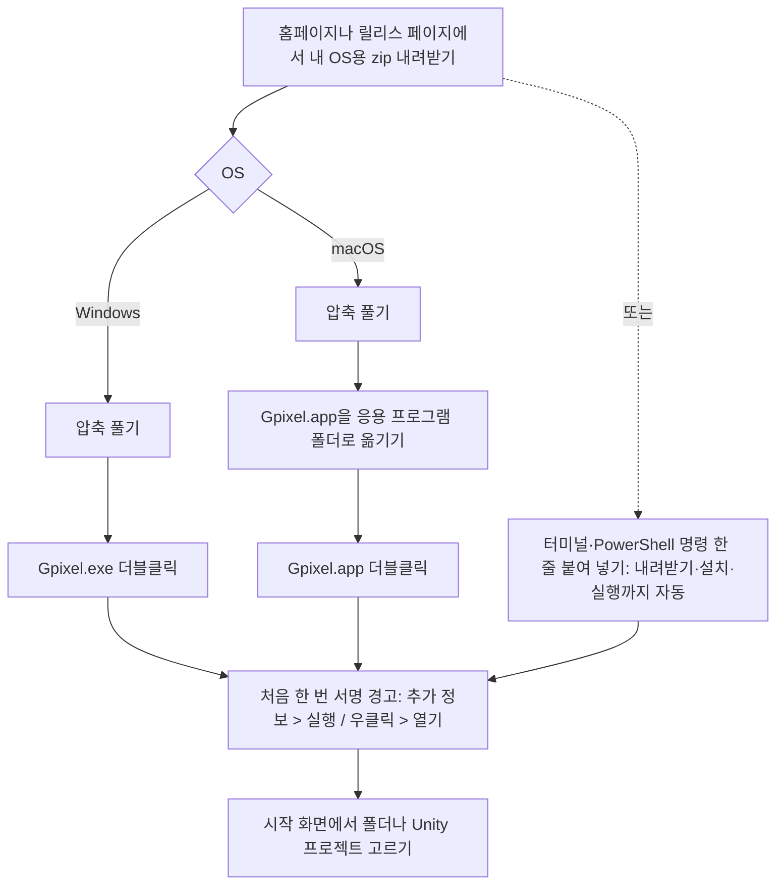
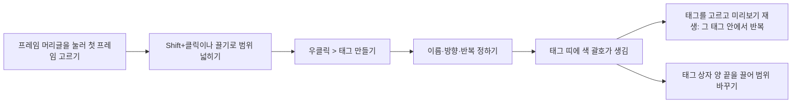
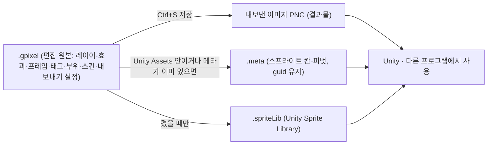
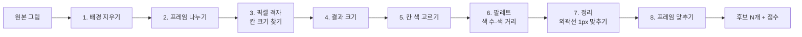
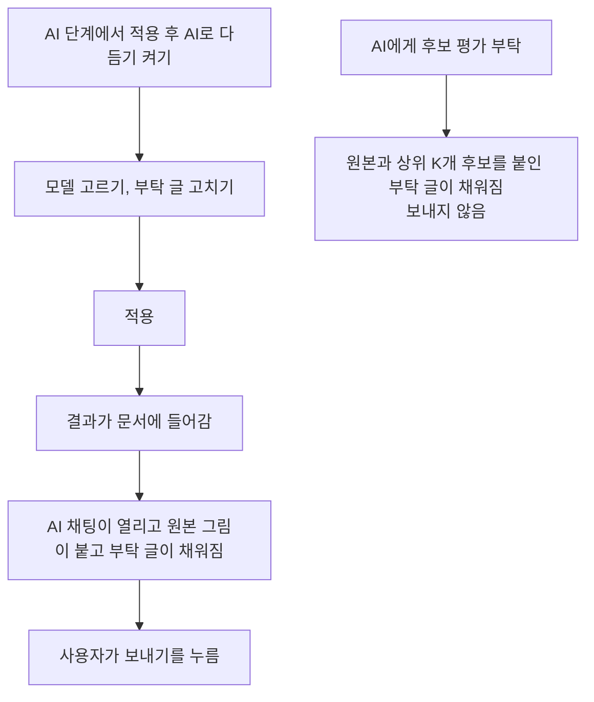
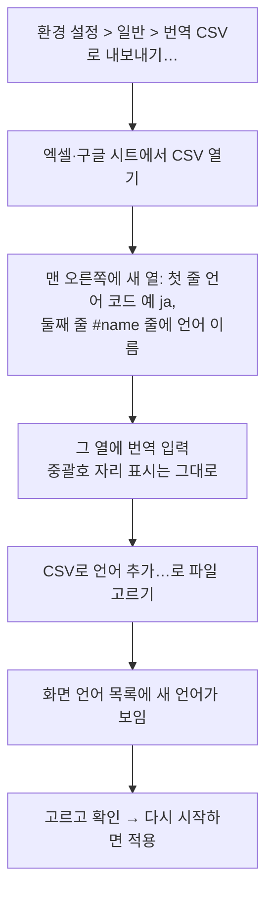
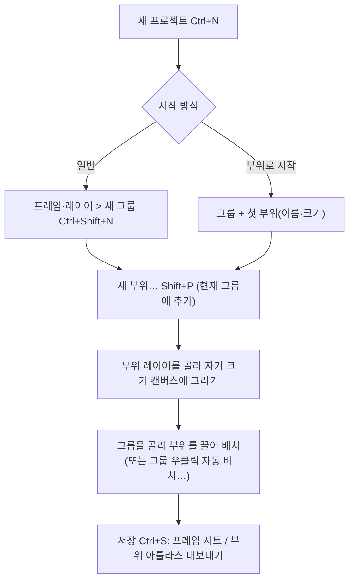
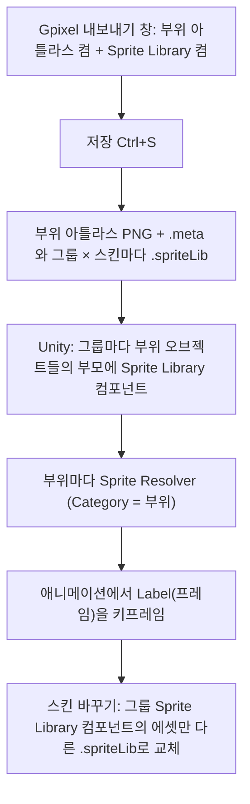
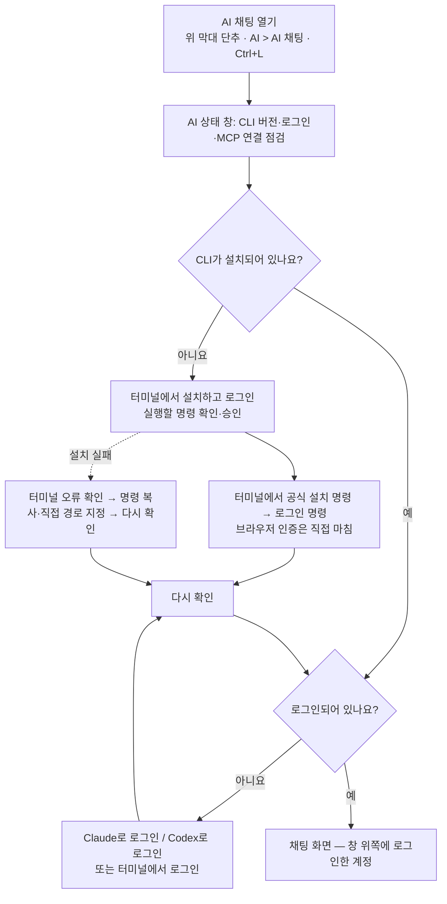

# 가이드 이미지 목록

사용 가이드(원본 `docs/i18n/guide.*` → 홈페이지 `docs/guide.html`·`docs/en/guide.html`, 앱 안 F1)의 쪽마다 넣은 그림 목록입니다. 모두 가이드 본문에 넣었습니다(`<figure class="shot">`, F1은 `python tools/build-docs.py`(→ build-help.py)가 만든 WebP).

- 그림 위치: `docs/assets/guide/<이름>.png`. 영어 화면 한 벌을 한국어·영어 가이드가 같이 씁니다. 이름은 가이드 쪽 id이고, 여러 장이면 `-2`, `-3`이 붙습니다.
- 움짤 위치: 받은 녹화를 30fps 움직이는 WebP로 바꿔 `docs/assets/guide/<이름>.webp`(홈페이지)와 `src/Gpixel.App/Assets/Help/media/<이름>.webp`(F1)에 두고, 가이드 그 쪽 끝에 `<figure class="clip">`으로 넣었습니다. 만드는 법은 `DEVELOPMENT.md`.
- 표시: 글이 설명하는 곳에 빨간 테두리와 빨간 동그라미 번호를 붙이고, 번호는 한 쪽의 그림 여러 장에 걸쳐 이어집니다. 그림 아래 설명(`figcaption`)과 본문이 같은 번호(①②…)로 가리킵니다.
- 다시 찍기: `dotnet run --project tools/GuideShots`(일부만이면 `-- screen- parts-`처럼 id 앞부분). 실제 Gpixel 화면을 화면 없이 띄워 찍으므로 UI를 바꾼 뒤 다시 돌리면 그대로 갱신됩니다(macOS에서도 Windows 모습). 그다음 `python tools/build-docs.py`. 사용법은 `tools/GuideShots/README.md`.
- 예시 그림은 늑대귀 모험가(`tools/GuideShots/Sample/wolf.png`)입니다. 화면에 보이는 경로는 사용자 이름이 나오지 않게 예시 파일 폴더(Windows `C:\GpixelGuide\MyGame`, macOS `/tmp/GpixelGuide/MyGame`)나 `D:\MyGame\…`, `%APPDATA%\…` 같은 예시 경로로 찍었습니다.
- 형태: 이미지 / 여러 장 / 워크플로우(그림 대신 흐름도·순서) / 움짤 요청(직접 녹화 필요) / 그림 불필요. 확인 `[x]`는 찍은 그림을 열어 보고 맞는지 확인한 것입니다.

## 직접 찍어 주실 것 (움짤·OS 화면)

장마다 아래 "움짤 요청"에 시작 상태·동작·길이를 자세히 적었습니다. 모아 보면 다음과 같습니다.

- [ ]  `start-first-run` — 정지 화면 2장: Windows "PC 보호" 창(추가 정보 > 실행), macOS "확인되지 않은 개발자" 창
- [X]  `screen-common-controls` — 숫자 칸 끌기·Shift 끌기·입력·우클릭 목록
- [ ]  `screen-file-browser` — 끌어 여러 파일 고르기 → 캔버스로 끌어 놓기
- [X]  `screen-tabs` — 탭 순서 바꾸기 → 끌어 두 칸 나누기 → 닫아서 풀기
- [X]  `screen-timeline-select` — 셀 끌어 고르기·Shift+클릭
- [X]  `screen-timeline-edit` — 프레임 끌어 옮기기·셀 묶음 옮기기·Ctrl 복사
- [X]  `screen-tags` — 태그 만들기 → 범위 끌기 → 재생
- [X]  `screen-layer-effects` — 타임라인 효과 상자 끝·몸통 끌기, 두 번 눌러 효과 창
- [ ]  `tools-basics` — Shift+클릭 직선, 반대 버튼으로 획 취소
- [ ]  `tools-gradient` — 캔버스에서 끌어 칠하기, 정지점 더하기
- [X]  `tools-transform` — Ctrl+T 회전·크기 조절·Enter
- [X]  `tools-canvas-size` — 손잡이 끌어 넓히기·자르기, 그림 옮기기
- [ ]  `files-drop-layer` — 탐색기에서 그림을 캔버스로 끌어 놓기
- [ ]  `pixelate-open` — 빈 창에 그림 끌어 놓아 후보가 채워지기까지
- [ ]  `pixelate-optimize` — 자동 최적화 실행·끝·되돌리기
- [ ]  `pixelate-view` — 칸 강조·색 견본 좌/우클릭·스포이드·크게 보기
- [ ]  `pixelate-output` — 적용 → 새 레이어 변형 모드 → Enter
- [ ]  `shortcuts-customize` — 단축키 검색·바꾸기·겹침 확인·기본값
- [ ]  `parts-arrange` — 부위 위 마우스·끌어 옮기기·방향키·더블클릭
- [ ]  `parts-auto-layout` — 부위 추가 시 다시 배치, 손으로 옮기면 묻는 창
- [ ]  `parts-skin-manager` — 스킨 카드 바꾸기·순서 끌기·부위 전용 스킨
- [ ]  `parts-outfits` — 착장 줄·Alt+[ / ]·착장 프리셋
- [ ]  `ai-overview` — 실제 로그인 상태에서 외곽선 부탁 한 차례
- [ ]  `ai-chat` — 그림 칩 붙여 넣기·끌어 놓기·미리보기·빼기
- [ ]  `ai-help` — 도움말 칸 열기·예시 부탁 넣기·닫기
- [ ]  `ai-generate` — Codex 그림 생성 → 변환 → 결과 카드

## 찍으면서 발견한 앱 문제

그림이 아니라 앱을 고쳐야 하는 것들입니다(아직 고치지 않음).

- 영어 화면: 앱 휴지통의 "Delete permanently" 단추 글자가 잘리고, "1 items now"처럼 복수형이 틀림.
- 영어 화면: 도구 설정의 "Diamond" 브러시 단추 글자가 잘림. 픽셀로 정리 넣기 단계의 "New layer in the current document (from the current frame)"이 설정 칸 너비(380px)에서 잘림.
- 기본 스킨 이름이 코드에 한국어로 고정(`Layer.DefaultSkinName = "기본"`)이라 영어 화면에서도 스킨 칩에 "기본"이 보임(영어 그림은 촬영 때만 Default로 바꿈).
- AI 상태 창의 확인 단추 글자가 두 언어 모두 잘림("확인하고 AI …" / "Continue to A…").
- 효과 창의 기본/커스텀 탭 머리글만 큰 기본 글꼴 크기로 보임.
- 픽셀로 정리: 일반 후보는 처음 체크한 프리셋(OKLCH1000, 점수용 색상 가중 1000)으로 점수를 매기는데, 이 기준에서는 "큰 면 색 바뀜"이 모든 후보에서 27 안팎(나쁨 100%)으로 커져 점수 차이에 기여하지 못함.
- 영어 복수형이 틀린 곳: "1 frames"(픽셀로 정리 후보), "1 colors excluded", "1 effects selected", "includes 1 effects above", "1 layers × Frames 5~6", "1 cells"(저장 상태), "cleaned up 1 old outputs".
- 영어 화면 글자 잘림: 픽셀로 정리 설정 칸(380px)의 "Use detected as manual"·두 번째 Offset 칸·"Min area"·"Max contrast"·"Auto (split by empty spac…"; 효과 창 기본 크기의 "Apply perma…"·"Expand keepi…"·"Outside (beyond the imag…"·"Edge light and s…"·피격 번쩍임 반복 단위 글자; 자동 배치 창의 "Vertical alignm…"·"Horizontal layo…"; GIF 내보내기 창 배경 묶음(300px 칸)의 투명 설명과 `#FFFFFF` 칸; AI 채팅 머리줄 계정 글자(470~520px 폭에서 "you@exa…").
- 영어 이름이 맞지 않음: 채우기·스포이드의 기준 목록 이름이 "Anchor"(가이드는 Source), 도구 이름 "Dodge/burn"과 묶음 이름 "Lighten/darken", 스마트 선택 묶음 제목 "Smart selection (same settings as fill)", 패널 머리 "Tool settings"(가이드는 Tool options). 부위 전용 스킨 표시가 "(Part only)"·"(individual)"·"Individual"로 제각각.
- 프레임 메뉴의 범위 표시가 머리글은 "Frames 5~6", 항목은 "Frames 5–6"으로 다름.
- 픽셀로 정리: CHANGELOG v1.14.38의 "원본·후보 칸 우클릭으로 PNG 저장·복사"가 코드에 없음(창에 우클릭 메뉴가 없음). 가이드 자동 최적화 설명의 기본값(Defaults) 단추도 실제로는 모두 선택/모두 해제 단추뿐. 프리셋 목록이 아무것도 고르지 않은 채 열림.
- 변형 중에는 미리보기와 타임라인 썸네일에 들어 올린 픽셀이 안 보임(의도일 수 있음).
- 내보내기 창 미리보기 머리글이 "① Frame sheet", "② Part atlas"처럼 동그라미 숫자를 써서 가이드 그림의 빨간 번호와 헷갈릴 수 있음.
- 파일 브라우저가 메인 창을 닫은 뒤에도 폴더 감시를 계속함(한 프로세스에서 다음 샷이 같은 폴더에 저장하다 멈춤 — 촬영 도구는 샷마다 프로세스를 나눠 피함). 설치 확인 창의 명령은 OS를 직접 확인해 `Platform.IsMac`을 따르지 않음.

## 대표 기능 (featured-*)

대표 기능 장은 이미 홈페이지·F1에 영상(또는 움짤)이 들어 있어 새로 찍지 않았습니다.


| 쪽 id                       | 제목                   | 형태      | 그림                          | 확인 | 설명                                         |
| --------------------------- | ---------------------- | --------- | ----------------------------- | ---- | -------------------------------------------- |
| `featured-number-field`     | 숫자 칸 바꾸는 법      | 기존 움짤 | `feature-number-field.gif`    | [x]  | 클릭 입력·끌기·우클릭 목록                 |
| `featured-ai-draw`          | AI로 그리기            | 기존 영상 | `feature-ai-draw.mp4`         | [x]  | Codex 채팅으로 나무 통 그리기                |
| `featured-pixelate-convert` | 이미지를 픽셀 아트로   | 기존 영상 | `feature-pixelate.mp4`        | [x]  | 붙여 넣기 → 후보 → 크게 보기 비교          |
| `featured-pixelate-colors`  | 색 빼기·더하기        | 기존 영상 | `feature-pixelate-colors.mp4` | [x]  | 쓰인 곳 보기·색 빼기·원본에서 집기         |
| `featured-effects`          | 효과 겹치기            | 기존 영상 | `feature-effects.mp4`         | [x]  | 효과 여러 개 쌓고 범위 정하기                |
| `featured-clip`             | 효과 클리핑            | 기존 영상 | `feature-clip.mp4`            | [x]  | 바로 위 효과에 클리핑                        |
| `featured-palette-web`      | Lospec 팔레트 가져오기 | 기존 영상 | `feature-palette.mp4`         | [x]  | 팔레트 웹 둘러보고 가져오기                  |
| `featured-palette-convert`  | 팔레트로 색 바꾸기     | 기존 영상 | `feature-convert.mp4`         | [x]  | 팔레트 색으로 변환 창                        |
| `featured-skins`            | 스킨 관리              | 기존 영상 | `feature-skins.mp4`           | [x]  | 스킨 칩·스킨 관리 창으로 갈아 끼우기        |
| `featured-skins-tiles`      | 타일·아이템 스킨      | 기존 영상 | `feature-skins-tiles.mp4`     | [x]  | 블록·아이템 부위와 종류별 스킨              |
| `featured-pivot`            | 피벗 연동              | 기존 영상 | `feature-pivot.mp4`           | [x]  | 피벗 옮기고 그 피벗으로 회전                 |
| `featured-export`           | 내보내기               | 기존 영상 | `feature-export.mp4`          | [x]  | 스킨 따로·한 장 모으기, 미리보기·파일 목록 |

## 시작하기 (start)


| 쪽 id             | 제목                | 형태             | 그림                                                                                                        | 확인 | 설명                                                                                                                                                                                                                                                                                                |
| ----------------- | ------------------- | ---------------- | ----------------------------------------------------------------------------------------------------------- | ---- | --------------------------------------------------------------------------------------------------------------------------------------------------------------------------------------------------------------------------------------------------------------------------------------------------- |
| `start-install`   | 설치                | 워크플로우       | -                                                                                                           | -    | 내려받기·압축 풀기·실행은 앱 밖(브라우저·탐색기·Finder) 단계라 앱 화면 그림 대신 아래 워크플로우. 설치가 끝난 첫 화면은`start-first-run.png`                                                                                                                                                    |
| `start-first-run` | 처음 실행할 때      | 이미지+움짤 요청 | `start-first-run.png` (①~④)                                                                               | [x]  | 문서 없이 켠 첫 화면: ① 폴더 열기 ② 최근 폴더 ③ 파일 브라우저(그림 목록이 나오는 곳) ④ Unity Hub 프로젝트 목록. 목록 내용은 예시 값(D:\MyGame 등). Windows "PC 보호"·macOS "확인되지 않은 개발자" 경고 창은 OS 화면이라 사용자 촬영 필요(아래 요청)                                            |
| `start-update`    | 업데이트            | 여러 장          | `start-update.png` (①), `start-update-2.png` (②~⑥), `start-update-3.png` (⑦), `start-update-4.png` (⑧) | [x]  | 1: 위 막대의 "Update 1.x.y" 단추 2: 업데이트 창 — ② 지금 업데이트 ③ 나중에 ④ 다음 업데이트까지 띄우지 않기 ⑤ 새/지금 버전 줄 ⑥ 바뀐 점(오프라인이라 릴리스 정보는 CHANGELOG.md에서 만든 예시) 3: 도움말 메뉴 ⑦ 업데이트 확인… 4: 환경 설정 > 일반의 업데이트 부분 ⑧ 시작할 때 새 버전 확인 |
| `start-privacy`   | 네트워크와 개인정보 | 이미지           | `start-privacy.png` (①)                                                                                    | [x]  | 환경 설정 > 일반 전체, ① 시작할 때 새 버전 확인(업데이트 확인을 끄는 곳). 개발 빌드 안내 문구는 릴리스 문구로 바꿔 찍음. 팔레트 웹·AI 채팅 창은 각 장의 그림                                                                                                                                      |
| `start-feedback`  | 제보·아이디어      | 여러 장          | `start-feedback.png` (①~③), `start-feedback-2.png` (④~⑥)                                                | [x]  | 1: ① 도움말 메뉴 ② 제보·아이디어 (Discord)… ③ Gpixel 정보… 2: Gpixel 정보 창 ④ Discord ⑤ 문제 신고(GitHub Issues) ⑥ 버전. 설정 파일 경로는 %APPDATA%\Gpixel\settings.json으로 바꿔 찍음                                                                                                    |

### 움짤 요청

- `start-first-run` — 정지 화면 두 장(움짤 아님): Windows에서 처음 Gpixel.exe를 실행했을 때 뜨는 "Windows의 PC 보호" 창에서 "추가 정보"를 누른 뒤 "실행" 단추가 보이는 상태, macOS에서 Gpixel.app 우클릭 > 열기로 뜨는 "확인되지 않은 개발자" 확인 창. 앱 밖 OS 창이라 자동 촬영 불가.

### 워크플로우

`start-install`



## 화면 구성 (screen)


| 쪽 id                    | 제목                        | 형태              | 그림                                                                                                                                                                                                                                                                                                                            | 확인 | 설명                                                                                                                                                                                                                                                                                                                                                                                                                                                                                                                                                                                                                                          |
| ------------------------ | --------------------------- | ----------------- | ------------------------------------------------------------------------------------------------------------------------------------------------------------------------------------------------------------------------------------------------------------------------------------------------------------------------------- | ---- | --------------------------------------------------------------------------------------------------------------------------------------------------------------------------------------------------------------------------------------------------------------------------------------------------------------------------------------------------------------------------------------------------------------------------------------------------------------------------------------------------------------------------------------------------------------------------------------------------------------------------------------------- |
| `screen`                 | 화면 구성(장 첫 그림)       | 이미지            | `screen-overview.png`(①~⑪)                                                                                                                                                                                                                                                                                                    | [x]  | 전체 창(파일 브라우저 예시 폴더, 6프레임·태그·그룹 프로젝트): ① 메뉴와 위 막대 · ② 도구 막대 · ③ 파일 브라우저 · ④ 팔레트 · ⑤ 색 · ⑥ 문서 탭 · ⑦ 캔버스 · ⑧ 타임라인 · ⑨ 미리보기 · ⑩ 도구 설정 · ⑪ 상태 표시줄                                                                                                                                                                                                                                                                                                                                                                                                        |
| `screen-top-bar`         | 메뉴와 위 막대              | 여러 장           | `screen-top-bar.png`(①~⑥), `screen-top-bar-2.png`(⑦), `-3`(⑧), `-4`(⑨), `-5`(⑩), `-6`(⑪)                                                                                                                                                                                                                                 | [x]  | 1) 위 막대: ① 도구 이름 · ② 사용법 · ③ 보기 옵션 · ④ 확대율 상자 · ⑤ 맞추기 · ⑥ AI 채팅 2) ⑦ 확대율 상자 우클릭 목록 3~6) 보기 단추 우클릭 설정 팝업: ⑧ 격자 · ⑨ 타일 격자 · ⑩ 타일 모드 · ⑪ 양파(표의 줄마다 한 장). 피벗 단추는 설정 팝업이 없음                                                                                                                                                                                                                                                                                                                                                                         |
| `screen-common-controls` | 숫자 칸과 메뉴 다루기       | 이미지+움짤 요청  | `screen-common-controls.png`(①②)                                                                                                                                                                                                                                                                                              | [x]  | ① 도구 설정의 크기 숫자 칸 · ② 우클릭 자주 쓰는 값 목록(지금 값 4 px에 점). 좌우로 끌어 값 바꾸기는 움짤로                                                                                                                                                                                                                                                                                                                                                                                                                                                                                                                                 |
| `screen-toolbar`         | 도구 막대                   | 이미지            | `screen-toolbar.png`(①~⑤)                                                                                                                                                                                                                                                                                                     | [x]  | ① 폴더 단추 · ② 도형 묶음 칸 · ③ 우클릭으로 펼친 목록(선·사각형·원) · ④ 저장 · ⑤ 되돌리기(수정된 상태라 켜짐)                                                                                                                                                                                                                                                                                                                                                                                                                                                                                                                      |
| `screen-file-browser`    | 파일 브라우저               | 여러 장+움짤 요청 | `screen-file-browser.png`(①~⑦), `-2`(⑧⑨), `-3`(⑩~⑮), `-4`(⑯~⑱)                                                                                                                                                                                                                                                          | [x]  | 1) ① 폴더 트리 · ② 썸네일 목록 · ③ 검색 · ④ 하위 폴더 포함 · ⑤ 제목 줄 아이콘 셋 · ⑥ .gpixel 배지 · ⑦ 빨간 점 2) ⑧ 두 개 고름 · ⑨ 우클릭 메뉴 3) 합치기 창: ⑩ 순서 · ⑪ 이름 · ⑫ 방식 · ⑬ 캔버스·기준점·원본 삭제 · ⑭ 미리보기 · ⑮ 타임라인 모양 4) 앱 휴지통: ⑯ 목록·미리보기 · ⑰ 되살리기·영구 삭제·비우기 · ⑱ 보관 정책. 폴더 경로는 D:\MyGame\Assets\Sprites로 바꿔 찍음. Unity Hub 목록 창은 Unity Hub가 있어야 해서 찍지 않음                                                                                                                                                                       |
| `screen-palette`         | 팔레트                      | 여러 장           | `screen-palette.png`(①~⑦), `-2`(⑧), `-3`(⑨~⑫)                                                                                                                                                                                                                                                                              | [x]  | 1) ① 기본색/보조색 · ② 쌓인 팔레트(그림에서 만든 팔레트) · ③ 새 팔레트 · ④ 머리글 · ⑤ 활성 팔레트 파란 줄 · ⑥ 기본색 칸 · ⑦ 보조색 칸 2) ⑧ 머리글 메뉴 3) 팔레트 색으로 변환 창: ⑨ 대상 · ⑩ 디더링 · ⑪ 전·후 미리보기 · ⑫ 색 수. 팔레트 웹(Lospec) 창은 인터넷이 필요해 찍지 않음                                                                                                                                                                                                                                                                                                                                       |
| `screen-color-picker`    | 색 고르기                   | 여러 장           | `screen-color-picker.png`(①~⑦), `-2`(⑧), `-3`(⑨), `-4`(⑩)                                                                                                                                                                                                                                                                  | [x]  | 같은 색(#5B6EE1). 1) ① 알파 막대 · ② RGB · ③ HSV · ④ A·HEX · ⑤ 최근 색 · ⑥ 방식 탭 · ⑦ 사각형 2~4) ⑧ 벌집 · ⑨ 색상환 · ⑩ 슬라이더(표의 줄마다)                                                                                                                                                                                                                                                                                                                                                                                                                                                                             |
| `screen-canvas`          | 캔버스                      | 여러 장           | `screen-canvas.png`(①②), `-2`(③~⑨), `-3`(⑩)                                                                                                                                                                                                                                                                                | [x]  | 1) 보석 부위 레이어를 고른 화면: ① 부위 · ② 반투명한 나머지 2) 700%에서 ③ 체커 · ④ 픽셀 격자 · ⑤ 타일 격자 · ⑥ 대칭 안내선 · ⑦ 피벗 · ⑧ 선택 영역 · ⑨ 양파 껍질 3) ⑩ 타일 모드(가운데 칸). H로 이전 프레임 보기는 그림 불필요                                                                                                                                                                                                                                                                                                                                                                                                |
| `screen-tabs`            | 문서 탭과 나누기            | 여러 장+움짤 요청 | `screen-tabs.png`(①~⑤, 2배 확대), `-2`(⑥), `-3`(⑦~⑨)                                                                                                                                                                                                                                                                       | [x]  | 1) ① 탭 제목 · ② 빨간 점 · ③ 전체 경로 도움말 · ④ 닫기 X · ⑤ + 2) ⑥ 탭 우클릭 메뉴 3) 좌우로 나눔: ⑦ 옮기기 단추 · ⑧ 오른쪽 칸 · ⑨ 포커스된 칸의 강조색 선. 탭 끌어 옮기기·나누기는 움짤로                                                                                                                                                                                                                                                                                                                                                                                                                                    |
| `screen-timeline`        | 타임라인                    | 여러 장           | `screen-timeline.png`(①~⑬), `screen-timeline-2.png`(⑭⑮), `screen-timeline-3.png`(⑯), `screen-timeline-4.png`(⑰), `screen-timeline-5.png`(번호 없음), `screen-timeline-6.png`(⑱)                                                                                                                                          | [x]  | 1) 타임라인(그림자 레이어 잠금, 4번 프레임 재생 중): ① 눈 · ② 자물쇠 · ③ 불투명도 · ④ 그룹 접기 삼각형 · ⑤ 부위 들여쓰기 · ⑥ 프레임 번호·길이 · ⑦ 썸네일 · ⑧ 태그 띠 · ⑨ 빈 프레임 추가 · ⑩ 마지막 프레임 복사 · ⑪ 빈 레이어 추가 · ⑫ 맨 아래 레이어 복사 · ⑬ 재생 중인 프레임(초록) 2) 프레임 1~3을 고르고 머리글 우클릭: ⑭ 메뉴 맨 위 선택 표시 · ⑮ 우클릭한 머리글 3) ⑯ 그림이 있는 셀 우클릭 메뉴 4) ⑰ 레이어 이름 우클릭 메뉴 5) 레이어 메뉴의 불투명도… 창 6) ⑱ 왼쪽 위 빈 칸 우클릭(새로 만들기)                                                                                                      |
| `screen-timeline-select` | 타임라인에서 고르기         | 여러 장+움짤 요청 | `screen-timeline-select.png`(①), `screen-timeline-select-2.png`(②③)                                                                                                                                                                                                                                                          | [x]  | 1) ① 고른 프레임 2~4(상태 표시줄 안내도 보임) 2) ② 셀 묶음(레이어 2개 × 프레임 2~3) · ③ 상태 표시줄 안내. 끌어서 사각형으로 고르기는 움짤로                                                                                                                                                                                                                                                                                                                                                                                                                                                                                              |
| `screen-timeline-edit`   | 타임라인 편집               | 여러 장+움짤 요청 | `screen-timeline-edit.png`(①②), `screen-timeline-edit-2.png`(③④)                                                                                                                                                                                                                                                            | [x]  | 1) 셀 묶음 우클릭(복사해 둔 뒤라 붙여넣기 켜짐): ① 고른 셀 묶음 · ② 셀 복사·잘라내기·붙여넣기 2) 빈 셀 우클릭: ③ 빈 셀 · ④ 이전 프레임 그림 복사. 순서 바꾸기·셀 묶음 옮기기/복사는 끄는 동작이라 움짤로                                                                                                                                                                                                                                                                                                                                                                                                                             |
| `screen-tags`            | 태그                        | 여러 장+움짤 요청 | `screen-tags.png`(①②), `screen-tags-2.png`(③~⑥), `screen-tags-3.png`(⑦⑧)                                                                                                                                                                                                                                                  | [x]  | 1) hit 태그를 지운 뒤 프레임 5~6을 고르고 머리글 우클릭: ① 고른 프레임 · ② 태그 만들기… 2) 새 태그 창: ③ 이름 · ④ 프레임 범위 · ⑤ 방향·반복 · ⑥ 색 3) ⑦ idle 태그 상자 · ⑧ 태그 우클릭 메뉴(태그 속성…·이 태그 재생·삭제). 범위 끌어 바꾸기는 움짤로, 태그 만들기 순서는 아래 워크플로우                                                                                                                                                                                                                                                                                                                                    |
| `screen-layer-effects`   | 레이어 효과                 | 여러 장+움짤 요청 | `screen-layer-effects.png`(①②), `screen-layer-effects-2.png`(③~⑤), `screen-layer-effects-3.png`(번호 없음), `screen-layer-effects-4.png`(⑥~⑭), `screen-layer-effects-5.png`(⑮), `screen-layer-effects-6.png`(⑯⑰), `screen-layer-effects-7.png`(⑱), `screen-layer-effects-8.png`(⑲), `screen-layer-effects-9.png`(⑳) | [x]  | 1) 몸 레이어 이름 우클릭: ① 효과…(2) · ② fx 2) 피격 번쩍임 설정: ③ 색 칸 · ④ 일반색/그라데이션(목록 펼침) · ⑤ 바로 위 효과에 클리핑 3) 색 칸을 누른 색 팝업 4) 효과 창 전체: ⑥ 효과 종류 · ⑦ 커스텀 탭 · ⑧ 추가 범위 · ⑨ 효과 목록과 단추 · ⑩ 설정 · ⑪ 전·후 미리보기와 재생 · ⑫ 프레임 줄 · ⑬ 캔버스 확대 · ⑭ 프레임 늘리기 5) 커스텀 탭(예시 효과 묶음 Gold outline·Hurt): ⑮ 전체 효과 저장 6) 타임라인: ⑯ 효과 줄 · ⑰ 피격 번쩍임 상자(프레임 5~6) 7) 셀 5~6 우클릭: ⑱ 효과 추가… 8) ⑲ 효과 상자 우클릭 메뉴 9) 상자 밖 빈 칸 우클릭: ⑳ 여기까지 늘리기·여기부터 복사본 추가. 효과 상자 끌기는 움짤로 |
| `screen-preview`         | 미리보기                    | 여러 장           | `screen-preview.png`(①~④), `-2`(⑤), `-3`(⑥)                                                                                                                                                                                                                                                                                 | [x]  | 1) ① 재생 화면 · ② FPS · ③ 배율 단추 · ④ 배경(그룹 없는 프로젝트라 착장 줄 없음) 2) ⑤ 그림 위 우클릭 메뉴 3) ⑥ 배경 목록                                                                                                                                                                                                                                                                                                                                                                                                                                                                                                             |
| `screen-export`          | 내보내기 창                 | 여러 장           | `screen-export.png`(①~⑥), `-2`(⑦~⑪), `-3`(⑫~⑯), `-4`(⑰), `-5`(⑱)                                                                                                                                                                                                                                                        | [x]  | 내보낼 결과 = 둘 다. 1) ① 내보내기 단추 · ② 내보내기 탭 · ③ Import Settings 탭 · ④ 설정 · ⑤ 결과 미리보기 · ⑥ 나눔줄 2) 묶음을 모두 접은 모습: ⑦ 공통 · ⑧ 파일 · ⑨ 프레임 시트 · ⑩ 부위 아틀라스 · ⑪ 고급 3) 공통 묶음: ⑫ 칸 수 · ⑬ 정렬 · ⑭ 따로 파일 · ⑮ 칸 이름 · ⑯ 스킨(스킨 고르기) 4) ⑰ 프리셋 팝업 5) ⑱ Import Settings 탭                                                                                                                                                                                                                                                                              |
| `screen-gif`             | GIF 애니메이션으로 내보내기 | 여러 장           | `screen-gif.png`(①~⑥), `screen-gif-2.png`(⑦)                                                                                                                                                                                                                                                                                 | [x]  | 1) ① 범위 · ② 배율 · ③ 반복 · ④ 배경 · ⑤ 미리보기 · ⑥ 결과 정보 2) ⑦ 태그 고르기 목록                                                                                                                                                                                                                                                                                                                                                                                                                                                                                                                                             |
| `screen-tool-settings`   | 도구 설정                   | 여러 장           | `screen-tool-settings.png`(①②), `-2`(③~⑥)                                                                                                                                                                                                                                                                                   | [x]  | 1) 연필: ① 제목 줄 · ② 그 도구의 설정 2) 피벗 도구: ③ 대상 · ④ 5×5 단추 · ⑤ X·Y · ⑥ 현재 프레임만 따로                                                                                                                                                                                                                                                                                                                                                                                                                                                                                                                            |
| `screen-status-bar`      | 상태 표시줄                 | 이미지            | `screen-status-bar.png`(①~⑦)                                                                                                                                                                                                                                                                                                  | [x]  | 캔버스 위에 마우스를 올린 상태: ① 좌표 · ② 색 · ③ 크기 · ④ 프레임/레이어 · ⑤ 확대율 · ⑥ 저장 상태 · ⑦ 안내                                                                                                                                                                                                                                                                                                                                                                                                                                                                                                                       |

### 움짤 요청

- `screen-common-controls` — 도구 설정의 브러시 크기(또는 위 막대 확대율) 칸을 좌우로 끌어 값이 바뀌는 모습, Shift를 누르고 천천히 끌기, 클릭해 글자로 입력, 우클릭 목록에서 값 고르기. 연필 도구가 고른 상태에서 시작, 8초쯤.
- `screen-file-browser` — 목록 빈 곳에서 끌어 사각형으로 여러 파일 고르기 → 고른 파일 하나를 캔버스로 끌어 놓아 새 레이어로 들어가는 모습. 예시 폴더를 연 상태에서 시작, 8초쯤.
- `screen-tabs` — 탭을 좌우로 끌어 순서 바꾸기 → 탭 하나를 캔버스 오른쪽 끝으로 끌어 놓아 두 칸으로 나뉘는 모습 → 한쪽 마지막 탭을 닫아 나눔이 풀리는 모습. 탭 세 개를 연 상태에서 시작, 10초쯤.
- `screen-timeline-select` — 셀 위를 누른 채 끌어 사각형으로 고르기, Shift+클릭으로 넓히기, 빈 곳 클릭으로 풀기. 6프레임 프로젝트에서 시작, 8초쯤.
- `screen-timeline-edit` — 이미 고른 프레임 머리글을 끌어 다른 자리로 옮기기(다른 열이 비켜 섬) → 셀 묶음을 끌어 옮기기 → Ctrl을 누른 채 놓아 복사하기. 6프레임 프로젝트에서 시작, 10초쯤.
- `screen-tags` — 프레임 머리글 2~4를 끌어 고르고 우클릭 "태그 만들기…"로 태그 만들기 → 태그 상자 안쪽 끝에 마우스를 대 좌우 화살표 커서가 되면 끌어 범위 늘리기 → 태그를 고르고 미리보기 재생. 8~10초.
- `screen-layer-effects` — 타임라인 효과 줄에서 효과 상자 오른쪽 끝을 끌어 범위 바꾸기 → 몸통을 끌어 통째로 옮기기 → 상자 두 번 눌러 효과 창 열기. 효과가 있는 레이어에서 시작, 8초쯤.

### 워크플로우

`screen-file-browser` — 여러 그림을 .gpixel 하나로 합치기

1. 파일 브라우저에서 Ctrl+클릭(또는 Shift+클릭, 끌어 사각형)으로 파일을 2개 이상 고릅니다.
2. 고른 파일 위에서 우클릭 > **N개 합치기…**를 고릅니다.
3. 합치기 창에서 순서(위 = 먼저)와 이름을 확인하고, 방식(레이어로 / 그룹으로 / 스킨으로 / 프레임으로)을 고릅니다.
4. 필요하면 캔버스 크기·기준점을 정하고, 원본을 치울 거면 **원본 삭제**를 켭니다(앱 휴지통으로 감).
5. 미리보기와 "타임라인에서는 이렇게 보입니다"를 확인하고 **합치기**를 누르면 첫 파일 폴더에 `<이름>.gpixel`이 만들어져 새 탭으로 열립니다.

`screen-tags` — 태그로 애니메이션 묶기



## 도구 (tools)


| 쪽 id               | 제목                   | 형태              | 그림                                                                                                | 확인 | 설명                                                                                                                                                                                                                                                                                                                                  |
| ------------------- | ---------------------- | ----------------- | --------------------------------------------------------------------------------------------------- | ---- | ------------------------------------------------------------------------------------------------------------------------------------------------------------------------------------------------------------------------------------------------------------------------------------------------------------------------------------- |
| `tools-list`        | 도구 목록              | 여러 장           | `tools-list.png`(①②), `tools-list-2.png`(③~⑭)                                                   | [x]  | 1) 창 전체: ① 도구 막대 · ② 도구 설정(연필) 2) 도구 막대 칸마다 번호(표의 도구 이름 앞 번호와 같음): ③ 연필 ~ ⑭ 9-slice, 묶음 칸은 한 번호(⑤ 채우기·그라데이션, ⑦ 도형, ⑧ 선택)                                                                                                                                              |
| `tools-basics`      | 그리기 기본            | 여러 장+움짤 요청 | `tools-basics.png`(①~④), `tools-basics-2.png`(⑤~⑧)                                              | [x]  | 1) 좁힌 창(1180×720): ① 기본색 · ② 보조색 · ③ 도구 설정의 오른쪽 버튼 = 지우개 · ④ 위 막대의 도구 안내 2) 펼친 편집 메뉴: ⑤ 외곽선 추가 · ⑥ 색 바꾸기 · ⑦ 뒤집기·회전 4개 · ⑧ 캔버스 크기                                                                                                                             |
| `tools-groups`      | 도구 묶음              | 이미지            | `tools-groups.png`(①~④)                                                                           | [x]  | ① 채우기 묶음 · ② 도형 묶음 · ③ 선택 묶음 칸 · ④ 선택 묶음을 우클릭해 펼친 목록(사각·원·자유·스마트 선택과 단축키)                                                                                                                                                                                                          |
| `tools-brush`       | 브러시 설정            | 여러 장           | `tools-brush.png`(①~③), `tools-brush-2.png`(④), `tools-brush-3.png`(⑤), `tools-brush-4.png`(⑥) | [x]  | 1) 연필: ① 모양(원) · ② 픽셀 미리보기 · ③ 크기 7 2) 사각형: ④ 선 두께·펜 모양 3) 밝게/어둡게: ⑤ 세기 4) 디더링: ⑥ 무늬 목록 펼침                                                                                                                                                                                             |
| `tools-select`      | 선택 도구              | 여러 장           | `tools-select.png`(①), `tools-select-2.png`(②), `tools-select-3.png`(③④)                        | [x]  | 1) ① 사각 선택으로 머리를 고른 점선 테두리 2) ② 자유 선택을 끄는 중(파란 점선으로 선택될 영역) 3) ③ 스마트 선택으로 고른 머리카락 영역 · ④ 스마트 선택 설정(채우기와 같음)                                                                                                                                                       |
| `tools-fill`        | 채우기                 | 여러 장           | `tools-fill.png`(①~④), `tools-fill-2.png`(⑤)                                                     | [x]  | 1) 채우기 도구 설정: ① 허용 오차 · ② 이어진 영역만 · ③ 대각선으로도 잇기 · ④ 기준(목록 펼침) 2) ⑤ 스포이드의 기준                                                                                                                                                                                                             |
| `tools-gradient`    | 그라데이션             | 여러 장+움짤 요청 | `tools-gradient.png`(①~⑦), `tools-gradient-2.png`(⑧~⑩), `tools-gradient-3.png`(⑪~⑭)           | [x]  | 1) 캐릭터 아래 새 레이어에 끄는 중(안내선): ① 시작점 · ② 끝점 · ③ 그라데이션 바 · ④ 위치·삭제 · ⑤ 색 · ⑥ 보간 · ⑦ 디더링 2) 바 우클릭 프리셋 메뉴: ⑧ 현재 그라데이션 저장 · ⑨ 저장된 프리셋 · ⑩ 프리셋 관리 3) 프리셋 관리 창: ⑪ 목록 · ⑫ 즐겨찾기·이름 바꾸기·삭제 · ⑬ 미리보기·편집 · ⑭ 변경 내용 저장 |
| `tools-transform`   | 변형 모드 (회전·크기) | 여러 장+움짤 요청 | `tools-transform.png`(①~⑧), `tools-transform-2.png`(⑨~⑪)                                        | [x]  | 1) 머리를 선택해 Ctrl+T 후 18도 돌린 상태: ① 안쪽 · ② 네모 손잡이 · ③ 테두리 바깥(회전) · ④ 회전 중심 · ⑤ 적용 · ⑥ 취소 · ⑦ 각도·가로/세로 %·중심 · ⑧ 리샘플링 2) 프레임 4개를 머리글로 골라 함께 변형: ⑨ 고른 셀 · ⑩ 모든 셀을 감싸는 손잡이 사각형 · ⑪ 상태 표시줄의 셀 수                                    |
| `tools-canvas-size` | 캔버스 크기 모드       | 이미지+움짤 요청  | `tools-canvas-size.png`(①~⑬), 움짤 `tools-canvas-size-slice.webp` | [x]  | 캔버스를 69×88로 넓히고 아래를 잘라 낸 상태: ① 하늘색 점선 테두리 · ② 흐린 잘릴 부분 · ③ 손잡이 · ④ 그림 안쪽 · ⑤ 확인 · ⑥ 취소 · ⑦ 캔버스 가로/세로 · ⑧ 캔버스 중심 기준 · ⑨ 9-slice로 늘리기(예시는 테두리 없어 꺼짐) · ⑩ 그림 가로/세로 · ⑪ 그림 비율 유지 · ⑫ 그림 위치 · ⑬ 기준점 9방향                                                                |
| `tools-nine-slice`  | 9-slice                | 이미지            | `tools-nine-slice.png`(①~④)                                                                       | [x]  | 예시 UI 단추(32×20): ① L5·T5·R5·B6 초록 선 4개 · ② L·T·R·B 값 · ③ 모두 0 · ④ 적용 대상                                                                                                                                                                                                                                  |

### 움짤 요청

- `tools-basics` — 늑대귀 모험가를 연 상태에서 연필로 한 점을 찍고 Shift를 누른 채 다른 곳을 클릭해 직선이 이어지는 모습, 이어서 왼쪽 버튼으로 긋는 중에 오른쪽 버튼을 눌러 획이 취소되는 모습(약 6~8초).
- `tools-gradient` — 사각 선택으로 빈 영역(또는 새 레이어)을 고른 뒤 그라데이션 도구로 시작점에서 끝점까지 끌어 칠하고, 바 아래 빈 곳을 눌러 색 정지점을 더해 결과가 바뀌는 모습(약 8초).
- `tools-transform` — 머리를 사각 선택한 뒤 Ctrl+T, 테두리 바깥을 끌어 회전, 모서리 손잡이를 Shift+끌기로 크기 조절, Enter로 적용(약 8~10초).
- `tools-canvas-size` — Ctrl+Alt+C로 들어가 오른쪽 손잡이를 끌어 여백을 늘리고, 아래 손잡이를 위로 끌어 발이 흐려지는 모습, 그림 안쪽을 끌어 옮긴 뒤 Enter(약 8~10초). 받은 녹화 둘째: 9-slice 도구로 선을 정하고 캔버스 크기 모드에서 9-slice로 늘이고 줄이기, 가운데 채우기를 되풀이로(`tools-canvas-size-slice.webp`).

## 파일 · 저장 · 내보내기 (files)

그림은 영어 화면 한 벌(한국어·영어 가이드가 같이 씀)이고, 빨간 번호(①②…)는 쪽마다 그림 여러 장에 걸쳐 이어지며 본문의 번호와 같습니다. 예시 파일 폴더 경로는 촬영 때의 `GUIDESHOTS_ROOT`(예: `/tmp/...`)가 그대로 보입니다.


| 쪽 id              | 제목                            | 형태               | 그림                                                              | 확인 | 설명                                                                                                                                                                                                                                                                                                                                                                                          |
| ------------------ | ------------------------------- | ------------------ | ----------------------------------------------------------------- | ---- | --------------------------------------------------------------------------------------------------------------------------------------------------------------------------------------------------------------------------------------------------------------------------------------------------------------------------------------------------------------------------------------------- |
| `files-roles`      | 파일의 종류                     | 워크플로우         | -                                                                 | -    | 그림 없음: 파일 브라우저는 프로젝트가 내보낸 PNG·.meta를 프로젝트 하나로 묶어 보여 줘 표의 네 종류가 한 화면에 따로 보이지 않음 — 아래 흐름도로 보완                                                                                                                                                                                                                                        |
| `files-save`       | 저장하기                        | 여러 장+워크플로우 | `files-save.png`, `files-save-2.png`, `files-save-3.png`          | [x]  | ① 파일 메뉴의 저장(+ 시트 내보내기) Ctrl+S ② 저장 뒤 상태 표시줄 "Saved: ….gpixel → frames ….png 1 cells" ③ 내보낼 자리에 같은 이름 폴더를 둬 시트 내보내기만 실패시킨 "Save failed" 창                                                                                                                                                                                                 |
| `files-autosave`   | 자동 저장                       | 여러 장            | `files-autosave.png`, `files-autosave-2.png`                      | [x]  | ① 자동 저장이 돈 뒤 상태 표시줄 "Autosaved (….gpixel)" ② 환경 설정 > 일반 > 저장의 자동 저장 체크 ③ 기다리는 시간(초)                                                                                                                                                                                                                                                                     |
| `files-revert`     | 저장한 내용으로 되돌리기        | 여러 장            | `files-revert.png`, `files-revert-2.png`, `files-revert-3.png`    | [x]  | ① 수정한 뒤 켜진 도구 막대 맨 아래 되돌리기 단추(상태 표시줄 Modified) ② 파일 메뉴의 Revert to saved ③ 되돌릴지 묻는 창의 Yes                                                                                                                                                                                                                                                              |
| `files-history`    | 닫아도 남는 실행취소 기록       | 이미지             | `files-history.png`                                               | [x]  | 환경 설정 > 일반 > 실행취소 기록: ① 기록 남기기 ② 보관 기간 ③ 최대 용량 ④ 기록 모두 지우기                                                                                                                                                                                                                                                                                                |
| `files-png-import` | PNG 열기(가져오기)              | 여러 장            | `files-png-import.png` ~ `files-png-import-4.png`                 | [x]  | ①② 칸이 모두 같은 크기인 시트를 열 때 묻는 창(As parts / As animation frames) ③ 프레임·레이어 메뉴의 격자로 나눠 프레임 만들기 ④ 나누는 방법 목록을 편 창 ⑤ 칸 크기 ⑥ 칸 수 ⑦ 자동 기준 최소 크기                                                                                                                                                                                     |
| `files-open-media` | 그림·움직이는 그림·영상 열기  | 여러 장            | `files-open-media.png` ~ `files-open-media-5.png`                 | [x]  | ① 파일 메뉴의 열기 Ctrl+O ②③④ 움직이는 GIF(만든 예시 slime_bounce.gif, 4프레임)를 연 새 문서의 새 탭·파일 이름 레이어·프레임 ⑤ 320프레임 GIF를 열 때 묻는 창 ⑥⑦⑧ 환경 설정 > 영상(ffmpeg) 탭·실행 파일 칸·찾아보기 ⑨~⑮ 영상 가져오기 창(구간·초당 프레임·최대 프레임 수·크기·부드럽게·예상치·가져오기, 예시 값). ffmpeg 탭의 "Using ffmpeg: …" 경로는 촬영한 컴퓨터의 것 |
| `files-drop-layer` | 캔버스에 그림 끌어 놓기         | 여러 장+움짤 요청  | `files-drop-layer.png`, `files-drop-layer-2.png`                  | [x]  | ① 끄는 중: 캔버스 둘레 빛남과 들어갈 자리 점선 사각형(하트 그림) ② 놓은 뒤 새 레이어 "heart" ③ 바로 들린 변형 모드 ④ 상태 표시줄 안내                                                                                                                                                                                                                                                     |
| `files-cleanup`    | 옛 결과 정리와 파일 이름 바꾸기 | 여러 장            | `files-cleanup.png`, `files-cleanup-2.png`, `files-cleanup-3.png` | [x]  | ① 내보낼 이름을 바꾸고 다시 저장한 뒤 "cleaned up 1 old outputs (app trash)" 상태 표시줄 ② 파일 목록 우클릭 Restore last deleted ③ View app trash… ④ 앱 휴지통 창의 옮겨진 옛 결과 ⑤ Restore                                                                                                                                                                                            |
| `files-cell-names` | 내보낼 칸 이름                  | 여러 장            | `files-cell-names.png`, `files-cell-names-2.png`                  | [x]  | ① 타임라인 프레임 머리 우클릭 메뉴의 Export cell name… ② 칸 이름 입력란                                                                                                                                                                                                                                                                                                                    |
| `files-quit`       | 끝낼 때 저장 묻기               | 이미지             | `files-quit.png`                                                  | [x]  | ① 저장하지 않은 파일 2개(썸네일·이름) ② Save selected files ③ Don't save ④ Cancel                                                                                                                                                                                                                                                                                                        |
| `files-settings`   | 환경 설정                       | 여러 장            | `files-settings.png` ~ `files-settings-4.png`                     | [x]  | ① 편집 메뉴의 Preferences… ②~⑥ 일반 탭(실행취소 횟수·실행취소 기록·자동 저장·앱 휴지통 보관) ⑦~⑩ 단축키 탭(save 검색, Change·Add·None·Default, JSON 내보내기·불러오기) ⑪ 겹치는 키(Ctrl+S)를 줄 때 묻는 창                                                                                                                                                                      |
| `files-crash-log`  | 오류가 생겼을 때                | 여러 장            | `files-crash-log.png`, `files-crash-log-2.png`                    | [x]  | ① 예시 오류로 띄운 "you can keep working" 창(로그 파일 이름) ② Open log folder ③ Report on Discord ④ 도움말 메뉴의 Open error log folder                                                                                                                                                                                                                                                  |

### 움짤 요청

- `files-drop-layer` — 늑대귀 모험가를 연 상태에서 탐색기의 작은 PNG를 캔버스 위로 끌어 오며 점선 사각형이 따라 움직이는 모습, 놓은 뒤 변형 모드로 크기를 조금 맞추고 Enter(약 6~8초).

### 워크플로우

`files-roles` — 저장 한 번으로 생기는 파일



`files-save` — Ctrl+S를 누르면

1. 저장한 적 없는 새 프로젝트면 저장 위치를 묻습니다(가져온 PNG는 같은 폴더의 같은 이름 `.gpixel`로 바로 저장).
2. `.gpixel`을 씁니다.
3. 설정에 따라 이미지를 내보내고, Unity `Assets` 안이거나 메타가 이미 있으면 `.meta`도 씁니다(guid·spriteID는 이름 기준으로 유지).
4. 더 이상 만들지 않게 된 옛 결과는 앱 휴지통으로 옮깁니다.
5. 결과를 상태 표시줄에 보여 줍니다. 이미지 내보내기만 실패하면 그 사실을 알립니다.

## AI 그림 픽셀로 정리 (pixelate)

예시 원본은 늑대귀 모험가를 7~8px 칸으로 고르지 않게 키우고 흐리게 해 밝은 배경에 JPEG로 저장한 "AI 그림 같은" 그림입니다(451×813 → 49×98, 17색으로 정리). 자동 최적화 그림은 촬영 시간을 줄이려고 프리셋 2개·시도 120번만 돌린 결과입니다. 그림은 영어 화면 한 벌이고, 빨간 번호(①②…)는 쪽마다 그림 여러 장에 걸쳐 이어지며 본문의 번호와 같습니다. 원본·후보 그림에는 우클릭 메뉴(PNG 저장·복사)가 없어(앱에 그런 메뉴가 없음) 찍지 않았습니다. 색 견본 우클릭은 메뉴 없이 바로 색 빼기라 뺀 상태를 찍었습니다.


| 쪽 id                 | 제목               | 형태               | 그림                                                                                                            | 확인 | 설명                                                                                                                                                                                                                                                                                                                                                                                                                                                         |
| --------------------- | ------------------ | ------------------ | --------------------------------------------------------------------------------------------------------------- | ---- | ------------------------------------------------------------------------------------------------------------------------------------------------------------------------------------------------------------------------------------------------------------------------------------------------------------------------------------------------------------------------------------------------------------------------------------------------------------ |
| `pixelate-open`       | 여는 방법          | 여러 장+움짤 요청  | `pixelate-open.png`, `pixelate-open-2.png`, `pixelate-open-3.png`, `pixelate-open-4.png`, `pixelate-open-5.png` | [x]  | 1) AI 메뉴의 AI 그림 픽셀로 정리 ① 2) 원본 없이 연 빈 창: 가운데 안내 ②, 파일 찾기 ③, 꺼진 적용 ④·자동 최적화 ⑤ 3) 편집 메뉴의 현재 레이어를 픽셀로 정리 ⑥ 4) 파일 브라우저에서 그림 파일 ⑦ 우클릭 메뉴의 AI 그림 픽셀로 정리 ⑧ 5) 원본이 들어온 창의 원본 바꾸기 ⑨                                                                                                                                                                                |
| `pixelate-settings`   | 설정 단계          | 여러 장+워크플로우 | `pixelate-settings.png`, `pixelate-settings-2.png` ~ `pixelate-settings-6.png`                                  | [x]  | 1) 접힌 설정 칸 막대 ① 2) 1. 배경 지우기 ②·2. 프레임 나누기 ③ 펼침 3) 3. 픽셀 격자 ④·4. 결과 크기 ⑤ 4) 5. 칸 색 고르기 ⑥·6. 팔레트 ⑦, 그 안의 색 거리 ⑧·명암 계열 우선 ⑨ 5) 7. 정리 ⑩와 외곽선 1px 맞추기 목록을 펼친 모습 ⑪ 6) 8. 프레임 맞추기 ⑫. 단계 순서는 아래 워크플로우                                                                                                                                                              |
| `pixelate-candidates` | 후보와 점수        | 여러 장            | `pixelate-candidates.png`, `pixelate-candidates-2.png`, `pixelate-candidates-3.png`                             | [x]  | 1) 설정 칸 후보 단계: 후보 수 ①, 바꿔 볼 항목 ② 2) 후보 칸 ③, 외곽선 맞추기 방식 이름 ④, 순위·점수 ⑤, 미리보기 아래 점수 내역 ⑥ 3) 후보 칸 툴팁의 점수 내역 ⑦                                                                                                                                                                                                                                                                                        |
| `pixelate-optimize`   | 자동 최적화        | 여러 장+움짤 요청  | `pixelate-optimize.png`, `pixelate-optimize-2.png`, `pixelate-optimize-3.png`                                   | [x]  | 1) 끝난 뒤 막대: 자동 최적화 ①, 설정 단추 ②, 최고 점수 그래프 ③, 한 줄 결과 ④, 되돌리기 ⑤, 최적화 표시 후보 ⑥ 2) 도는 중: 취소 ⑦, 진행 한 줄 ⑧ 3) 자동 최적화 설정 창: 항목 체크 ⑨, 모두 선택/해제 ⑩, 시도·초 ⑪, 점수 가중치 ⑫, 시도 기록(펼침) ⑬, 불러오면 자동 최적화 ⑭. 촬영용으로 프리셋 2개·시도 120번만 켬                                                                                                                             |
| `pixelate-view`       | 원본과 미리보기    | 여러 장+움짤 요청  | `pixelate-view.png`, `pixelate-view-2.png` ~ `pixelate-view-6.png`                                              | [x]  | 1) 전체 창: 원본 보기 ①, 큰 미리보기 ②, 색 견본 ③, 재생 조절·프레임 줄 ④, 후보 칸 ⑤ 2) 원본 아래 막대: 배경 지운 모습 ⑥, 결과 크기 자동 ⑦, 가로×세로 ⑧, 사슬 단추 ⑨, 격자 보기 ⑩ 3) 픽셀 격자의 칸 경계 지역 보정 ⑪ 4) 색 하나를 뺀 견본 줄: 뺀 견본 ⑫, "색 빼기 1개 · 모두 되살리기" ⑬, 원본에서 색 추가(+) ⑭ 5) 배경 지우기의 스티커 테두리 지우기 ⑮·배경 남기기 ⑯ 6) 크게 보기: 결과 칸 ⑰, 원본 칸 ⑱, 격자 보기 단추 ⑲, 색 견본 ⑳ |
| `pixelate-output`     | 넣기               | 여러 장+움짤 요청  | `pixelate-output.png`, `pixelate-output-2.png`                                                                  | [x]  | 1) 넣기 단계: 현재 문서에 새 레이어 ①, 새 문서 ②, 프레임 길이 ③, 새 팔레트로도 저장 ④ 2) 창 아래 새 탭에 추가 ⑤·적용 ⑥                                                                                                                                                                                                                                                                                                                                |
| `pixelate-ai`         | AI로 다듬기 (실험) | 여러 장+워크플로우 | `pixelate-ai.png`, `pixelate-ai-2.png`                                                                          | [x]  | 1) AI(실험) 단계: 적용 후 AI로 다듬기 ①, 부탁 글 ②, 모델 ③, AI 참고 자료에 더하기 ④, AI에게 후보 평가 부탁 ⑤, 보낼 후보 수 ⑥ 2) 모델 목록(Claude·Codex)을 펼친 모습 ⑦                                                                                                                                                                                                                                                                                |
| `pixelate-presets`    | 프리셋             | 여러 장            | `pixelate-presets.png`, `pixelate-presets-2.png`                                                                | [x]  | 1) 프리셋 목록을 펼친 모습(기본·작은 스프라이트(32px)·색 적게(16색)·원본 색 유지) ①, 저장(+) ②, 삭제 ③ 2) 저장할 때 묻는 프리셋 이름 창 ④                                                                                                                                                                                                                                                                                                             |

## 단축키 (shortcuts)


| 쪽 id                 | 제목                   | 형태              | 그림                                                                                                                                                                 | 확인 | 설명                                                                                                                                                                                                                                                                                                                                                                                                                                                                    |
| --------------------- | ---------------------- | ----------------- | -------------------------------------------------------------------------------------------------------------------------------------------------------------------- | ---- | ----------------------------------------------------------------------------------------------------------------------------------------------------------------------------------------------------------------------------------------------------------------------------------------------------------------------------------------------------------------------------------------------------------------------------------------------------------------------- |
| `shortcuts-customize` | 단축키 바꾸기          | 여러 장+움짤 요청 | `shortcuts-customize.png` (①~⑩), `shortcuts-customize-2.png` (⑪), `shortcuts-customize-3.png` (⑫), `shortcuts-customize-4.png` (⑬), `shortcuts-customize-5.png` | [x]  | 1: 환경 설정 > ① 단축키 탭, 검색 칸 ⑦에 "export"로 거른 목록, "Export as animated GIF" 줄의 ② 바꾸기 ③ 추가 ④ 없음 ⑤ 기본값과 ⑥ 키를 기다리는 칸, ⑧ 모두 기본값 ⑨ 내보내기(JSON) ⑩ 불러오기(JSON) 2: 그 줄에서 Ctrl+E를 누르자 뜬 ⑪ 겹치는 키 물음(File/Export…) 3: 바꾼 키(Ctrl+Alt+G)가 보이는 파일 메뉴 ⑫ 4: 도움말 메뉴 ⑬ 단축키 목록 5: 단축키 목록 창(번호 없음). 본문 목록에서 "내보내기/불러오기"와 "겹치는 키" 항목 순서를 번호 순서에 맞춰 바꿈 |
| `shortcuts-file`      | 파일과 창              | 이미지            | `shortcuts-file.png` (①)                                                                                                                                            | [x]  | 파일 메뉴를 펼쳐 새 프로젝트…~닫기의 ① 키 열 표시(표 아래 한 줄 설명 추가)                                                                                                                                                                                                                                                                                                                                                                                            |
| `shortcuts-edit`      | 편집과 선택            | 이미지            | `shortcuts-edit.png` (①)                                                                                                                                            | [x]  | 편집 메뉴, 실행취소~선택 해제의 ① 키 열                                                                                                                                                                                                                                                                                                                                                                                                                                |
| `shortcuts-transform` | 변형과 이미지          | 이미지            | `shortcuts-transform.png` (①)                                                                                                                                       | [x]  | 편집 메뉴, 좌우 뒤집기~캔버스 크기의 ① 키 열                                                                                                                                                                                                                                                                                                                                                                                                                           |
| `shortcuts-tools`     | 도구                   | 이미지            | `shortcuts-tools.png` (①②)                                                                                                                                         | [x]  | 도구 메뉴, ① 도구 키(연필 B~9-slice S) ② 도구 옵션·브러시 크기·색 교환 키                                                                                                                                                                                                                                                                                                                                                                                           |
| `shortcuts-view`      | 보기와 캔버스          | 이미지            | `shortcuts-view.png` (①)                                                                                                                                            | [x]  | 보기 메뉴, 확대~양파 껍질의 ① 키 열                                                                                                                                                                                                                                                                                                                                                                                                                                    |
| `shortcuts-timeline`  | 타임라인·레이어·그룹 | 이미지            | `shortcuts-timeline.png` (①)                                                                                                                                        | [x]  | 프레임·레이어 메뉴, 재생/정지~다음 스킨의 ① 키 열                                                                                                                                                                                                                                                                                                                                                                                                                     |

## 언어 (language)


| 쪽 id             | 제목                      | 형태               | 그림                                                                                        | 확인 | 설명                                                                                                                                                                                                              |
| ----------------- | ------------------------- | ------------------ | ------------------------------------------------------------------------------------------- | ---- | ----------------------------------------------------------------------------------------------------------------------------------------------------------------------------------------------------------------- |
| `language-change` | 화면 언어 바꾸기          | 여러 장+워크플로우 | `language-change.png` (①), `language-change-2.png` (②~④), `language-change-3.png` (⑤⑥) | [x]  | 1: 편집 메뉴 ① 환경 설정… 2: 환경 설정 > 일반 전체, ② 언어 부분 ③ 펼친 화면 언어 목록(한국어·English) ④ 확인 3: 확인 뒤 묻는 창 ⑤ 지금 다시 시작 ⑥ 나중에(창만 직접 띄워 찍고 닫음 — 다시 시작하지 않음) |
| `language-make`   | 새 언어 만들기            | 여러 장+워크플로우 | `language-make.png` (①②), `language-make-2.png` (③)                                      | [x]  | 1: 언어 부분 ① 번역 CSV로 내보내기… ② CSV로 언어 추가… 2: 일본어 열(ja, 문구 3개)을 더한 CSV를 넣은 뒤 펼친 목록의 ③ 日本語 (ja)와 아래 넣은 결과 글(파일 고르기 창 대신 같은 처리를 직접 부름)              |
| `language-fix`    | 내장 문구 고치기와 지우기 | 이미지             | `language-fix.png` (①)                                                                     | [x]  | 언어 부분 ① 언어 폴더 열기                                                                                                                                                                                       |

### 움짤 요청 (픽셀로 정리·단축키)

- `pixelate-open` — 시작: AI > AI 그림 픽셀로 정리…로 연 빈 창과 옆에 탐색기. 탐색기에서 AI 그림 파일 하나를 창에 끌어 놓으면 원본이 보이고 후보 칸이 하나씩 채워지는 데까지. 약 6초.
- `pixelate-optimize` — 시작: 원본을 넣고 후보가 다 나온 창(최적화 설정에서 "빠른 확인" 프리셋만 체크해 짧게). 자동 최적화를 누르면 단추가 취소로 바뀌고 그래프가 오르며 진행 글이 바뀌다가, 끝나고 "최적화" 표시 후보가 들어오고 왼쪽 설정이 바뀌는 데까지, 이어서 되돌리기를 한 번 누름. 약 10~15초.
- `pixelate-view` — 시작: 후보를 고른 창. 왼쪽 원본의 칸 위로 마우스를 움직여 결과 픽셀 강조 보이기, 색 견본 좌클릭(결과에서 그 색 강조), 견본 우클릭(색 빼기 → 다시 우클릭으로 되살리기), 끝의 + 눌러 스포이드로 원본 칸 하나 집기(고정 색), 마지막으로 결과 그림을 눌러 크게 보기에서 휠 확대·끌기. 약 15~20초.
- `pixelate-output` — 시작: 문서가 열린 메인 창 위의 정리 창(넣기 = 현재 문서에 새 레이어). 적용을 누르면 창이 닫히고 결과가 새 레이어로 들어와 변형 모드가 되며, 조금 옮긴 뒤 Enter로 확정하는 데까지. 약 8초.
- `shortcuts-customize` — 시작: 환경 설정 > 단축키 탭. 검색 칸에 명령 이름 입력 → 그 줄의 바꾸기 → 키 누르기(다른 명령이 쓰는 키면 빼도 되는지 묻는 창에서 예) → 바뀐 키가 굵게 보임 → 기본값으로 되돌리기. 약 8초.

### 워크플로우 (픽셀로 정리·언어)

`pixelate-settings` — 단계는 왼쪽 위에서 아래로 차례로 적용되고, 값을 바꾸면 약 0.3초 뒤 처음부터 다시 만듭니다.



`pixelate-ai` — AI로 다듬기는 넣은 뒤 채팅을 준비만 하고, 보내기는 사용자가 합니다.



`language-change`

1. 편집 > 환경 설정…(Ctrl+,)을 엽니다. 일반 탭 맨 위가 언어입니다.
2. 화면 언어 목록에서 언어를 고릅니다.
3. 확인을 누릅니다.
4. 묻는 창에서 지금 다시 시작을 누르면 앱이 닫혔다가 새 언어로 켜집니다(저장하지 않은 문서가 있으면 먼저 물음). 나중에를 고르면 다음에 켤 때 적용됩니다.

`language-make`



## 부위(그룹) 레이어 · 스킨 (parts)

예시 프로젝트: 늑대귀 모험가(49×98)를 Head/Body/Legs 부위로 잘라 "Character" 그룹에 넣고(스킨: Default·knight·zombie, Head 전용 "Hat"), 그 위 "Gear" 그룹(스킨: None·Sword, 부위 Weapon), 착장 프리셋 "Knight set"·"Zombie", 머리가 까딱이는 4프레임 idle 태그. 만드는 코드는 `tools/GuideShots/Shots/PartsSample.cs`. 영어 화면 한 벌을 한국어·영어 가이드가 같이 씀. 내보내기 창의 경로 글자는 임시 폴더 대신 `D:\MyGame\Assets\Characters`로 바꿔 찍음. 빨간 번호는 쪽마다 이어지며 가이드 글의 ①②…와 같음.


| 쪽 id                  | 제목                                  | 형태               | 그림                                                                                                                                             | 확인 | 설명                                                                                                                                                                                                                                                                                                                       |
| ---------------------- | ------------------------------------- | ------------------ | ------------------------------------------------------------------------------------------------------------------------------------------------ | ---- | -------------------------------------------------------------------------------------------------------------------------------------------------------------------------------------------------------------------------------------------------------------------------------------------------------------------------- |
| `parts-concept`        | 그룹과 부위                           | 이미지             | `parts-concept.png`(①~⑤)                                                                                                                       | [x]  | 그룹 "Character"를 고른 캔버스+타임라인: ① 그룹 행 ② 부위 행 ③ 부위 크기 글자 ④ Head 프레임 칸 ⑤ 캔버스의 Head 자리                                                                                                                                                                                                   |
| `parts-create`         | 만들기                                | 여러 장+워크플로우 | `parts-create.png`(①②), `parts-create-2.png`(③④), `parts-create-3.png`(⑤⑥), `parts-create-4.png`(⑦⑧)                                     | [x]  | 1) 새 프로젝트 창 ① 부위로 시작 ② 첫 부위 이름·크기 2) 프레임·레이어 메뉴 ③ 새 그룹 ④ 새 부위… 3) 새 부위 창 ⑤ 이름 ⑥ 크기 4) 그룹 우클릭 메뉴 ⑦ 새 그룹 ⑧ 부위 추가…                                                                                                                                          |
| `parts-timeline`       | 타임라인에서 보기                     | 이미지             | `parts-timeline.png`(①~⑤)                                                                                                                      | [x]  | 타임라인만: ① 접기 삼각형 ② 그룹 합성 썸네일 ③ 들여 쓴 부위 행 ④ 그룹 스킨 칩 ⑤ 보이기·잠금                                                                                                                                                                                                                          |
| `parts-arrange`        | 배치하기(그룹 선택)                   | 이미지+움짤 요청   | `parts-arrange.png`(①~④)                                                                                                                       | [x]  | 그룹 화면(크게): ① 마우스 올린 Legs(점선 + 이름표) ② 클릭해 고른 Head(파란 실선) ③ 부위 피벗(파랑) ④ 프레임 피벗(주황)                                                                                                                                                                                                 |
| `parts-draw`           | 그리기(부위 선택)                     | 여러 장            | `parts-draw.png`(①②), `parts-draw-2.png`(③), `parts-draw-3.png`(④⑤), `parts-draw-4.png`(⑥), `parts-draw-5.png`(⑦)                         | [x]  | 1) Head 부위 화면 ① 타임라인 Head 행 ② 자기 크기로 보이는 Head 2) 프레임·레이어 메뉴 ③ 부위 크기… 3) 부위 우클릭 ④ 크기… ⑤ 위치… 4) 부위 크기 창 ⑥ 기준점 9방향 5) 도구 막대 ⑦ 피벗·9-slice 도구                                                                                                               |
| `parts-auto-layout`    | 자동 배치                             | 여러 장+움짤 요청  | `parts-auto-layout.png`(①), `parts-auto-layout-2.png`(②~⑩), `parts-auto-layout-3.png`(⑪)                                                     | [x]  | 1) 그룹 우클릭 ① 자동 배치… 2) 자동 배치 창 ② 미리 보기 ③ 적용 ④~⑩ 설정 표의 줄(방향·맞춤·배치·간격 여백·순서·영역·숨긴 부위) 3) 적용 뒤 가로로 늘어선 부위 + ⑪ 그룹 행 마름모(캔버스를 136px로 넓히고 Gear 그룹은 숨긴 상태)                                                                                 |
| `parts-export`         | 내보내기: 프레임 시트와 부위 아틀라스 | 이미지             | `parts-export.png`(①~⑤)                                                                                                                        | [x]  | 내보내기 창을 세로로 키워 왼쪽 설정 전부: ① 프레임 시트 묶음 ② 부위 아틀라스 묶음 ③ 내보낼 결과 ④ 부위 아틀라스 이름 ⑤ 공통 설정 제목. 오른쪽 미리 보기 제목의 ①②는 앱 글자(같은 뜻)                                                                                                                                |
| `parts-skins`          | 스킨과 슬롯                           | 이미지+워크플로우  | `parts-skins.png`(①~③)                                                                                                                         | [x]  | 지금 스킨 knight: ① 그룹 스킨 칩 ② 위에 겹치는 Gear 그룹 ③ 첫 스킨에서 물려받아 흐린 Head 칸                                                                                                                                                                                                                            |
| `parts-per-part`       | 부위마다 따로 고르기와 부위 전용 스킨 | 여러 장            | `parts-per-part.png`(①~③), `parts-per-part-2.png`(④⑤), `parts-per-part-3.png`(⑥~⑧), `parts-per-part-4.png`(⑨), `parts-per-part-5.png`(⑩) | [x]  | 1) Head만 zombie: ① Body 칩(그룹 따름) ② Head 칩(파랑) ③ 그룹 칩 2) 스킨 관리 창 Character 상자 ④ This part's skins ⑤ 개별 Hat 카드 3) 부위 우클릭 ⑥ 이 부위 스킨 하위 메뉴 ⑦ 이 부위 스킨… ⑧ Hat (individual) 4) Hat 카드 우클릭 ⑨ 전체 스킨으로 올리기 5) Head 줄 knight 카드 우클릭 ⑩ Head 전용으로 내리기… |
| `parts-skin-manager`   | 스킨 관리 창                          | 여러 장+움짤 요청  | `parts-skin-manager.png`(①~③), `parts-skin-manager-2.png`(④~⑦), `parts-skin-manager-3.png`(⑧~⑪)                                            | [x]  | 1) 메인 창 전체 + 프레임·레이어 메뉴: ① 스킨 칩 ② 스킨 관리… ③ 착장 줄 관리… 2) 창 위쪽 ④ 전체 착장 ⑤ 그룹 스킨 카드 ⑥ 새 스킨 ⑦ 복제 3) 창 전체 + zombie 카드 우클릭 ⑧ 이름 바꾸기·삭제·앞으로/뒤로 ⑨ 부위별 ⑩ 없음 카드 ⑪ 보기 거르기                                                                    |
| `parts-outfits`        | 착장 바꾸기와 착장 프리셋             | 여러 장+움짤 요청  | `parts-outfits.png`(①), `parts-outfits-2.png`(②), `parts-outfits-3.png`(③), `parts-outfits-4.png`(④~⑥)                                      | [x]  | 1) 미리보기 ① 착장 줄 2) 그룹 우클릭 ② 스킨 하위 메뉴 3) 부위 우클릭 ③ 이 부위 스킨 하위 메뉴 4) 스킨 관리 창 착장 프리셋 ④ 지금 착장 저장… ⑤ 프리셋 카드 ⑥ Zombie 카드 우클릭 메뉴(덮어쓰기·이름·삭제·순서)                                                                                                     |
| `parts-skin-export`    | 스킨 내보내기                         | 여러 장            | `parts-skin-export.png`(①~⑤), `parts-skin-export-2.png`(⑥~⑧)                                                                                 | [x]  | 1) 내보내기 창 ① 지금 착장 ② 고른 스킨 ③ 스킨 고르기… ④ 한 이미지 ⑤ 따로 파일, 오른쪽에 스킨마다 한 줄씩 늘어난 프레임 시트 2) 스킨 고르기 창 ⑥ 스킨 ⑦ 착장 프리셋 ⑧ 물려받은 칸도 이 스킨 스프라이트로                                                                                                           |
| `parts-sprite-library` | Unity Sprite Library                  | 이미지+워크플로우  | `parts-sprite-library.png`(①②)                                                                                                                 | [x]  | 부위 아틀라스 묶음 ① Sprite Library 켬 ②`<부위 아틀라스>_<그룹>@<스킨>.spriteLib` 결과 경로                                                                                                                                                                                                                              |
| `parts-import`         | 예전 파일과 PNG 가져오기              | 여러 장            | `parts-import.png`(①②), `parts-import-2.png`(③)                                                                                               | [x]  | 1) 칸 크기가 서로 다른 부위 아틀라스 PNG(+ .meta)를 연 결과: ① 시트 이름 그룹 하나 ② 칸마다 부위, 프레임 1개 2) 그 그림의 내보내기 창 ③ 내보낼 결과 = 부위 아틀라스. 예전 버전 아틀라스 .gpixel 변환은 그 버전 파일을 만들 수 없어 그림 없음(글로 충분)                                                                 |

### 움짤 요청

- `parts-arrange` — 예시 프로젝트를 열고 타임라인에서 "Character" 그룹을 고른 상태에서 시작. Body 위에 마우스를 올려 점선·이름표를 보이고, Head를 끌어 2~3px 옮긴 뒤 놓기, 방향키로 1px·Shift+방향키로 8px 옮기기, Head를 더블클릭해 부위 그리기 화면으로 넘어가기까지. 약 10초.
- `parts-auto-layout` — 자동 배치를 켠 그룹(타임라인 마름모 표시)에서 시작. 그룹 우클릭 "Add part…"로 새 부위를 더하면 부위들이 다시 늘어서는 모습, 이어서 부위 하나를 손으로 끌려 할 때 자동 배치를 끌지 묻는 창이 뜨는 데까지. 약 8초.
- `parts-skin-manager` — 스킨 관리 창을 메인 창 옆에 띄운 상태에서 시작. Character 그룹 카드 knight → zombie를 차례로 눌러 캔버스·미리보기가 바로 바뀌는 모습, 카드 하나를 끌어 순서 바꾸기, "Per part"를 펼쳐 Head 줄에서 "Hat" 카드 누르기. 약 12초.
- `parts-outfits` — 미리보기 아래 착장 줄이 보이는 상태에서 시작. Character 상자에서 스킨 바꾸기, Alt+[ / Alt+] 로 현재 그룹 스킨 돌리기, 스킨 관리 창의 착장 프리셋 "Zombie" → "Knight set" 카드 누르기. 약 10초.

### 워크플로우

`parts-create` — 부위 캐릭터를 처음 만드는 흐름:



`parts-skins` — 새 스킨(의상·체형) 한 벌 만들기:

1. 타임라인 그룹 스킨 칩을 누르거나 프레임·레이어 > 스킨 관리… 로 스킨 관리 창을 연다.
2. 그룹 줄에서 "새 스킨"(빈 스킨) 또는 "복제"를 누른다. 새 스킨이 지금 스킨이 된다.
3. 빈 칸은 첫 스킨 그림을 물려받아 흐리게 보이므로, 달라지는 부위(예: Body·Legs)만 골라 다시 그린다. 그리기 시작한 칸은 그 스킨 자신의 그림이 된다.
4. 착장 줄이나 Alt+[ / Alt+] 로 스킨을 바꿔 가며 확인하고, 마음에 드는 조합은 "지금 착장 저장…"으로 착장 프리셋을 만든다.
5. 내보내기 창 스킨 = "고른 스킨"으로 원하는 스킨만 체크해 내보낸다.

`parts-sprite-library` — Unity에서 스킨 바꿔 끼우기:



## AI 채팅 (Claude · Codex) (ai)

대화 장면은 진짜 채팅 창에 CLI 대신 대본 세션을 붙여 만든 예시입니다(모델 요청 없음). 도구 호출은 편집기의 진짜 AI 도구로 실행해 캔버스·실행취소·오류 문구가 실제와 같습니다. 머리줄 계정(you@example.com)과 AI 상태 창의 경로·버전은 예시 값이고, 설치 확인 창의 명령은 Windows 명령으로 바꿔 찍었습니다. 영어 화면 한 벌을 한국어·영어 가이드가 같이 씁니다. 빨간 번호(①②…)는 쪽마다 그림 여러 장에 걸쳐 이어지며 본문·그림 설명의 번호와 같습니다. 번호가 붙은 글줄을 가리지 않도록 몇 장은 그 그림에서만 대화 칸 왼쪽을 조금 띄우거나(지금 그림만·진행·탭·문제·그림 생성 진행), 풍선 도움말을 컨트롤 옆에 띄워 찍었습니다(화면 없는 촬영에는 마우스 자리가 없음).


| 쪽 id             | 제목                         | 형태               | 그림                                                                                                                                     | 확인 | 설명                                                                                                                                                                                                                                                                                                                |
| ----------------- | ---------------------------- | ------------------ | ---------------------------------------------------------------------------------------------------------------------------------------- | ---- | ------------------------------------------------------------------------------------------------------------------------------------------------------------------------------------------------------------------------------------------------------------------------------------------------------------------- |
| `ai-overview`     | 무엇을 할 수 있나요          | 이미지+움짤 요청   | `ai-overview.png` (①~③)                                                                                                                | [x]  | 메인 창 위에 채팅 창: ① "1px 흰 외곽선" 부탁 ② 외곽선이 들어간 캔버스 그림 ③ Claude·Codex 탭                                                                                                                                                                                                                    |
| `ai-open`         | 채팅 창 열기                 | 이미지             | `ai-open.png` (①~③)                                                                                                                    | [x]  | AI 메뉴를 연 위 막대: ① 위 막대 오른쪽 AI 채팅 단추 ② AI 메뉴 ③ AI 채팅(Ctrl+L) 항목                                                                                                                                                                                                                             |
| `ai-setup`        | 처음 한 번: 설치와 로그인    | 여러 장+워크플로우 | `ai-setup.png` (①~④), `ai-setup-2.png` (⑤⑥), `ai-setup-3.png` (⑦~⑨), `ai-setup-4.png` (⑩⑪), `ai-setup-5.png` (⑫)                | [x]  | 1) CLI를 못 찾은 화면: 터미널에서 설치하고 로그인·명령 복사·직접 경로 지정·다시 확인 2) 설치 단추를 누르면 뜨는 확인 창(실행할 명령·확인) 3) 첫 사용 때 뜨는 AI 상태 창(Claude Code 준비됨, Codex CLI 설치 안 됨, AI로 계속) 4) 로그인 전 Codex 탭(Codex로 로그인·터미널에서 로그인) 5) 머리줄의 로그인한 계정 |
| `ai-tabs`         | Claude 탭과 Codex 탭         | 이미지             | `ai-tabs.png` (①~③)                                                                                                                    | [x]  | Codex 탭이 작업 중일 때 Claude 탭에서 보낸 모습: ① 탭(Codex 뒤 점) ② "Codex가 작업 중" 안내 ③ 보내지 않고 남은 입력란 글                                                                                                                                                                                         |
| `ai-chat`         | 대화하기                     | 여러 장+움짤 요청  | `ai-chat.png` (①~⑦), `ai-chat-2.png` (⑧), `ai-chat-3.png` (⑨), `ai-chat-4.png` (⑩⑪), `ai-chat-5.png` (⑫⑬), `ai-chat-6.png` (⑭)  | [x]  | 1) 표 차례대로 보내기·이미지…·캔버스 첨부·모델·새 대화·물음표·연필/휴지통 2) 답을 받는 동안의 정지 3) 모델 목록(첫 칸 "기본 · 실제 모델") 4) 입력란 그림 칩과 마우스를 올린 미리보기 5) 칩을 누른 큰 그림과 첨부 빼기 6) 보낸 메시지의 칩                                                                   |
| `ai-history`      | 지난 대화 이어 하기          | 여러 장            | `ai-history.png` (①~⑤), `ai-history-2.png` (⑥)                                                                                        | [x]  | 1) 새 대화·지난 대화 목록·즐겨찾기 별·휴지통·새 대화 입력란 2) 휴지통을 누르면 묻는 창(예)                                                                                                                                                                                                                      |
| `ai-help`         | 도움말과 예시 부탁           | 여러 장+움짤 요청  | `ai-help.png` (①~③), `ai-help-2.png` (④⑤)                                                                                            | [x]  | 1) 물음표 단추·닫기 X·AI가 할 수 있는 일 2) 칸을 내린 예시 부탁·잘 쓰는 요령                                                                                                                                                                                                                                     |
| `ai-generate`     | 그림 생성 → 픽셀 변환       | 여러 장+움짤 요청  | `ai-generate.png` (①~⑥), `ai-generate-2.png` (⑦~⑭), `ai-generate-3.png` (⑮⑯), `ai-generate-4.png` (⑰⑱), `ai-generate-5.png` (⑲) | [x]  | 1) Codex 탭 그리기 설정(직접 찍기): 단추(빨간 X)·Codex CLI 상태·정보 아이콘·그림 생성·직접 찍기·팔레트 색만 사용 2) 그림 생성의 옵션(표 차례) 3) 스프라이트 시트 생성 중 진행 줄과 정지 4) 결과 카드와 변환 설정 보기 5) Claude 탭의 빨간 경고 아이콘과 풍선                                                   |
| `ai-file-only`    | 지금 그림만 고치게 하기      | 이미지             | `ai-file-only.png` (①~③)                                                                                                               | [x]  | ① 지금 그림만 ② "편집 범위: 지금 그림 …만" 안내 줄 ③ 새 그림 만들기(new_project)가 거절된 빨간 도구 줄(화면 위아래 차례로 번호)                                                                                                                                                                                 |
| `ai-locked`       | 잠긴 레이어 지키기           | 이미지             | `ai-locked.png` (①②)                                                                                                                   | [x]  | 메인 창 + 채팅: ① replace_color가 "잠겨 있어 바꿀 수 없습니다"로 거절된 줄 ② 타임라인의 주황 자물쇠                                                                                                                                                                                                               |
| `ai-progress`     | 진행 표시                    | 이미지             | `ai-progress.png` (①)                                                                                                                   | [x]  | ① "도구 호출 작성 중: draw_pixels (3.4K자) · 12초 (전체 41초)" 진행 줄                                                                                                                                                                                                                                            |
| `ai-edits`        | AI가 할 수 있는 편집         | 이미지             | `ai-edits.png` (①~③)                                                                                                                   | [x]  | "지팡이 그려 줘" 한 차례: ① get_image ② draw_shape·set_pixels 도구 줄 ③ 타임라인에 생긴 "Staff" 레이어                                                                                                                                                                                                          |
| `ai-effects`      | 레이어 효과 부탁하기         | 이미지             | `ai-effects.png` (①~④)                                                                                                                 | [x]  | 메인 창 + 채팅: ① 타임라인의 Outline 효과 줄 ② 부탁 ③ add_effect 도구 줄 ④ 이 단계 되돌리기                                                                                                                                                                                                                     |
| `ai-references`   | 참고 자료로 그림 실력 높이기 | 여러 장            | `ai-references.png` (①~⑬), `ai-references-2.png` (③), `ai-references-3.png` (⑭~⑱)                                                   | [x]  | 1) AI 참고 자료 창: 목록·검색·종류 거르기·미리보기·정보 칸·팔레트(본문 차례), 단추(표 차례), 설명 없음 알림 2) 종류 거르기 목록을 펼친 모습(③과 같은 칸) 3) 환경 설정 > AI 참고 자료 탭(폴더 칸은 %AppData% 표기로 바꿔 찍음)                                                                                 |
| `ai-undo`         | 되돌리기                     | 여러 장            | `ai-undo.png` (①②), `ai-undo-2.png` (③)                                                                                               | [x]  | 1) 답 아래 결과 그림과 이 단계 되돌리기 2) 누른 뒤: 캔버스의 외곽선이 사라지고 단추가 다시 적용으로 바뀐 모습                                                                                                                                                                                                       |
| `ai-edit-last`    | 마지막 메시지 수정·삭제     | 여러 장+워크플로우 | `ai-edit-last.png` (①②), `ai-edit-last-2.png` (③~⑤)                                                                                  | [x]  | 1) 마지막 메시지 아래 연필·휴지통 2) 그림을 바꾼 차례를 지울 때 묻는 창(되돌리기 / 그림은 두기 / 취소)                                                                                                                                                                                                             |
| `ai-troubleshoot` | 문제가 생기면                | 이미지             | `ai-troubleshoot.png` (①②)                                                                                                             | [x]  | Codex 탭: ① MCP 연결 실패 빨간 줄(프록시·VPN·보안 프로그램·CLI 버전 안내) ② 비용 없이 시간만 보이는 끝 줄                                                                                                                                                                                                      |

### 움짤 요청

- `ai-overview` — 실제 Claude 또는 Codex 로그인 상태에서 늑대귀 모험가(tools/GuideShots/Sample/wolf.png)를 열고 채팅 창을 메인 창 오른쪽에 둔 상태로 시작. "캐릭터에 1px 흰 외곽선을 넣어 줘"를 입력해 보내고, 진행 줄이 바뀌다가 도구 줄·답·결과 그림이 붙고 캔버스에 외곽선이 생기는 데까지 녹화. 15~25초(기다리는 구간은 빠르게).
- `ai-chat` — 채팅 입력란이 빈 상태에서 시작. 그림을 복사해 Ctrl+V로 붙여 칩(#1)이 생기는 것, 탐색기에서 PNG 하나를 입력란에 끌어 놓아 칩(#2)이 생기는 것, 칩에 마우스를 올려 작은 미리보기, 칩을 눌러 큰 그림과 "첨부 빼기", 칩 바로 뒤에서 Backspace로 칩이 빠지고 번호가 다시 매겨지는 것까지. 15~20초.
- `ai-help` — 대화가 있는 채팅 창에서 시작. 물음표 단추를 눌러 도움말 칸이 오른쪽으로 부드럽게 열리는 것, 칸을 조금 내려 예시 부탁 하나를 눌러 입력란에 들어가는 것, X로 닫혀 창이 원래 너비로 돌아오는 것. 8~10초.
- `ai-generate` — Codex 로그인 상태, 빈 64×112 그림을 연 Codex 탭에서 시작. "늑대귀 모험가 캐릭터를 그려 줘"를 보내고 진행 줄(그림 생성 중 → 변환 최적화 중… 시도 n/N)이 바뀌다가 결과 카드가 붙고 새 레이어가 들어가는 것까지. 실제로 30~90초 걸리므로 기다리는 구간은 빠르게 해 15~20초로.

### 워크플로우

`ai-setup` — 처음 한 번: 설치와 로그인



`ai-edit-last` — 마지막 메시지 수정·삭제

```mermaid
flowchart TD
    A[마지막 메시지 아래 연필 또는 휴지통] --> B{답을 받는 중인가요?}
    B -- 예 --> X[누를 수 없음 — 정지로 멈춘 뒤에는 지울 수 있음]
    B -- 아니요 --> C{그 답이 그림을 바꿨고 아직 되돌릴 수 있나요?}
    C -- 예 --> D[이 대화에서 바뀐 그림도 되돌릴까요?]
    D -- 되돌리기 --> E[그림을 그 차례 전으로 되돌림]
    D -- 그림은 두기 --> F[그림은 그대로]
    D -- 취소 --> Y[아무것도 지우지 않음]
    C -- 아니요 --> F
    E --> G[메시지와 그 뒤 답·도구 줄·결과 그림을 대화에서 지움]
    F --> G
    G --> H{연필(수정)이었나요?}
    H -- 예 --> I[지운 글과 그림 칩을 입력란에 다시 넣음 → 고쳐서 보내기]
    H -- 아니요 --> J[앞 메시지에 연필·휴지통이 생김 — 계속 거슬러 올라갈 수 있음]
    I --> K[다음 메시지는 새 AI 세션 + 남은 대화 요약과 함께 보냄]
    J --> K
```
